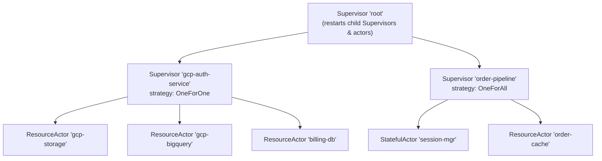
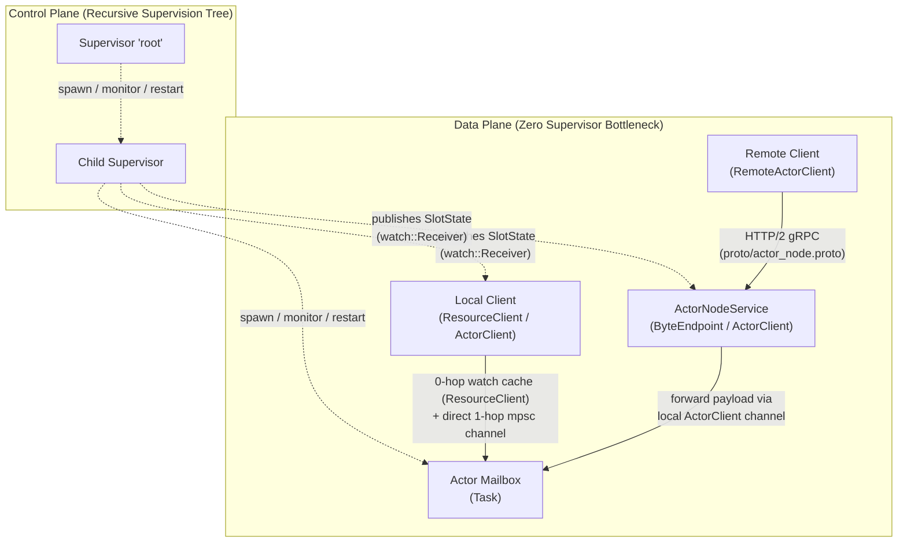
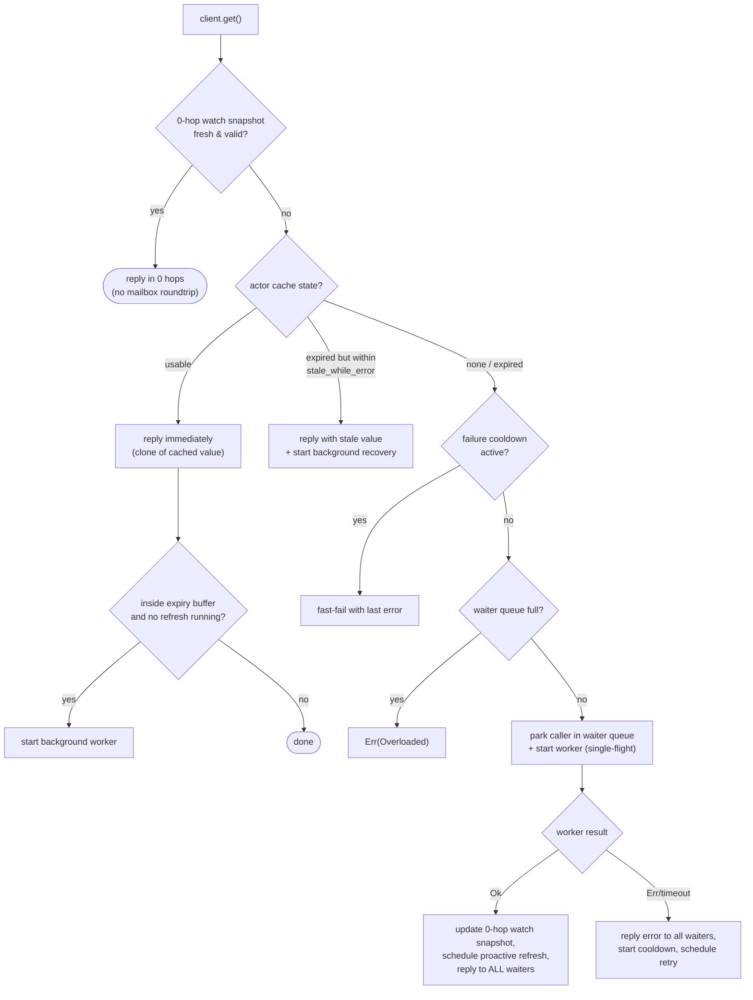
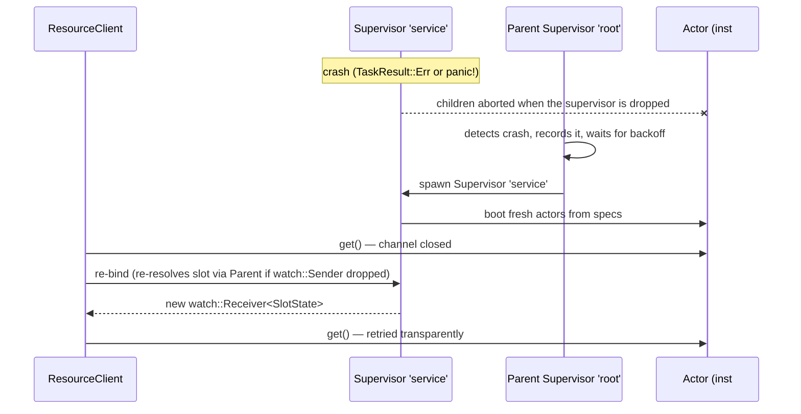

# otp-actor — Fault-Tolerant OTP Actors, 0-ms Self-Healing & gRPC Remoting for Tokio

> **Note:** This crate is based on code developed in a large production system since 2024 and is now being extracted step by step into a standalone crate.

**Stop writing brittle reconnect loops, guarding unbounded mailboxes against OOM, or wrapping actors in proc-macro boilerplate.**
`otp-actor` brings Erlang/OTP supervision semantics to [Tokio](https://tokio.rs) with strictly decoupled control and data planes:

- **0-ms Reactive Client Rebinding (`watch<SlotState>`)**: When an actor crashes or panics, [`ActorClient`](src/actor/stateful_actor.rs) and [`ResourceClient`](src/actor/generic_actor.rs) never poll or sleep—they await the supervisor's `SlotState` watch channel and rebind immediately as soon as the replacement spawns.
- **0-Hop Lock-Free Cache Reads (`ResourceActor`)**: Fresh expiring resources (OAuth2 tokens, DB credentials, config snapshots, signed URLs) are read directly from a `tokio::sync::watch` snapshot on the caller task without crossing the actor mailbox or allocating a `oneshot`.
- **Zero-Cost Pure Traits (Native `impl Future`)**: [`StatefulActor`](src/actor/stateful_actor.rs) and [`Worker`](src/actor/generic_actor.rs) use native RPITIT `impl Future` (Rust `edition = "2024"`)—zero `#[async_trait]`, zero `Box::pin` per message, and zero heavy derive macros.
- **Bounded Mailboxes & Explicit Backpressure**: Bounded `mpsc` channels (`try_cast()` → `ActorError::MailboxFull`) and bounded single-flight waiter queues (`ResourceError::Overloaded`) prevent runaway memory growth under load.
- **N-Level OTP Supervision Trees**: Unified recursive [`Supervisor`](src/actor/supervisor.rs) supporting `OneForOne`, `OneForAll`, and `RestForOne` at every depth, sliding-window `RestartPolicy` budgets with exponential backoff, `RestartType`, `ShutdownPolicy`, and parent escalation (`escalate_on_failure`).
- **Point-to-Point gRPC Remoting (`--features remote`)**: Location-transparent HTTP/2 gRPC ([`RemoteActorClient`](src/remote/client.rs), [`AnyActorClient`](src/remote/client.rs)) with a universal Protobuf envelope ([`proto/actor_node.proto`](proto/actor_node.proto)), bounded 4 MiB `postcard` serialization, and 2-phase `GOAWAY` shutdown—without running a Raft or Gossip cluster.

---

## Why `otp-actor`?

| Feature | `otp-actor` | `ractor` | Raw Tokio (`spawn` + `mpsc`) |
| --- | --- | --- | --- |
| **Supervision Trees** | Built-in recursive `Supervisor` (`OneForOne`, `OneForAll`, `RestForOne`, budgets & backoff) | Basic links in core; full trees via `ractor_supervisor` | Manual (`JoinSet` + custom loops) |
| **Client Rebinding on Crash** | Automatic **0-ms** reactive rebind via `watch<SlotState>` | Manual re-lookup / handle `ActorRef` exit | Manual channel replacement |
| **Cached Reads** | **0-hop** `watch` snapshot (`ResourceClient::get`) | Custom implementation | Custom `watch` / `RwLock` |
| **Mailbox & Backpressure** | Bounded `mpsc` (`try_cast` → `MailboxFull`) & bounded waiters | Unbounded by default (bounded options in factories) | Explicit (`mpsc::channel`) |
| **Async Trait Overhead** | Pure traits with native `impl Future` (zero `Box::pin`) | `#[async_trait]` (boxed trait futures) | None (manual loops) |
| **Remoting / Distribution** | Optional point-to-point gRPC (`--features remote`, no cluster daemon) | Full cluster layer (`ractor_cluster`) | Custom `tonic` / TCP |

---

## Table of Contents

- [Why `otp-actor`?](#why-otp-actor)
- [Highlights](#highlights)
- [Architecture](#architecture)
  - [Control plane vs. data plane](#control-plane-vs-data-plane)
  - [Component overview](#component-overview)
- [Getting Started](#getting-started)
  - [Requirements](#requirements)
  - [Build, run, test](#build-run-test)
- [Quick Start](#quick-start)
- [Core Concepts](#core-concepts)
  - [Workers](#workers)
  - [`TimedResource` and expiry](#timedresource-and-expiry)
  - [`WorkerContext`](#workercontext)
  - [Resource lifecycle inside an actor](#resource-lifecycle-inside-an-actor)
- [Configuring an Actor](#configuring-an-actor)
- [Stateful Actors (`StatefulActor`)](#stateful-actors-statefulactor)
  - [Implementing `StatefulActor`](#implementing-statefulactor)
  - [Spawning and communicating via `ActorClient`](#spawning-and-communicating-via-actorclient)
  - [Timers, streams & scoped background tasks](#timers-streams--scoped-background-tasks)
  - [State lifecycle on restart & persistence patterns](#state-lifecycle-on-restart--persistence-patterns)
- [Remote Actors over gRPC](#remote-actors-over-grpc)
  - [Architectural Overview](#architectural-overview)
  - [The Protobuf Contract](#the-protobuf-contract)
  - [Running Multi-Process Examples](#running-multi-process-examples)
  - [Code Example: Building a Remote Node](#code-example-building-a-remote-node)
  - [Code Example: Calling from a Remote Client](#code-example-calling-from-a-remote-client)
  - [Client-Initiated Stopping and Lifecycle Semantics](#client-initiated-stopping-and-lifecycle-semantics)
- [Supervision](#supervision)
  - [Strategies](#supervision-strategies)
  - [Restart policy and backoff](#restart-policy-and-backoff)
  - [Child restart types (`RestartType`) and graceful shutdown (`ShutdownPolicy`)](#child-restart-types-restarttype-and-graceful-shutdown-shutdownpolicy)
  - [Declarative child specs](#declarative-child-specs-otp-style)
  - [Dynamic children](#dynamic-children)
  - [What happens when a supervisor crashes?](#what-happens-when-a-supervisor-crashes)
  - [Runtime introspection & status observation](#runtime-introspection--status-observation)
- [Client API](#client-api)
- [Error Handling](#error-handling)
- [Resilience Features in Detail](#resilience-features-in-detail)
- [Demo Application](#demo-application)
- [Testing](#testing)
- [Project Layout](#project-layout)
- [Release Profile](#release-profile)
- [Known Limitations & Design Notes](#known-limitations--design-notes)
- [License](#license)

---

## Highlights

| Area | Feature |
| --- | --- |
| **Supervision** | Unified recursive tree: `Supervisor` → child `Supervisor`s / actors to arbitrary depth $N$ |
| **Strategies** | `OneForOne`, `OneForAll`, `RestForOne` (Erlang/OTP semantics) at every tree level |
| **Restart types** | `RestartType::Transient`, `RestartType::Permanent`, `RestartType::Temporary` |
| **Graceful shutdown** | `ShutdownPolicy::Timeout(d)`, `BrutalKill`, `Infinity` with mailbox draining & in-flight completion (`supervisor.shutdown()`, `stop_child()`, `delete_child()`) |
| **Stateful actors** | `StatefulActor` trait (`handle` / `handle_cast`, `CallMessage<A>` / `ask`, `on_start` / `on_stop` hooks, `ActorContext<Self>` with `client()`, `supervisor()`, `send_after()`, `send_interval()` / `send_interval_with()`, `spawn_scoped()` / `ActorScope`, `forward_receiver()`) running alongside `ResourceActor` under the same `Supervisor`s |
| **Runtime introspection** | Bounded supervisor health snapshots (`snapshot()`, `snapshot_timeout()`, ordered `SupervisorSnapshot` with `ChildStatus`, `RestartType`, `restarts_in_window`, `all_running()` / `any_failed()` helpers), read-only `watch_child_status()` (`ChildStatusWatcher`), and non-blocking `ActorClient::queue_stats()` |
| **Escalation & Recovery** | OTP-grade crash escalation (`escalate_on_failure`), manual recovery API (`restart_child`) |
| **Crash-loop protection** | `#[non_exhaustive]` `RestartPolicy` builder, `RestartTracker` with capped exponential backoff, permanent-failure `SlotState::Failed` with fast-fail errors |
| **Zero-hop cache reads** | `ResourceClient::get()` reads fresh values in 0 hops directly from a `tokio::sync::watch` snapshot without crossing the actor mailbox |
| **Zero-polling self-healing** | Per-child `watch::Receiver<SlotState>` channels let `ResourceClient`, `ActorClient`, and child `SupervisorHandle`s re-bind in 0 ms without polling loops or sleep backoff |
| **Backpressure** | Bounded mailbox + `try_cast()` (`ActorError::MailboxFull`), `cast_timeout()`, bounded waiter queue → `ResourceError::Overloaded` |
| **Flexible workers** | Implement `Worker<T, E>` on a struct, or pass any `async fn` / closure returning native `impl Future` (zero `Box::pin` per call) |
| **Caching & Resilience** | Per-actor TTL cache, expiry buffer, single-flight coalescing, proactive background refresh with jitter, eager pre-warming, stale-while-error, failure cooldown, generation guards |
| **Timeouts** | Worker-side (`worker_timeout`, default 30s), handler (`handler_timeout`), and client-side (`get_timeout`, `call_timeout`, `call_retry_timeout`, `cast_timeout`) |
| **Fault & panic isolation** | Controlled error exits (`TaskResult::Err`, `max_consecutive_failures`, `ctx.fail()`) and panics are caught, escalated, and recovered by the supervisor |
| **Remote actors (gRPC)** | HTTP/2 actor distribution (`--features remote`), universal Protobuf wire envelope (`actor_node.proto` with `Call`/`Cast` `timeout_ms` & `MAX_RESTARTS_EXCEEDED`), Location Transparency (`RemoteActorClient`, `AnyActorClient`), 4 MiB allocation-bomb defense, coordinated 2-phase shutdown |
| **Logging** | Structured logging via `tracing` with contextual fields across the entire actor hierarchy |
| **Chaos testing** | Built-in `simulate_crash()` and `trigger_child_crash()`, feature-gated behind `chaos_test` (auto-enabled in `[dev-dependencies]` for examples & tests) |

---

## Architecture



### Control plane vs. data plane



- **Data plane** —
  - **In-process:** `ResourceClient::get()` checks a local **0-hop `tokio::sync::watch` cache snapshot** first; on cold starts or near expiry it sends straight to the actor's mailbox over a direct 1-hop `mpsc` channel. `ActorClient::call()` / `ask()` / `cast()` communicate directly with the actor's bounded `mpsc` mailbox.
  - **Remote (`--features remote`):** `RemoteActorClient` sends requests over multiplexed HTTP/2 gRPC to `ActorNodeService`, where `ActorClient<A>` (implementing the type-erased `ByteEndpoint` trait) decodes the `postcard` payload and forwards it directly into the local actor's mailbox.
  - In both cases, **no supervisor is ever in the message request path**.
- **Control plane** — `Supervisor`s own child `JoinHandle`s, detect exits/panics, execute restart strategies (`OneForOne`, `OneForAll`, `RestForOne`) at *any* depth, and maintain a reactive `watch::Sender<SlotState>` per child slot. When a direct `mpsc` channel closes after a crash, clients (and child `SupervisorHandle`s) reactively await `SlotState::Running` over their `watch::Receiver<SlotState>`—rebinding in 0 ms with **zero polling** (and re-resolving via the managing `SupervisorHandle` only if the parent supervisor itself was restarted).

### Component overview

| Component | File | Responsibility |
| --- | --- | --- |
| `Supervisor`, `SupervisorBuilder`, `SupervisorHandle`, `SupervisorSnapshot`, `ChildSnapshot`, `ChildStatus`, `ChildStatusWatcher`, `ChildSpec`, `SpawnContext`, `SlotState` | [`src/actor/supervisor.rs`](src/actor/supervisor.rs) | Unified recursive supervisor (leaf actors and child supervisors to arbitrary depth). Applies `SupervisionStrategy`, tracks restart intensity & wave tickets, publishes reactive `watch::Receiver<SlotState>` slots, exposes bounded introspection snapshots (`snapshot`, `snapshot_timeout`) & read-only status watchers (`watch_child_status`), and provides typed accessors (`get_resource_client`, `get_actor_client`, `get_supervisor`). |
| `ResourceActor`, `ResourceActorBuilder`, `ResourceActorConfig`, `ResourceClient`, `Worker`, `TimedResource`, `WorkerContext`, `ResourceError` | [`src/actor/generic_actor.rs`](src/actor/generic_actor.rs) | Caching/refreshing resource actor with 0-hop `watch` cache reads, fluent builder, worker abstraction, and self-healing `ResourceClient`. |
| `StatefulActor`, `StatefulActorBuilder`, `StatefulActorConfig`, `CallMessage`, `ActorClient`, `ActorContext`, `ActorScope`, `ActorControl`, `QueueStats`, `ActorError` | [`src/actor/stateful_actor.rs`](src/actor/stateful_actor.rs) | Zero-cost general-purpose stateful actor (`gen_server` style) with `handle` / `handle_cast` / `ask`, `ActorContext<Self>` timers & scoped stream forwarding (`send_after`, `send_interval`, `send_interval_with`, `spawn_scoped`, `forward_receiver`), backpressure (`try_cast`, `queue_stats`), and self-healing `ActorClient`. |
| `RemoteActorClient`, `AnyActorClient`, `ActorNodeHandle`, `ActorNodeService`, `ActorNodeRegistry`, `ByteEndpoint`, `RemoteActorError`, `RemoteNodeError` | [`src/remote/mod.rs`](src/remote/mod.rs) | gRPC remote actors (`--features remote`): bounded `postcard` endpoint bridge, typed remote client, location transparency, coordinated 2-phase shutdown. |
| Protobuf Schema & Build Script | [`proto/actor_node.proto`](proto/actor_node.proto) & [`build.rs`](build.rs) | Compact universal gRPC actor wire contract (`Call`, `Cast`, `RemoteError`), compiled automatically via `tonic-prost-build`. |
| `SupervisionStrategy`, `RestartPolicy`, `RestartTracker`, `RestartType`, `ShutdownPolicy`, `SupervisorError`, `TaskResult`, `EXPIRY_BUFFER`, `DEFAULT_SHUTDOWN_TIMEOUT`, `DEFAULT_SNAPSHOT_TIMEOUT` | [`src/actor/model.rs`](src/actor/model.rs) | Shared domain model: strategies, `#[non_exhaustive]` policies & errors, restart types, shutdown policies, sliding-window crash tracking (`restarts_in_window`) & backoff, task exit results. |
| Quickstart (Crash & 0-ms Rebind) | [`examples/quickstart.rs`](examples/quickstart.rs) | 35-line copy-paste showcase: real actor panic isolation and automatic `watch<SlotState>` rebinding. |
| Microservice Pipeline | [`examples/microservice_pipeline.rs`](examples/microservice_pipeline.rs) | Ingestion worker (`ctx.forward_receiver`, `ctx.send_interval_with`) + 0-hop `ResourceActor` auth cache (`stale_while_error`) + bounded `try_cast`/`queue_stats()` + `ChildStatusWatcher`/`SupervisorSnapshot`. |
| `RestForOne` Pipeline | [`examples/rest_for_one_pipeline.rs`](examples/rest_for_one_pipeline.rs) | 3-stage pipeline isolating panics and restarting only downstream stages (supports `--interactive`). |
| Demo | [`examples/otp_actor.rs`](examples/otp_actor.rs) | Eight-phase walkthrough with simulated GCP tokens and a database secret. |
| Minimum | [`examples/minimum.rs`](examples/minimum.rs) | Output-free minimal example demonstrating both `ResourceActor` and `StatefulActor` under a root `Supervisor`. |
| Simple / Educational | [`examples/simple.rs`](examples/simple.rs) | Minimal, step-by-step example highlighting core usages, 0-hop reads, self-healing, `StatefulActor`, and graceful shutdown. |
| Dynamic Child | [`examples/dynamic_child.rs`](examples/dynamic_child.rs) | Dynamically spawning sibling child actors at runtime via `ctx.supervisor()`. |
| Dynamic Supervisor | [`examples/dynamic_supervisor.rs`](examples/dynamic_supervisor.rs) | Dynamically provisioning isolated `OneForAll` child `Supervisor` subtrees at runtime. |
| Remote All-in-One Showcase | [`examples/remote/all_in_one.rs`](examples/remote/all_in_one.rs) | Full remote lifecycle: hosting, gRPC client calls, crash self-healing, client-initiated `ctx.stop()`, and 2-phase shutdown. |
| Remote Server Node (Rechner B) | [`examples/remote/server.rs`](examples/remote/server.rs) | Standalone daemon hosting actors under OTP supervision over network gRPC (default: `http://127.0.0.1:50051`, override via `REMOTE_ADDR`). |
| Remote Client (Rechner A) | [`examples/remote/client.rs`](examples/remote/client.rs) | Lightweight client invoking remote actors with location transparency and testing crash recovery. |
| Integration tests | [`tests/actor_supervision_test.rs`](tests/actor_supervision_test.rs) | 82 tests covering recursive supervision, 0-hop caching, stateful actors, timers & stream forwarding, `ActorScope`, runtime introspection (`snapshot`, `watch_child_status`, `queue_stats`), restart types, graceful shutdown, timeouts, backpressure, and factory panic isolation. |
| Remote gRPC tests | [`tests/remote_grpc_test.rs`](tests/remote_grpc_test.rs) | 9 tests covering TCP/HTTP2 transport, location transparency, crash recovery, protocol versioning, request authorization, label sanitization, timeouts, and 2-phase drainage. |

---

## Getting Started

### Requirements

- **Rust 1.88 or newer** (the crate uses `edition = "2024"` and `let`-chains).
- No system dependencies for standard in-memory usage. Runtime library dependencies are minimal:
  - [`tokio`](https://crates.io/crates/tokio) 1 (`rt`, `sync`, `time`, `macros`)
  - [`thiserror`](https://crates.io/crates/thiserror) 2
  - [`tracing`](https://crates.io/crates/tracing) 0.1
- **Optional gRPC Remote Actors (`--features remote`):**
  - Requires standard `libprotoc` (or `protox`) on build; pulls in `tonic`, `prost`, `serde`, and `postcard`.

### Build, run, test

```bash
# Build the core library (zero gRPC overhead)
cargo build

# 30-second quickstart: panic isolation + 0-ms client rebinding
cargo run --example quickstart

# Run the output-free minimal example (both actor types)
cargo run --example minimum

# Run the microservice ingestion pipeline blueprint (forward_receiver + interval + queue_stats + snapshot)
cargo run --example microservice_pipeline

# Run the RestForOne pipeline demo (or add `-- --interactive` to inject panics manually)
cargo run --example rest_for_one_pipeline

# Run the simple educational example (core usages only)
cargo run --example simple

# Run the full interactive demo (8 phases: chaos engineering, crash loops, etc.)
cargo run --example otp_actor

# Run the complete core integration test suite
cargo test

# --- Distributed Remote Actor Examples (gRPC) ---

# Run the combined All-in-One remote actor showcase
cargo run --example remote_all_in_one --features remote

# Run in two separate terminals (or across two machines):
# Terminal 1 (Rechner B / Server Node):
cargo run --example remote_server --features remote

# Terminal 2 (Rechner A / Client):
cargo run --example remote_client --features remote

# Run all 92 core & remote tests (+ 4 doc-tests = 96 total)
cargo test --all-features

# Optimized build
cargo build --release

# Optimized build tuned for the local CPU (AVX2, AES-NI, ...)
RUSTFLAGS="-C target-cpu=native" cargo build --release
```

To use the crate from another project in the same workspace or from crates.io, add the dependency (the package is named `otp-actor`, and its public API is re-exported from the crate root as well as the `actor` module):

```toml
[dependencies]
otp-actor = "0.3.0"
# Optional features:
# otp-actor = { version = "0.3.0", features = ["remote"] }
# otp-actor = { version = "0.3.0", features = ["chaos_test"] }
tokio = { version = "1", features = ["full"] }
```

```rust
use otp_actor::{ResourceActor, Supervisor, TimedResource, WorkerContext};
// (or via `otp_actor::actor::{...}`)
```

---

## Quick Start

### 1. Panic Recovery & 0-ms Client Rebinding (`StatefulActor`)

Run this directly via `cargo run --example quickstart` ([`examples/quickstart.rs`](examples/quickstart.rs)):

```rust
use otp_actor::{ActorContext, ActorError, StatefulActor, StatefulActorBuilder, Supervisor};

#[derive(Default)]
struct Counter(i64);

enum Msg { Add(i64), Get, PanicNow }

impl StatefulActor for Counter {
    type Message = Msg;
    type Response = i64;
    type Error = String;

    async fn handle(&mut self, msg: Msg, ctx: &mut ActorContext<Self>) -> Result<i64, String> {
        match msg {
            Msg::Add(n) => { self.0 += n; Ok(self.0) }
            Msg::Get => Ok(self.0),
            Msg::PanicNow => panic!("boom inside instance #{}!", ctx.instance_id()),
        }
    }
}

#[tokio::main]
async fn main() -> Result<(), Box<dyn std::error::Error>> {
    let root = Supervisor::new_root();
    let client = StatefulActorBuilder::from_default::<Counter>("counter")
        .spawn(&root)
        .await?;

    assert_eq!(client.call(Msg::Add(42)).await?, 42);

    // Real panic inside the actor task — isolated by the Supervisor.
    let crash = client.call(Msg::PanicNow).await;
    assert!(matches!(crash, Err(ActorError::ActorUnavailable)));

    // Same `ActorClient` immediately rebinds via `watch<SlotState>` (zero polling/sleeps)
    // and delivers the non-Clone `Msg::Get` to the fresh replacement instance:
    assert_eq!(client.call(Msg::Get).await?, 0);

    root.shutdown().await?;
    Ok(())
}
```

### 2. Zero-Hop Resource Caching (`ResourceActor`)

A supervised actor that "fetches" a token valid for 60 seconds, refreshes it in the background shortly before expiry, and serves fresh reads in **0 hops** directly from the `watch` snapshot:

```rust
use std::time::Duration;
use otp_actor::actor::{
    ResourceActor, Supervisor, TimedResource, WorkerContext,
};

#[tokio::main]
async fn main() {
    // 1. Start the root of the supervision tree.
    let root = Supervisor::new_root();

    // 2. Start a domain child supervisor under `root`.
    let service = Supervisor::spawn_child("auth-service", &root)
        .await
        .expect("child supervisor registration failed");

    // 3. Any async closure `Fn(WorkerContext) -> Future<Output = Result<TimedResource<T>, E>>`
    //    is a Worker. T and E are inferred.
    let token_worker = |ctx: WorkerContext| async move {
        // ... call your identity provider here ...
        Ok::<_, String>(TimedResource::with_ttl(
            format!("token-gen-{}", ctx.generation),
            Duration::from_secs(60),
        ))
    };

    // 4. Build, spawn, supervise and obtain a direct client in one go.
    let client = ResourceActor::builder("api-token")
        .worker(token_worker)
        .eager_prewarm(true)                          // fetch immediately on start
        .expiry_buffer(Duration::from_secs(5))        // refresh 5 s before expiry
        .worker_timeout(Duration::from_secs(10))      // abort slow workers
        .spawn(&service)
        .await
        .expect("failed to start actor");

    // 5. Use it. Fresh cache hits are served in 0 hops without touching the actor mailbox.
    let token = client.get().await.expect("token unavailable");
    println!("token = {token}");
}
```

---

## Core Concepts

### Workers

A `Worker<T, E>` produces a `TimedResource<T>` or an error `E`:

```rust
pub trait Worker<T, E>: Send + Sync + 'static {
    fn execute(&self, ctx: WorkerContext)
        -> impl Future<Output = Result<TimedResource<T>, E>> + Send;
}
```

Because `execute` returns `impl Future`, no boxing is required. There are three equally valid ways to supply a worker:

**1. A custom struct** (good for configuration and dependencies):

```rust
struct GcpTokenWorker { scope: String }

impl Worker<String, TokenError> for GcpTokenWorker {
    async fn execute(&self, ctx: WorkerContext) -> Result<TimedResource<String>, TokenError> {
        let token = fetch_token(&self.scope, ctx.generation).await?;
        Ok(TimedResource::with_ttl(token, Duration::from_secs(3600)))
    }
}

ResourceActor::builder("gcp-storage")
    .worker(GcpTokenWorker { scope: "gcp-storage".into() });
```

**2. A standalone `async fn`:**

```rust
async fn bigquery_worker(ctx: WorkerContext) -> Result<TimedResource<String>, TokenError> { /* ... */ }

ResourceActor::builder("gcp-bigquery").worker(bigquery_worker);
```

**3. A closure** — it may capture state, such as shared handles, HTTP clients or counters:

```rust
let counter = Arc::new(AtomicUsize::new(0));
let worker = move |ctx: WorkerContext| {
    let counter = counter.clone();
    async move {
        counter.fetch_add(1, Ordering::SeqCst);
        Ok::<_, String>(TimedResource::perpetual(format!("inst-{}", ctx.instance_id)))
    }
};
```

> **Type requirements.** `T` (payload) and `E` (error) must be `Clone + Send + Sync + 'static`. Values are cloned to hand them out to multiple callers.

### `TimedResource` and expiry

A value bundled with an optional expiry deadline (`Debug` formatting intentionally redacts `value` as `"<redacted>"` so cached tokens and secrets are never leaked into logs):

```rust
TimedResource::with_ttl(value, Duration::from_secs(300)); // expires 300 s from now
TimedResource::perpetual(value);                          // never expires
```

The actor reasons about three time zones for a cached resource:

```text
 fetched                         expires_at - expiry_buffer        expires_at        expires_at + stale_while_error
    |------------ FRESH ---------------|------- STALE-SOON -------|---- EXPIRED ----|-- hard expiry -->
                                       ^ background refresh starts  ^ no longer "usable"   ^ no longer served
```

| Method | Meaning |
| --- | --- |
| `is_fresh(buffer)` | More than `buffer` left until expiry (or perpetual). |
| `is_still_usable()` | Not yet expired. |
| `is_usable_stale(allowance)` | Expired, but within the stale-while-error `allowance`. |

### `WorkerContext`

Passed to every worker invocation:

| Field | Description |
| --- | --- |
| `instance_id` | Which incarnation of the actor is running. Starts at 1 and increases on every supervisor restart. |
| `generation` | Monotonically increasing number of the fetch attempt *within* one actor instance. Useful for logging and for tests. |

### Resource lifecycle inside an actor



Key properties:

- **0-hop cache reads.** Fresh snapshots are published to a lock-free `tokio::sync::watch` channel, so steady-state `client.get()` calls avoid both mailbox queuing and `oneshot` allocation.
- **Single-flight.** At most one worker runs per actor at any time. Concurrent callers during a cold start are parked and all answered by the same result.
- **Cache hits never block.** A valid cached value is returned immediately; refreshes happen in the background.
- **Generation guard.** Every worker run gets a new `generation`. Results (or timeouts/panics) from superseded generations are ignored, so a slow, old fetch can never overwrite a newer value.

---

## Configuring an Actor

`ResourceActor::builder(name)` (alias: `ResourceActor::spec(name)`) returns a unified `ResourceActorBuilder<T, E, W>` backed by a [`ResourceActorConfig`]. Call `.worker(...)` to attach the worker; all options can be set **both before and after** `.worker(...)`.

| Option | Default | Description |
| --- | --- | --- |
| `.worker(w)` | — *(required)* | Attaches the `Worker` (struct, `async fn`, or closure). Infers `T` and `E`. |
| `.expiry_buffer(d)` | `2 s` (`EXPIRY_BUFFER`) | Safety margin: refresh begins this long before expiry. Clamped to at most half the remaining TTL, so short-lived values don't end up permanently "stale". |
| `.channel_capacity(n)` | `256` | Mailbox size of the actor (clamped to `>= 1`). |
| `.max_waiters(n)` | `1024` | Max parked callers during a cold start (clamped to `>= 1`). Beyond that → `ResourceError::Overloaded(n)`. |
| `.eager_prewarm(b)` | `false` | Fetch the resource immediately on (re)start instead of at the first `get()`. |
| `.restart_policy(p)` | `RestartPolicy::default()` | Crash-loop protection and backoff for this actor. |
| `.restart_type(t)` | `RestartType::Transient` | OTP restart rule (`Permanent`, `Transient`, or `Temporary`). |
| `.shutdown_policy(p)` | `ShutdownPolicy::Timeout(5 s)` | How the supervisor terminates the actor on stop/shutdown (`Timeout(Duration)`, `BrutalKill`, or `Infinity`). |
| `.shutdown_timeout(d)` | — | Shorthand for `.shutdown_policy(ShutdownPolicy::Timeout(d))`. |
| `.worker_timeout(d)` | `30 s` (`DEFAULT_WORKER_TIMEOUT`) | Abort a worker run that exceeds `d` → `ResourceError::Timeout(Duration)`. |
| `.no_worker_timeout()` | — | Disables the execution timeout, allowing workers to run indefinitely. |
| `.failure_cooldown(d)` | `1 s` (`DEFAULT_FAILURE_COOLDOWN`) | After a failed fetch, fast-fail new callers for `d` instead of hammering the backend (negative caching). |
| `.stale_while_error(d)` | `0` (disabled) | Keep serving an expired value for up to `d` while a refresh recovers. |
| `.proactive_refresh(b)` | `true` | Refresh in the background via a timer before expiry, even without client traffic. |
| `.proactive_jitter(d)` | `0` | Randomly start proactive refreshes up to `d` earlier (clamped to at most half the refresh lead time, with entropy-hashed jitter) to avoid thundering herds across many actors. |
| `.max_consecutive_failures(n)` | `None` (disabled) | After `n` consecutive worker failures or timeouts, exit with `TaskResult::Err` to trigger a full supervisor restart (including `OneForAll` / `RestForOne` siblings) without panicking. |

Finish the builder with one of:

| Method | Result |
| --- | --- |
| `.spawn(&supervisor)` | Starts the actor under the `SupervisorHandle` and returns a `ResourceClient<T, E>`. |
| `.build_child_spec()` | Returns a `ChildSpec` (to start later or hand to a `SupervisorBuilder`). |
| `.into()` / `ChildSpec::from(builder)` | Same as `build_child_spec()`. |

---

## Stateful Actors (`StatefulActor`)

Alongside `ResourceActor` (which is specialized for caching and refreshing single resources), the framework provides **`StatefulActor`** ([`src/actor/stateful_actor.rs`](src/actor/stateful_actor.rs)) for general-purpose stateful actors modeled after Erlang/OTP's `gen_server`.

`StatefulActor` runs on the **exact same unified `Supervisor`** hierarchy — you can mix `ResourceActor`s, `StatefulActor`s, and nested child `Supervisor`s inside the same `OneForOne`, `OneForAll`, or `RestForOne` supervisor!

### Implementing `StatefulActor`

Like `Worker`, `StatefulActor` uses native `impl Future` return types (zero `#[async_trait]` / `Box::pin` heap allocations):

```rust
use otp_actor::actor::{ActorContext, CallMessage, RestartType, StatefulActor, StatefulActorBuilder};

#[derive(Clone, Default)]
struct CounterActor {
    total: i64,
}

#[derive(Clone, Debug)]
enum CounterMsg {
    Add(i64),
    Get,
}

impl StatefulActor for CounterActor {
    type Message = CounterMsg;
    type Response = i64;
    type Error = String;

    async fn handle(
        &mut self,
        msg: Self::Message,
        _ctx: &mut ActorContext<Self>,
    ) -> Result<Self::Response, Self::Error> {
        match msg {
            CounterMsg::Add(delta) => {
                self.total += delta;
                Ok(self.total)
            }
            CounterMsg::Get => Ok(self.total),
        }
    }

    // Optional separate cast handler (defaults to calling `handle` and discarding the reply):
    async fn handle_cast(
        &mut self,
        msg: Self::Message,
        ctx: &mut ActorContext<Self>,
    ) -> Result<(), Self::Error> {
        let _ = self.handle(msg, ctx).await?;
        Ok(())
    }

    // Optional lifecycle hooks:
    async fn on_start(&mut self, _ctx: &mut ActorContext<Self>) -> Result<(), String> {
        Ok(())
    }

    async fn on_stop(&mut self, _ctx: &mut ActorContext<Self>) {}
}

// Optional typed ask sub-message unpacking via CallMessage<A>:
struct GetCount;
impl From<GetCount> for CounterMsg {
    fn from(_: GetCount) -> Self {
        CounterMsg::Get
    }
}
impl CallMessage<CounterActor> for GetCount {
    type Reply = i64;
    fn extract_reply(resp: i64) -> Result<Self::Reply, String> {
        Ok(resp)
    }
}
```

Inside `handle`, `handle_cast`, `on_start`, and `on_stop`, `ctx: &mut ActorContext<Self>` provides:
- `ctx.name()` — the registered actor name.
- `ctx.instance_id()` — the current supervisor incarnation (starts at `1`, increments on every restart).
- `ctx.client()` — returns a self-healing `ActorClient<Self>` handle to this actor.
- `ctx.supervisor()` — returns a `&SupervisorHandle` to the parent supervisor (for dynamic sibling/child spawning).
- `ctx.send_after(delay, msg)` — schedules a delayed fire-and-forget `cast` to `self`, returning a `tokio::task::AbortHandle`.
- `ctx.send_interval(period, msg)` / `ctx.send_interval_with(period, make_msg)` — schedules a lifecycle-bound periodic timer (`MissedTickBehavior::Skip`; non-`Clone` compatible via closure), returning an `AbortHandle`.
- `ctx.spawn_scoped(|scope| ...)` — spawns an instance-bound background task receiving an [`ActorScope<Self>`](src/actor/stateful_actor.rs) (`cancelled()`, `cast()`, `try_cast()`, `instance_id()`) that cancels automatically when this instance exits or panics.
- `ctx.forward_receiver(rx, map_msg)` — forwards items from an external `tokio::sync::mpsc::Receiver` into `self` as `cast` messages without idle permit starvation.
- `ctx.stop()` — instructs the actor to drain its mailbox, invoke `on_stop`, and exit cleanly with `Ok(())`.
- `ctx.fail("reason")` — escalates a fatal failure to the `Supervisor`, triggering supervision recovery (`OneForOne`, `OneForAll`, `RestForOne`).

### Spawning and communicating via `ActorClient`

Build and spawn a `StatefulActor` using `StatefulActorBuilder::from_default`, `StatefulActorBuilder::from_instance`, or `StatefulActorBuilder::new(name, |instance_id| ...)`:

```rust
let client = StatefulActorBuilder::from_default::<CounterActor>("session-counter")
    .restart_type(RestartType::Permanent)
    .shutdown_timeout(Duration::from_secs(2))
    .spawn(&supervisor)
    .await?;

// Fire-and-forget notification (gen_server:cast) & non-blocking backpressure check
client.cast(CounterMsg::Add(10)).await?;
client.try_cast(CounterMsg::Add(1))?; // Err(ActorError::MailboxFull) when saturated

// Request-response (gen_server:call) & typed CallMessage ask
let current = client.call(CounterMsg::Add(5)).await?;
let total: i64 = client.ask(GetCount).await?;
assert_eq!((current, total), (16, 16));
```

`StatefulActorBuilder` options:

| Option | Default | Description |
| --- | --- | --- |
| `.channel_capacity(n)` | `256` | Mailbox size of the actor (clamped to `>= 1`). |
| `.restart_policy(p)` | `RestartPolicy::default()` | Crash-loop protection and exponential backoff for this actor. |
| `.restart_type(t)` | `RestartType::Transient` | OTP restart rule (`Permanent`, `Transient`, or `Temporary`). |
| `.shutdown_policy(p)` | `ShutdownPolicy::Timeout(5 s)` | How the supervisor terminates the actor on stop/shutdown (`Timeout(Duration)`, `BrutalKill`, or `Infinity`). |
| `.shutdown_timeout(d)` | — | Shorthand for `.shutdown_policy(ShutdownPolicy::Timeout(d))`. |
| `.handler_timeout(d)` | `None` (disabled) | Aborts a `handle()` or `handle_cast()` execution that exceeds `d`, immediately returns `Err(ActorError::Timeout(d))` to `call` callers, and escalates to the supervisor (`ctx.fail(...)`) so a fresh instance is booted via `on_start` without leaving partially mutated `&mut self` state. |

### Timers, streams & scoped background tasks

Instead of manually spawning detached `tokio::spawn` loops with raw `ActorClient` handles (which can outlive an actor restart and leak work or inject stale messages into a fresh incarnation), bind background tasks directly to the current actor instance via `ActorContext`:

```rust
async fn on_start(&mut self, ctx: &mut ActorContext<Self>) -> Result<(), String> {
    // Periodic ticks: first tick arrives after `period`, uses MissedTickBehavior::Skip under
    // backpressure, and stops automatically if this actor instance exits, crashes, or panics.
    ctx.send_interval(Duration::from_secs(5), Msg::Heartbeat);

    // Non-Clone / lazy payload variant (`make_msg` runs only after reserving a mailbox permit):
    ctx.send_interval_with(Duration::from_secs(1), || Msg::Tick(Instant::now()));

    Ok(())
}
```

For external channels or custom async loops:

```rust
// 1. Forward external mpsc streams without holding mailbox permits while idle:
ctx.forward_receiver(external_rx, Msg::InboundEvent);

// 2. Or spawn a custom task bound to this exact instance via ActorScope<Self>:
ctx.spawn_scoped(|mut scope| async move {
    loop {
        tokio::select! {
            biased;
            _ = scope.cancelled() => break,
            Some(item) = stream.next() => {
                if scope.cast(Msg::Item(item)).await.is_err() {
                    break;
                }
            }
        }
    }
});
```

Key design guarantees:
- **Zero-duration guard:** `send_interval` and `send_interval_with` ignore `Duration::ZERO` (logging a warning and returning a completed `AbortHandle`) rather than panicking.
- **No idle permit starvation:** `send_interval_with` and `forward_receiver` wait for input *first* and only then reserve a bounded mailbox slot (`tx.reserve()`), so even `channel_capacity(1)` actors never deadlock waiting on an idle timer/stream.
- **No cross-instance leaks:** Unlike `ActorClient`, `ActorScope<A>` is pinned to a single `instance_id` and intentionally **never** rebinds after a crash—returning `Err(ActorError::ActorUnavailable)` once that instance exits.

### State Lifecycle on Restart & Persistence Patterns

#### Does an actor lose its in-memory state when restarted?
**Yes, by design.** When an actor crashes or terminates abnormally, its in-memory struct fields are discarded and the supervisor boots a **fresh, clean instance** from the configured factory (e.g. `Default::default()` or initial state clone).

This embodies the core Erlang/OTP philosophy:
- **Crash Loop Prevention**: In-memory crashes usually occur because internal state entered an invalid, corrupted, or inconsistent invariant. Reviving the exact same corrupted in-memory state would immediately trigger a crash on the very next message, trapping the system in an endless crash loop.
- **Known-Good State**: Starting fresh gives the actor a clean slate while the client's direct channel rebinds transparently.

#### How to preserve state across restarts (Persistence)
When state must survive actor restarts, combine `StatefulActor` with an external storage layer (database, SQLite, Redis, or disk):

1. **Rehydrate in `on_start`**:
   The `on_start(&mut self, ctx: &mut ActorContext<Self>)` hook runs before any mailbox messages are processed (both on initial boot and on every restart). Load the latest committed state snapshot here:
   ```rust
   async fn on_start(&mut self, ctx: &mut ActorContext<Self>) -> Result<(), String> {
       // Rehydrate state from database or disk using the actor's unique name:
       self.total = database::load_counter_state(ctx.name()).await?;
       Ok(())
   }
   ```

2. **Commit updates in `handle`**:
   Persist state updates or write-ahead event logs during message processing before returning `Ok(response)`:
   ```rust
   async fn handle(
       &mut self,
       msg: Self::Message,
       ctx: &mut ActorContext<Self>,
   ) -> Result<Self::Response, Self::Error> {
       match msg {
           CounterMsg::Add(delta) => {
               database::persist_increment(ctx.name(), delta).await?;
               self.total += delta;
               Ok(self.total)
           }
           // ...
       }
   }
   ```

3. **Inject storage handles via `StatefulActorBuilder::new`**:
   Pass shared connection pools or repository handles into the factory closure:
   ```rust
   let db_pool = pool.clone();
   let client = StatefulActorBuilder::new("session-counter", move |_instance_id| {
       CounterActor {
           db: db_pool.clone(),
           total: 0, // rehydrated in on_start
       }
   })
   .spawn(&supervisor)
   .await?;
   ```

---

## Remote Actors over gRPC

When built with `--features remote`, the crate enables distributed actor communication across machines, processes, and containers over high-performance HTTP/2 gRPC.

```toml
[dependencies]
otp-actor = { version = "0.3.0", features = ["remote"] }
serde = { version = "1", features = ["derive"] }
tokio = { version = "1", features = ["full"] }
```

### Architectural Overview

```text
 ┌─────────────────────────────────────────────────────────────────┐
 │                         Remote Machine A                        │
 │                                                                 │
 │   let remote = RemoteActorClient::<BankAccount>::connect(       │
 │       "http://192.168.1.50:50051",                              │
 │       "bank-service",                                           │
 │       "acc-42",                                                 │
 │   ).await?;                                                     │
 │   let client: AnyActorClient<BankAccount> =                     │
 │       AnyActorClient::Remote(remote);                           │
 │                                                                 │
 │   let balance: i64 = client                                     │
 │       .call_timeout(BankMsg::GetBalance, Duration::from_secs(3))│
 │       .await?;                                                  │
 └───────────────────────────────┬─────────────────────────────────┘
                                 │
                                 │ gRPC / HTTP/2 (otp_actor.remote.v1)
                                 │ CallRequest / CastRequest { service_name,
                                 │   actor_name, payload (postcard), timeout_ms}
                                 ▼
 ┌─────────────────────────────────────────────────────────────────┐
 │                         Remote Machine B                        │
 │                                                                 │
 │   ActorNodeHandle / ActorNodeService (127.0.0.1:50051)          │
 │     │                                                           │
 │     ├── ActorNodeRegistry (("bank-service", "acc-42")           │
 │     │     │              -> Arc<dyn ByteEndpoint>)              │
 │     │     │                                                     │
 │     │     └── ActorClient<BankAccount> (impl ByteEndpoint)      │
 │     │           │ Decodes postcard payload (≤ 4 MiB)            │
 │     ▼           ▼                                               │
 │   Supervisor "bank-service" (OneForOne, RestartType::Transient) │
 │     └── BankAccount ("acc-42", balance: 1000)                   │
 └─────────────────────────────────────────────────────────────────┘
```

The remote subsystem is built around four core principles:
1. **Universal Protobuf Wire Contract ([`proto/actor_node.proto`](proto/actor_node.proto))**: A single schema-agnostic `ActorNode` service (`Call` and `Cast` RPCs, both supporting optional `timeout_ms`) transports arbitrary typed messages without modifying or recompiling `.proto` files per actor type.
2. **Type-Erased Byte Bridging & DoS Defense (`ByteEndpoint`)**: `ByteEndpoint` is implemented directly for `ActorClient<A>`, decoding `postcard` payloads via `postcard::take_from_bytes` with a strict **4 MiB** limit (`MAX_REMOTE_PAYLOAD_BYTES`) and trailing-byte rejection, and forwarding them directly to the actor mailbox. Both `Ok(A::Response)` and domain errors `Err(A::Error)` are serialized symmetrically across the wire.
3. **Location Transparency (`AnyActorClient<A>`)**: Enum unifier (`AnyActorClient::Local(ActorClient<A>)` | `AnyActorClient::Remote(RemoteActorClient<A>)`) exposing `.call()`, `.call_timeout()`, `.cast()`, and `.cast_timeout()`, mapping local `ActorError<A::Error>` variants (including `MailboxFull` and `MaxRestartsExceeded`) symmetrically into `RemoteActorError<A::Error>`.
4. **Coordinated 2-Phase Graceful Shutdown**: `ActorNodeHandle::shutdown()` returns `Result<(), RemoteNodeError>`, emits HTTP/2 `GOAWAY`, awaits `serve_with_incoming_shutdown` until active in-flight RPCs drain (bounded by `with_drain_timeout(...)`, default `DEFAULT_DRAIN_TIMEOUT = 10s`), and then calls `SupervisorHandle::shutdown()` so child supervisors and actors stop recursively in reverse registration order according to each `ShutdownPolicy`.

### The Protobuf Contract

Defined in [`proto/actor_node.proto`](proto/actor_node.proto):

```protobuf
syntax = "proto3";

package otp_actor.remote.v1;

// Service exposed by any node hosting otp-actor actors.
service ActorNode {
  // Synchronous request/response (call) with typed/serialized response payload.
  rpc Call (CallRequest) returns (CallResponse);

  // Fire-and-forget notification (cast).
  rpc Cast (CastRequest) returns (CastResponse);
}

// Universal call envelope carrying an arbitrary serialized payload.
message CallRequest {
  string service_name = 1;
  string actor_name = 2;
  bytes payload = 3;
  optional uint64 timeout_ms = 4;
  uint32 protocol_version = 5;
}

// Universal call response envelope carrying the outcome.
message CallResponse {
  oneof result {
    bytes ok_payload = 1;
    bytes actor_error_payload = 2;
    RemoteError framework_error = 3;
  }
}

// Universal cast envelope.
message CastRequest {
  string service_name = 1;
  string actor_name = 2;
  bytes payload = 3;
  optional uint64 timeout_ms = 4;
  uint32 protocol_version = 5;
}

// Cast acknowledgment (returns once enqueued in local actor mailbox).
message CastResponse {
  optional RemoteError framework_error = 1;
}

// Structured error for remote actor invocations.
message RemoteError {
  enum Kind {
    UNSPECIFIED = 0;
    SERVICE_NOT_FOUND = 1;
    ACTOR_NOT_FOUND = 2;
    MAILBOX_FULL = 3;
    ACTOR_UNAVAILABLE = 4;
    TIMEOUT = 5;
    SERIALIZATION = 6;
    DESERIALIZATION = 7;
    ACTOR_PANIC = 8;
    MAX_RESTARTS_EXCEEDED = 9;
    INCOMPATIBLE_PROTOCOL = 10;
  }
  Kind kind = 1;
  string message = 2;
}
```

### Running Multi-Process Examples

We provide ready-to-run examples in [`examples/remote/`](examples/remote/):

#### Scenario A: Two Terminals (Server + Client)

Open two terminal windows:

**Terminal 1 — Run the gRPC Remote Server Node:**
```bash
cargo run --example remote_server --features remote
```
Starts an actor node on `127.0.0.1:50051` by default (override via `REMOTE_ADDR`, e.g. `REMOTE_ADDR=0.0.0.0:50051` for LAN access), registers a supervised `BankAccountActor` (`"banking-service/account-9876"`) with `RestartType::Transient`, and serves requests until `Ctrl+C` triggers 2-phase graceful shutdown.

**Terminal 2 — Run the Remote Client:**
```bash
cargo run --example remote_client --features remote
```
Connects to `http://127.0.0.1:50051` (override via `REMOTE_ENDPOINT`), executes deposits/withdrawals, tests domain error propagation (`RemoteActorError::Actor`), triggers a simulated crash to observe transparent supervisor self-healing over the existing HTTP/2 channel, and requests account closure (`AccountMsg::CloseAccount` → `ctx.stop()`).

#### Scenario B: Automated All-in-One Demo

To run both server and client together in a single automated showcase:
```bash
cargo run --example remote_all_in_one --features remote
```

### Code Example: Building a Remote Node

```rust
use otp_actor::actor::{
    ActorContext, RestartType, StatefulActor, StatefulActorBuilder, SupervisionStrategy,
    Supervisor,
};
use otp_actor::remote::{ActorNodeHandle, ActorNodeRegistry};
use serde::{Deserialize, Serialize};
use std::net::SocketAddr;

#[derive(Clone, Debug, Serialize, Deserialize)]
enum BankMsg {
    Deposit(i64),
    GetBalance,
    SimulateCrash,
    CloseAccount,
}

#[derive(Clone, Default)]
struct BankAccount {
    balance: i64,
}

impl StatefulActor for BankAccount {
    type Message = BankMsg;
    type Response = i64;
    type Error = String;

    async fn handle(
        &mut self,
        msg: Self::Message,
        ctx: &mut ActorContext<Self>,
    ) -> Result<Self::Response, Self::Error> {
        match msg {
            BankMsg::Deposit(amount) => {
                self.balance += amount;
                Ok(self.balance)
            }
            BankMsg::GetBalance => Ok(self.balance),
            BankMsg::SimulateCrash => {
                ctx.fail("Fatal hardware error simulated!");
                Err("Crashing...".into())
            }
            BankMsg::CloseAccount => {
                ctx.stop(); // Clean termination
                Ok(self.balance)
            }
        }
    }
}

#[tokio::main]
async fn main() -> Result<(), Box<dyn std::error::Error + Send + Sync>> {
    // 1. Set up supervision tree with Transient restart (normal stops are NOT restarted)
    let root = Supervisor::new_root();
    let supervisor = Supervisor::builder("bank-service")
        .strategy(SupervisionStrategy::OneForOne)
        .spawn(&root)
        .await?;

    let local_client = StatefulActorBuilder::from_default::<BankAccount>("account-42")
        .restart_type(RestartType::Transient)
        .spawn(&supervisor)
        .await?;

    // 2. Register actor in the remote node registry (uses client.service_name() & client.name())
    let registry = ActorNodeRegistry::new();
    registry.register_client(local_client);

    // 3. Start gRPC server attached to the root Supervisor for coordinated shutdown
    let addr: SocketAddr = "127.0.0.1:50051".parse()?;
    let node = ActorNodeHandle::start(addr, registry, Some(root)).await?;
    println!("Node listening on http://{}", node.local_addr());

    // 4. Wait for shutdown signal, then drain RPCs & tear down supervision tree
    tokio::signal::ctrl_c().await?;
    node.shutdown().await?;
    Ok(())
}
```

### Code Example: Calling from a Remote Client

```rust
// Reusing BankAccount and BankMsg from a shared module/crate
use otp_actor::remote::{AnyActorClient, RemoteActorClient};
use std::time::Duration;

#[tokio::main]
async fn main() -> Result<(), Box<dyn std::error::Error + Send + Sync>> {
    // Option A: Explicit Remote Client
    let remote = RemoteActorClient::<BankAccount>::connect(
        "http://127.0.0.1:50051",
        "bank-service",
        "account-42",
    )
    .await?;

    // Option B: Location-Transparent Client (can wrap either ActorClient or RemoteActorClient)
    let client: AnyActorClient<BankAccount> = AnyActorClient::Remote(remote);

    // Call with timeout deadline (sets both gRPC deadline and wire timeout_ms)
    let balance = client
        .call_timeout(BankMsg::Deposit(250), Duration::from_secs(3))
        .await?;
    println!("Balance: {balance}");

    // Cast (fire-and-forget enqueue)
    client.cast(BankMsg::Deposit(50)).await?;

    // Domain-initiated graceful stop via a message whose handler calls ctx.stop()
    let final_balance = client.call(BankMsg::CloseAccount).await?;
    println!("Final balance before close: {final_balance}");
    Ok(())
}
```

### Client-Initiated Stopping and Lifecycle Semantics

Because `RemoteActorClient` intentionally exposes only domain `Call` / `Cast` RPCs (rather than a generic administrative stop RPC), remote clients trigger controlled termination via a domain message (such as `BankMsg::CloseAccount`) whose `StatefulActor::handle` calls `ctx.stop()`, while in-process callers can also invoke `ActorClient::shutdown()`. The actor's `RestartType` governs what happens next:

| Configuration | What happens when `ctx.stop()` (or local `ActorClient::shutdown()`) runs? | Use Case |
| --- | --- | --- |
| **`RestartType::Transient`** *(Recommended for stoppable actors)* | The actor drains its mailbox, runs `on_stop`, and terminates cleanly (`TaskResult::Ok`). The supervisor **does not** restart it, and follow-up calls receive `ActorUnavailable` (or `ActorNotFound` if unregistered). | User sessions, shopping carts, bank accounts, per-tenant workers. |
| **`RestartType::Permanent`** | The actor terminates, but the supervisor treats any self-initiated exit as unexpected and immediately restarts a fresh instance (unless stopped explicitly via supervisor APIs like `stop_child`). | Core infrastructure daemons that must always remain active. |
| **`RestartType::Temporary`** | The actor is never restarted, even after a crash (`ctx.fail` / panic), and is reaped from supervisor state on exit. | Short-lived one-shot compute jobs. |

---

## Supervision

### Supervision strategies

Configured per `Supervisor` via `SupervisionStrategy`:

| Strategy | When child *X* crashes … | Typical use |
| --- | --- | --- |
| `OneForOne` *(default)* | only *X* is restarted. | Independent, shared-nothing actors or sub-supervisors. |
| `OneForAll` | *all* running children are gracefully terminated in reverse registration order (honoring their `ShutdownPolicy` and `on_stop` hooks) and then restarted in registration order without instance overlap. | Tightly coupled actors that share state or exclusive resources. |
| `RestForOne` | *X* and all children registered **after** *X* are gracefully terminated in reverse order and restarted in registration order; earlier ones stay untouched. | Linear dependency pipelines `A → B → C`. |

Example with `RestForOne` and children `pipe-1 → pipe-2 → pipe-3`:

| Crash in | Restarted |
| --- | --- |
| `pipe-1` | `pipe-1`, `pipe-2`, `pipe-3` |
| `pipe-2` | `pipe-2`, `pipe-3` |
| `pipe-3` | `pipe-3` |

### Restart policy and backoff

```rust
#[non_exhaustive]
pub struct RestartPolicy {
    pub max_restarts: usize,        // allowed restarts within `time_window`
    pub time_window: Duration,      // sliding window for counting restarts
    pub initial_backoff: Duration,  // delay before the first restart
    pub max_backoff: Duration,      // upper bound for the delay
    pub backoff_multiplier: f64,    // growth factor per consecutive crash
}
```

Defaults: `max_restarts = 5`, `time_window = 10 s`, `initial_backoff = 50 ms`, `max_backoff = 2 s`, `backoff_multiplier = 2.0`. Configure cleanly via `RestartPolicy::new(max_restarts, time_window)` and fluent builder methods (`.max_restarts(...)`, `.time_window(...)`, `.initial_backoff(...)`, `.max_backoff(...)`, `.backoff_multiplier(...)`).

Behaviour (implemented by `RestartTracker`, exposing `.policy()`, `.consecutive_failures()`, and `.restarts_in_window()`):

- Each crash is recorded; entries older than `time_window` are discarded.
- If the number of recent restarts reaches `max_restarts`, the component is marked **permanently failed** (`SlotState::Failed`). Pending and future lookups then fail fast with `MaxRestartsExceeded`.
- Otherwise the restart is delayed by `initial_backoff × multiplier^(consecutive_failures − 1)`, capped at `max_backoff`.
- Once a component has been stable for a full `time_window`, the failure streak resets and the backoff decays back to `initial_backoff`.
- The exponent is capped, so the computation can never overflow, produce `NaN`, or panic (covered by a test with 1,200 consecutive crashes).
- Backoff delays happen in a **separate task**, so a supervisor keeps serving other children and requests while one child waits to be restarted.
- Stale crash notifications from already-replaced instances are ignored via monotonic restart wave tickets.
- Backoff delays and sibling shutdown waves are strictly serialized so old instances cleanly finish their `ShutdownPolicy` (`on_stop`) before replacement instances are spawned.

Leaf actors have their own `RestartPolicy` (set on their builder), and child `Supervisor`s have one too (`SupervisorBuilder::restart_policy`), used by the parent `Supervisor` when restarting the child supervisor.

### Child restart types (`RestartType`) and graceful shutdown (`ShutdownPolicy`)

Each `ChildSpec` (and actor/`Supervisor` builder) configures how termination and shutdown are handled:

| `RestartType` | Clean exit (`Ok(())`) | Crash (`Err` or panic) | Typical use |
| --- | --- | --- | --- |
| `Transient` *(default)* | Not restarted | Restarted | Standard workers, actors, and sub-supervisors that may complete normally. |
| `Permanent` | **Restarted** (unless stopped via supervisor) | Restarted | Critical long-lived daemons and token/cache actors. |
| `Temporary` | Not restarted (reaped completely) | **Never restarted** (reaped completely) | One-shot background tasks. Automatically removed from supervisor memory and specs upon exit to prevent memory leaks. |

| `ShutdownPolicy` | Behavior on `stop_child` / `delete_child` / `shutdown` |
| --- | --- |
| `Timeout(Duration)` *(default: 5 s for actors; `Infinity` for child `Supervisor`s)* | Signals graceful shutdown (closes mailbox, drains buffered requests, awaits in-flight worker) and aborts if the deadline elapses. |
| `BrutalKill` | Immediately aborts the task (`AbortHandle::abort`). |
| `Infinity` | Signals graceful shutdown and waits indefinitely for clean completion (default for child `Supervisor`s so they can complete child shutdowns sequentially). |

### Declarative child specs (OTP style)

Declare the entire multi-level subtree up front (including nested child `Supervisor`s!). Each supervisor starts all children on boot **and again after the supervisor itself is restarted**:

```rust
let core_pool = Supervisor::builder("worker-pool")
    .strategy(SupervisionStrategy::OneForOne)
    .add_child(ResourceActor::builder("cache").worker(worker_a).eager_prewarm(true));

let service = Supervisor::builder("coupled-service")
    .strategy(SupervisionStrategy::OneForAll)
    .restart_policy(RestartPolicy::default())
    .escalate_on_failure(false) // Set to `true` for pure OTP escalation to parent Supervisor
    .add_child(ResourceActor::builder("a").worker(worker_a).eager_prewarm(true))
    .add_child(ResourceActor::builder("b").worker(worker_b))
    .add_child(core_pool) // Arbitrary recursive nesting!
    .spawn(&root)
    .await?;

let client_a = service.get_resource_client::<String, String>("a").await?;
let client_b = service.get_resource_client::<String, String>("b").await?;
let nested = service.get_supervisor("worker-pool").await?;
```

`add_child` accepts anything convertible to a `ChildSpec` — including a configured `ResourceActorBuilder`, `StatefulActorBuilder`, or nested `SupervisorBuilder` directly.

> **Erlang/OTP Escalation (`escalate_on_failure`):** By default (`false`), exceeding `max_restarts` marks the child as permanently failed (`MaxRestartsExceeded`), allowing clients to fast-fail or operators to call `restart_child`. With `.escalate_on_failure(true)`, the supervisor instead terminates itself with `TaskResult::Err`, triggering an automatic parent-level subtree reboot without panicking.

### Dynamic children

Children (both actors and sub-supervisors) can also be added at runtime. The spec is remembered, so the child is re-created if the supervisor is restarted:

```rust
let spec: ChildSpec = ResourceActor::builder("dyn-child")
    .worker(worker)
    .build_child_spec();

service.start_child(spec).await?;
let client = service.get_resource_client::<String, String>("dyn-child").await?;
```

Starting a child with a name that already exists returns `SupervisorError::ChildAlreadyExists`. Inside any `StatefulActor`, `ctx.supervisor()` also provides direct access to its managing `SupervisorHandle`.

### What happens when a supervisor crashes?



Because children are owned by their supervisor, a supervisor crash also replaces its subtree with fresh instances (their in-memory cache/state starts empty again, and `instance_id` restarts at 1). Clients re-bind seamlessly via `SlotState` watch channels apart from the one-time re-bind latency.

### Runtime introspection & status observation

`otp-actor` provides non-invasive, zero-hot-path-overhead primitives for health endpoints, flapping detection, and lifecycle observation:

- **Bounded supervisor snapshots (`snapshot()` / `snapshot_timeout(d)`):**
  Returns `SupervisorSnapshot` containing the supervisor's `name`, `instance_id`, `strategy`, and ordered `children: Vec<ChildSnapshot>` (`name`, `status: ChildStatus`, `instance_id`, `restart_type`, `restarts_in_window`). Queries are bounded by `DEFAULT_SNAPSHOT_TIMEOUT` (2 s) or a custom duration (`SupervisorError::Timeout`), ensuring health probes never hang indefinitely if a supervisor is stalled in shutdown or heavy restarts.
  `SupervisorSnapshot` offers raw inspection helpers (`child(name)`, `all_running()`, `any_failed()`, `any_restarting()`, `running_count()`, `restarting_count()`, `stopped_count()`, `failed_count()`) rather than an opinionated `is_healthy()`, leaving readiness policies (e.g., whether a `Restarting` child in backoff counts as `200 OK` vs `503`) to your service. Snapshot types intentionally omit `serde` because `ChildStatus::Failed(SupervisorError)` and `Instant`-backed restart tracking belong strictly in-process.
- **Zero-channel-duplication status watcher (`watch_child_status(name)`):**
  Returns a read-only `ChildStatusWatcher` wrapping the supervisor's existing per-child `watch::Receiver<SlotState>` channel (`child_name()`, `current()`, `changed()`, `wait_for(...)`), without exposing internal `UntypedSender` handles or maintaining a second status channel. Unlike internal data-plane resolution, `watch_child_status` succeeds for `Stopped` and `Failed` children too. `ChildStatus` exposes only externally observable states (`Running { instance_id }`, `Restarting { instance_id }`, `Stopped`, `Failed(SupervisorError)`).
- **Approximate mailbox depth (`ActorClient::queue_stats()`):**
  Reads the locally cached bounded channel sender (`max_capacity`, `available`, `queued`, `is_closed`, `is_full()`) without contacting the supervisor or locking across `.await`. Values are approximate point-in-time snapshots under concurrent traffic; notably, immediately after an actor crash and *before* the next `call`/`cast` triggers rebinding, `queue_stats()` still inspects the exited instance's closed mailbox (`is_closed == true`).

```rust
// Observe transitions without polling:
let mut watcher = supervisor.watch_child_status("worker").await?;
let snap = supervisor.snapshot().await?;
if !snap.any_failed() && snap.all_running() {
    // Check flapping per child:
    for child in &snap.children {
        println!("{} restarts_in_window={}", child.name, child.restarts_in_window);
    }
}
```

---

## Client API

`Supervisor` entrypoints:
- `Supervisor::new(name)` — spawns a top-level supervisor with `OneForOne` strategy.
- `Supervisor::new_root()` — spawns a top-level supervisor named `"root"`.
- `Supervisor::with_strategy(name, strategy)` — spawns a top-level supervisor with custom strategy (`OneForOne`, `OneForAll`, `RestForOne`).
- `Supervisor::builder(name)` — returns a `SupervisorBuilder` for declarative setup (strategies, policies, nested children).
- `Supervisor::spawn_child(name, &parent)` / `Supervisor::spawn_child_with_strategy(name, strategy, &parent)` — spawns a child supervisor under `parent`.

`SupervisorHandle` (returned by `Supervisor::new*` / `SupervisorBuilder::spawn*` / `get_supervisor`) is a cheap, cloneable handle for every level of the tree:

| Method | Description |
| --- | --- |
| `get_resource_client::<T, E>(name)` | Returns a typed `ResourceClient<T, E>`. Fails with `ChildTypeMismatch` if `T`/`E` do not match the actor. |
| `get_actor_client::<A>(name)` | Returns a typed `ActorClient<A>` for a supervised `StatefulActor`. Fails with `ChildTypeMismatch` if `A` does not match the actor. |
| `get_supervisor(name)` | Returns a resilient child `SupervisorHandle` for a supervised child `Supervisor`. |
| `start_child(spec)` | Starts and supervises a new child (`ResourceActor`, `StatefulActor`, or child `Supervisor`). |
| `restart_child(name)` | Manually recovers a failed or stopped child (and dependent siblings under `OneForAll` / `RestForOne`), gracefully awaiting termination of any running instance before spawning the replacement. |
| `stop_child(name)` | Gracefully stops a supervised child according to its `ShutdownPolicy` and disables auto-restart on supervisor reboot. |
| `delete_child(name)` | Gracefully stops (if running) and completely removes a child's specification and state from the supervisor. |
| `snapshot()` | Captures a point-in-time `SupervisorSnapshot` bounded by `DEFAULT_SNAPSHOT_TIMEOUT` (2 s). Returns ordered child snapshots (`ChildStatus`, `instance_id`, `RestartType`, `restarts_in_window`) and helpers (`all_running()`, `any_failed()`, etc.). |
| `snapshot_timeout(d)` | Like `snapshot()`, bounded by an explicit `Duration` → `SupervisorError::Timeout(d)`. |
| `watch_child_status(name)` | Returns a read-only `ChildStatusWatcher` wrapping the child's existing `SlotState` watch channel (`current()`, `changed()`, `wait_for(...)`). Succeeds on `Stopped` and `Failed` children too. |
| `request_shutdown()` | Enqueues graceful shutdown without waiting for completion (safe to call from inside a child actor's message handler via `ctx.supervisor()` without deadlocking). |
| `shutdown()` | Sequentially shuts down all supervised children in reverse registration order and terminates this supervisor (cascading recursively into child supervisors). Do not `.await` from inside a supervised child's own message handler; use `request_shutdown()` instead. |
| `resolve_child_channel::<S>(name)` / `resolve_child_channel_untyped(name)` | Low-level endpoint lookup. |
| `trigger_child_crash(name)` | Chaos *(requires `chaos_test` or test cfg)*: terminates a supervised child with a crash error (`TaskResult::Err`). |
| `simulate_crash()` | Chaos *(requires `chaos_test` or test cfg)*: terminates this supervisor with a crash error (`TaskResult::Err`). |
| `name()` | The supervisor's name. |

`ResourceClient<T, E>` (cloneable, share it freely across tasks):

| Method | Description |
| --- | --- |
| `get()` | Returns the resource. Fresh hits are served in **0 hops** directly from the `watch` snapshot without crossing the actor mailbox. On cold start, expiry, or crash, transparently falls back to the 1-hop mailbox and re-binds reactively via `SlotState` (up to 3 attempts), propagating terminal supervisor errors (e.g. `ChildNotFound`, `MaxRestartsExceeded`) immediately. |
| `get_timeout(d)` | Like `get()` with a client-side deadline → `ResourceError::Timeout(Duration)`. |
| `force_refresh()` | Immediately starts a new fetch, superseding any in-flight one, invalidating the 0-hop cache, and clearing failure state / cooldown. Transparently re-binds if the channel was closed by a prior crash. |
| `shutdown()` | Invalidates the 0-hop cache and sends a graceful shutdown command directly to the actor (with transparent channel re-binding). |
| `simulate_crash()` | Chaos *(requires `chaos_test` or test cfg)*: terminates the actor with a crash error (`TaskResult::Err`) to exercise supervision. |
| `name()` / `supervisor()` | The actor's name and its managing `SupervisorHandle`. |

`ActorClient<A>` (cloneable, self-healing client for `StatefulActor`s):

| Method | Description |
| --- | --- |
| `call(msg)` | Sends a request-response message and awaits `A::Response`. Re-binds reactively via `SlotState` and retries if the channel was closed by a prior crash or `on_start` failure (without requiring `A::Message: Clone`). |
| `ask(msg)` | Sends a `CallMessage<A>` sub-message and unpacks its strongly-typed `M::Reply`. |
| `call_retry(msg)` | Like `call(msg)`, but requires `A::Message: Clone` so it can also re-bind and re-send when the actor crashes mid-handler while processing the request. |
| `call_retry_timeout(msg, d)` | Like `call_retry(msg)` with a client-side deadline → `ActorError::Timeout(Duration)`. |
| `call_timeout(msg, d)` | Like `call(msg)` with a client-side deadline → `ActorError::Timeout(Duration)`. |
| `cast(msg)` | Sends a fire-and-forget message. Re-binds reactively via `SlotState` if the channel was closed. |
| `try_cast(msg)` | Non-blocking enqueue attempt. Returns `Err(ActorError::MailboxFull)` immediately when the bounded mailbox is at capacity. |
| `cast_timeout(msg, d)` | Like `cast(msg)` with a client-side deadline → `ActorError::Timeout(Duration)`. |
| `queue_stats()` | Returns approximate mailbox metrics (`QueueStats`: `max_capacity`, `available`, `queued`, `is_closed`, `is_full()`) from the cached sender without contacting the supervisor. After a crash before the next `call`/`cast` rebinds, reports the exited instance's closed channel. |
| `shutdown()` | Sends a graceful shutdown command directly to the actor (drains mailbox, runs `on_stop`, and exits cleanly; re-binds if needed). |
| `simulate_crash()` | Chaos *(requires `chaos_test` or test cfg)*: terminates the actor with a crash error (`TaskResult::Err`) to exercise supervision. |
| `name()` / `service_name()` / `supervisor()` | The actor's name, managing supervisor name, and `&SupervisorHandle`. |

---

## Error Handling

All error types are marked `#[non_exhaustive]`, implement `std::error::Error` (via `thiserror`), and are `Clone`:

```rust
#[non_exhaustive]
pub enum ResourceError<E> {
    ActorUnavailable,             // actor gone and could not be re-bound
    Supervisor(SupervisorError),  // supervisor-level error (e.g. MaxRestartsExceeded)
    WorkerFailed(E),              // your worker returned Err(E)
    Timeout(Duration),            // worker_timeout or get_timeout elapsed
    Overloaded(usize),            // waiter queue reached max_waiters
}

#[non_exhaustive]
pub enum ActorError<E> {
    ActorUnavailable,             // actor gone and could not be re-bound
    MailboxFull,                  // non-blocking try_cast failed (mailbox saturated)
    Supervisor(SupervisorError),  // supervisor-level error (e.g. MaxRestartsExceeded)
    HandlerFailed(E),             // StatefulActor::handle / handle_cast returned Err(E)
    Timeout(Duration),            // handler_timeout or call/cast timeout elapsed
}

#[non_exhaustive]
pub enum SupervisorError {
    ChildAlreadyExists(String),
    ChildNotFound(String),
    ChildTypeMismatch(String),
    SupervisorUnavailable,
    MaxRestartsExceeded(String, usize, Duration),
    FactoryPanicked(String, String),
    Timeout(Duration),
}
```

Typical handling:

```rust
match client.get_timeout(Duration::from_secs(2)).await {
    Ok(value) => use_it(value),
    Err(ResourceError::WorkerFailed(e)) => tracing::warn!("backend failed: {e:?}"),
    Err(ResourceError::Timeout(d)) => tracing::warn!("operation timed out after {d:?}"),
    Err(ResourceError::Overloaded(n)) => tracing::warn!("shed load, queue limit {n}"),
    Err(ResourceError::Supervisor(e)) => tracing::error!("actor permanently failed: {e}"),
    Err(other) => tracing::error!("{other}"),
}
```

---

## Resilience Features in Detail

### Eager pre-warming
With `.eager_prewarm(true)` the first fetch starts when the actor boots. The first `get()` is typically an immediate cache hit instead of a cold start.

### Proactive refresh
Whenever a new resource is stored, the actor schedules a timer at `expires_at − min(expiry_buffer, ttl/2)` (minus optional jitter). When it fires the worker runs in the background, so under normal conditions clients never wait for a refresh. If a refresh fails, a retry is scheduled after `max(failure_cooldown, 50 ms)`.

### Request coalescing & backpressure
During a cold start or hard expiry, callers are parked in a waiter queue and answered by **one** worker run. Callers that have gone away (dropped / timed out) are pruned. When `max_waiters` is reached, new callers get `Overloaded` immediately instead of building an unbounded queue.

### Worker timeouts
`worker_timeout` wraps each worker run in `tokio::time::timeout`. On expiry all waiters get `ResourceError::Timeout`, a failure is recorded, and a retry is scheduled.

### Negative caching / failure cooldown
With `failure_cooldown`, a failed fetch is remembered. Until the cooldown ends, callers that would need a fresh fetch are failed fast with the previous error and no new worker is started. This protects a struggling backend from a retry storm. `force_refresh()` bypasses and clears the cooldown.

### Stale-while-error
With `stale_while_error`, an expired value is still served for the configured grace period while a background refresh tries to recover — turning short outages of the upstream system into non-events.

### Fault escalation & panic isolation
Supervisors monitor tasks via `JoinHandle<TaskResult>` (`Result<(), String>`):
- **Controlled error exits (`TaskResult::Err`)**: Escalations such as `.max_consecutive_failures(n)`, `.escalate_on_failure(true)`, and chaos hooks (`simulate_crash()`, `trigger_child_crash()`) return `Err(reason)` directly from the task loop without invoking `panic!`, so the entire supervision tree works even when compiled with `panic = "abort"`.
- **Worker panic isolation**: When compiled with `panic = "unwind"`, unexpected panics inside a worker are caught by the actor's `JoinSet` (`JoinError::is_panic()`) and cleanly escalated to the `Supervisor` as `TaskResult::Err` (without cascading re-panics). A client call that was waiting on the actor does not hang: it re-binds reactively via `SlotState` to the replacement instance and is retried.

### Generation guard
Each worker run is tagged with a generation. When `force_refresh()` supersedes an in-flight fetch, the older result is discarded when it eventually arrives (verified by `test_generation_guard_ignores_stale_refresh`).

---

## Demo Application

`cargo run --example otp_actor` runs an end-to-end scenario built around simulated Google Cloud tokens and a database secret rotator:

| Phase | What it shows |
| --- | --- |
| **1** | Root `Supervisor` (`"root"`) starts; a child `Supervisor` (`"gcp-auth-service"`) spawns beneath it. |
| **2** | Three actors with three worker styles: a struct (`GcpTokenWorker`, eager pre-warm), an `async fn` (`gcp_bigquery_worker`, lazy) and a closure (`billing-db`). |
| **3** | Data-plane serving: eager 0-hop watch cache hit vs. cold start vs. subsequent instant cache hits. |
| **4** | Crash of one actor; sibling stays unaffected; client re-binds transparently via `SlotState`. |
| **5** | Crash of the child `Supervisor`; the root `Supervisor` restarts the subtree. |
| **6** | Supervision restored after supervisor restart; another actor crash is handled by supervisor #2. |
| **7** | Crash-loop protection: restart policy `max_restarts = 2` with exponential backoff, then permanent failure and fast-fail errors. |
| **8** | `OneForAll`: crashing `session-mgr` restarts `order-cache`, too (asserted). |

The output is intentionally verbose (emoji-tagged log lines such as `🔥 Eager Pre-Warming`, `⏰ Proactive refresh`, `🚨 ALARM`, `🔄 Spawning replacement`) so you can follow what each actor and supervisor is doing.

---

## Testing

```bash
cargo test                                            # core suite + doc-tests (82 + 4 = 86)
cargo test --all-features                             # core, remote gRPC, codec unit & doc-tests (82 + 9 + 1 + 4 = 96)
cargo test --test actor_supervision_test              # core integration suite only
cargo test --test remote_grpc_test --features remote  # remote gRPC suite only
cargo test test_strategy_rest_for_one -- --nocapture  # a single test with logs
```

*(Note: `[dev-dependencies]` enables `otp-actor = { path = ".", features = ["chaos_test"] }`, so integration tests, doc-tests, and examples can call chaos hooks out of the box without exposing them in default production builds.)*

> **Remote test suite ([`tests/remote_grpc_test.rs`](tests/remote_grpc_test.rs)):** 9 tests (7 end-to-end TCP/HTTP2 integration tests + 2 in-process gRPC service unit tests) covering request/response `call`, `cast`, `cast_timeout`, domain error round-tripping, location transparency (`AnyActorClient`), crash recovery over an active channel, wire protocol version checks, request authorization hooks, untrusted label sanitization, timeout clamping, trailing-byte rejection, and coordinated 2-phase graceful shutdown.

The integration suite in [`tests/actor_supervision_test.rs`](tests/actor_supervision_test.rs) covers 82 deterministic tests:

| Topic | Tests |
| --- | --- |
| Builder & caching | `test_builder_and_eager_prewarm`, `test_proactive_timer_refresh`, `test_stale_while_error_serves_expired_cache`, `test_force_refresh_bypasses_failure_cooldown`, `test_ttl_duration_max_no_panic`, `test_force_refresh_aborts_in_flight_worker`, `test_ttl_shorter_than_expiry_buffer_does_not_storm_refresh_on_get`, `test_large_jitter_and_zero_ttl_do_not_cause_refresh_storm`, `test_default_failure_cooldown_fast_fails_second_call`, `test_stale_while_error_background_refresh_throttled_when_cooldown_zero` |
| Strategies & recursive tree | `test_strategy_one_for_all`, `test_strategy_rest_for_one`, `test_top_level_supervisor_supports_rest_for_one_strategy`, `test_three_level_nested_supervisor_hierarchy_and_subtree_recovery`, `test_rest_for_one_overlapping_backoffs_and_failed_downstream_recovery`, `test_sibling_isolation_during_crash`, `test_root_supervisor_shutdown_aborts_entire_tree`, `test_one_for_all_and_restart_child_graceful_on_stop_without_overlap`, `test_duplicate_service_supervisor_does_not_boot_children` |
| Restart types & graceful shutdown | `test_restart_type_permanent_restarts_on_normal_exit`, `test_restart_type_transient_stops_on_normal_exit_but_restarts_on_crash`, `test_restart_type_temporary_never_restarts_even_on_crash`, `test_stop_child_completes_in_flight_worker_gracefully`, `test_stop_child_prevents_overlapping_start_child_while_on_stop_running`, `test_shutdown_policy_timeout_aborts_hung_actor`, `test_root_supervisor_graceful_shutdown_cascade`, `test_sequential_graceful_shutdown_in_reverse_registration_order`, `test_stopped_and_deleted_children_do_not_resurrect_on_supervisor_restart`, `test_root_supervisor_drop_aborts_services_even_with_active_handles`, `test_request_shutdown_from_actor_handler_does_not_deadlock` |
| Stateful actors (`StatefulActor`) | `test_stateful_actor_call_and_cast_with_crash_recovery`, `test_handle_cast_call_message_ask_and_send_after`, `test_try_cast_mailbox_full_and_cast_timeout`, `test_stateful_actor_lifecycle_hooks_on_start_and_on_stop`, `test_mixed_supervision_resource_actor_and_stateful_actor_one_for_all`, `test_stateful_actor_ctx_stop_drains_all_queued_messages`, `test_stateful_actor_graceful_shutdown_drains_messages_queued_after_shutdown_envelope`, `test_stateful_actor_handler_timeout_fails_fast_and_restarts_cleanly`, `test_stateful_actor_non_clone_message_rebind_and_call_retry_mid_handler`, `test_stateful_actor_on_start_failure_triggers_supervisor_recovery` |
| Timers, streams & scoped tasks | `test_actor_context_send_interval_ticks_abort_and_lifecycle_cancel`, `test_actor_context_send_interval_with_non_clone_and_skips_missed_ticks_under_backpressure`, `test_actor_context_send_interval_cancels_on_panic_and_ignores_zero_or_max_duration`, `test_actor_context_forward_receiver_no_permit_starvation_backpressure_and_cleanup`, `test_actor_context_spawn_scoped_panic_isolation_and_no_cross_instance_leak` |
| Runtime introspection | `test_restart_tracker_restarts_in_window_ages_out_without_new_crash`, `test_supervisor_snapshot_ordered_children_helpers_and_flapping`, `test_supervisor_snapshot_timeout_during_backoff_and_fast_fail_on_shutdown`, `test_supervisor_watch_child_status_allows_stopped_and_failed_and_observes_transitions`, `test_actor_client_queue_stats_backpressure_and_post_crash_pre_rebind_caveat` |
| Crash-loop & backoff | `test_crash_loop_protection`, `test_root_supervisor_crash_loop_protection`, `test_backoff_overflow_prevention`, `test_backoff_decays_after_stability`, `test_supervisor_nonblocking_backoff`, `test_retry_storm_exponential_backoff`, `test_restart_tracker_enforces_max_restarts_when_backoff_exceeds_time_window_and_delete_service`, `test_one_for_all_max_restarts_preserves_stopped_and_removes_temporary_siblings` |
| Recovery & manual intervention | `test_worker_panic_auto_recovery`, `test_max_consecutive_failures_escalates_without_panic`, `test_one_for_all_survives_and_heals_after_supervisor_crash`, `test_client_channel_rebind_during_slow_backoff`, `test_client_control_commands_rebind_after_crash`, `test_restart_child_recovers_failed_actor`, `test_restart_service_recovers_failed_supervisor`, `test_root_restart_service_honors_shutdown_policy_without_overlap`, `test_delete_and_start_child_during_backoff_ignores_stale_timer`, `test_escalate_on_failure_triggers_root_supervisor_restart`, `test_factory_panic_returns_factory_panicked_and_allows_recovery`, `test_factory_panic_during_auto_recovery_retries_and_escalates` |
| Child specs | `test_child_spec_builder_pattern`, `test_dynamic_start_child`, `test_child_spec_with_custom_struct_worker`, `test_child_spec_with_closure_capturing_env`, `test_zero_channel_capacity_and_spec_poisoning_protection` |
| Timeouts & load | `test_client_get_timeout`, `test_actor_worker_timeout`, `test_actor_overloaded_backpressure`, `test_dead_waiters_pruned`, `test_resource_client_rebinds_on_actor_unavailable_and_propagates_actor_not_found` |
| Race safety | `test_generation_guard_ignores_stale_refresh` |
| Retry storms | `test_retry_storm_protection_and_negative_caching` |

> Tests relying on backoff decay use Tokio's virtual time (`#[tokio::test(start_paused = true)]`), running instantaneously and deterministically without sleeps or flaky wall-clock assertions.

---

## Project Layout

```text
.
├── Cargo.toml
├── README.md
├── build.rs                            # compiles actor_node.proto when `--features remote` is active
├── proto
│   └── actor_node.proto                # universal Protobuf wire contract (otp_actor.remote.v1)
├── docs
│   └── actor_model_guide.md            # deep-dive architectural guide to the Actor Model & OTP
├── src
│   ├── lib.rs                          # crate root: `pub mod actor; pub use actor::*; #[cfg(feature = "remote")] pub mod remote;`
│   ├── actor
│   │   ├── mod.rs                      # module docs + public re-exports
│   │   ├── generic_actor.rs            # Worker trait, ResourceActorBuilder, ResourceActorConfig, ResourceActor, ResourceClient
│   │   ├── stateful_actor.rs           # StatefulActor trait, CallMessage, ActorContext, ActorScope, QueueStats, StatefulActorBuilder, ActorClient
│   │   ├── model.rs                    # SupervisionStrategy, RestartType, ShutdownPolicy, RestartPolicy, RestartTracker, SupervisorError
│   │   └── supervisor.rs               # Unified recursive Supervisor, SupervisorHandle, SupervisorSnapshot, ChildStatus, ChildStatusWatcher, ChildSpec, SlotState
│   └── remote                          # optional (`--features remote`) distributed gRPC subsystem
│       ├── mod.rs                      # module docs + public re-exports
│       ├── client.rs                   # RemoteActorClient, AnyActorClient
│       ├── endpoint.rs                 # ByteEndpoint trait + bounded postcard codec (MAX_REMOTE_PAYLOAD_BYTES)
│       ├── error.rs                    # RemoteActorError, RemoteNodeError + gRPC status mapping
│       ├── proto.rs                    # generated tonic/prost bindings
│       ├── registry.rs                 # ActorNodeRegistry
│       └── server.rs                   # ActorNodeService + ActorNodeHandle (2-phase shutdown)
├── examples
│   ├── quickstart.rs                   # 35-line panic isolation & 0-ms watch<SlotState> rebind showcase
│   ├── microservice_pipeline.rs        # ingestion worker (forward_receiver, send_interval_with) + auth cache + queue_stats + snapshot/watcher
│   ├── rest_for_one_pipeline.rs        # 3-stage RestForOne panic recovery (automated & --interactive)
│   ├── minimum.rs                      # output-free minimal example for both actor types
│   ├── otp_actor.rs                    # full 8-phase demo walkthrough
│   ├── simple.rs                       # minimal step-by-step educational example
│   ├── dynamic_child.rs                # dynamic child spawning via ctx.supervisor()
│   ├── dynamic_supervisor.rs           # dynamic child Supervisor subtree provisioning
│   └── remote
│       ├── all_in_one.rs               # combined gRPC remote actor showcase
│       ├── common.rs                   # shared domain actor & messages for remote examples
│       ├── server.rs                   # standalone gRPC server node
│       └── client.rs                   # standalone gRPC client
└── tests
    ├── actor_supervision_test.rs       # 82 core integration tests
    └── remote_grpc_test.rs             # 9 gRPC remote tests (`--features remote`)
```

The public API is re-exported from the crate root and `otp_actor::actor`:

```rust
use otp_actor::{
    // resource actors & clients
    DEFAULT_FAILURE_COOLDOWN, DEFAULT_WORKER_TIMEOUT, ResourceActor, ResourceActorBuilder,
    ResourceActorConfig, ResourceClient, ResourceError, TimedResource, Worker, WorkerContext,
    // stateful actors & clients (StatefulActor)
    ActorClient, ActorContext, ActorControl, ActorError, ActorScope, CallMessage, QueueStats,
    StatefulActor, StatefulActorBuilder, StatefulActorConfig,
    // supervision model
    DEFAULT_SHUTDOWN_TIMEOUT, DEFAULT_SNAPSHOT_TIMEOUT, EXPIRY_BUFFER, RestartPolicy,
    RestartTracker, RestartType, ShutdownPolicy, SupervisionStrategy, SupervisorError, TaskResult,
    // unified recursive supervisor & runtime introspection
    ChildSnapshot, ChildSpec, ChildStatus, ChildStatusWatcher, ShutdownSignalFn, SlotState,
    SpawnContext, Supervisor, SupervisorBuilder, SupervisorHandle, SupervisorSnapshot,
    UntypedActorFactory, UntypedSender,
};

// With `--features remote`:
use otp_actor::remote::{
    ActorNodeBuilder, ActorNodeClient, ActorNodeHandle, ActorNodeRegistry, ActorNodeServer,
    ActorNodeService, AnyActorClient, Authorizer, ByteEndpoint, DEFAULT_DRAIN_TIMEOUT,
    DEFAULT_REMOTE_CALL_TIMEOUT, MAX_REMOTE_REQUEST_TIMEOUT, REMOTE_PROTOCOL_VERSION,
    RemoteActorClient, RemoteActorError, RemoteNodeError,
};
```

---

## Release Profile

`Cargo.toml` ships an aggressive release profile:

| Setting | Value | Why |
| --- | --- | --- |
| `opt-level` | `3` | Maximum optimization |
| `lto` | `true` | Full cross-crate inlining |
| `codegen-units` | `1` | Best optimization, slower compile |
| `strip` | `"debuginfo"` | Strip DWARF debug info while keeping symbol names for panic unwinds |
| `panic` | `"unwind"` | Required so unexpected panics inside workers/handlers (`JoinError::is_panic()` / `catch_unwind`) are isolated and recovered by the supervisor rather than aborting the process |
| `overflow-checks` | `true` | Prevent silent integer wrap-around in release builds |

---

## Known Limitations & Design Notes

- **In-process & Distributed execution.** Core actors run in-process over 0-hop `watch` cache snapshots and high-throughput Tokio mpsc channels with zero network overhead. When distributed cross-process, cross-container, or cross-network communication is needed, the optional `remote` feature (`--features remote`) provides HTTP/2 gRPC actor nodes and location-transparent clients (`AnyActorClient`).
- **Remote wire format & transport security.** Remote payloads are encoded with bounded `postcard` (≤ 4 MiB) inside a versioned Protobuf envelope (`protocol_version = 1`), so both client and server nodes should share matching Rust message schemas (not intended for schema-evolving polyglot contracts). `ActorNodeHandle::start` binds plaintext HTTP/2 TCP by default; use `ActorNodeHandle::builder` / `ActorNodeHandle::start_with` (passing a TLS-configured `tonic::transport::Server` and optional `Authorizer` / Tonic interceptor) alongside `RemoteActorClient::connect_with` / `with_request_metadata` (or a service mesh) when traversing untrusted networks.
- **Secret redaction in `Debug`.** `TimedResource<T>` redacts its inner `value` (`"<redacted>"`) in `fmt::Debug` output so cached tokens or credentials are never accidentally leaked into logs.
- **Hybrid failure signaling (`TaskResult` + panic isolation).** Supervision is triggered both by controlled error exits (`TaskResult::Err`, such as `max_consecutive_failures`, `handler_timeout`, `ctx.fail()`, `escalate_on_failure`, or `simulate_crash()`) and by uncaught task/factory panics (`JoinError::is_panic()` / `catch_unwind`) when compiled with `panic = "unwind"`.
- **Restarts reset in-memory actor state (by design).** Actors and child supervisors are re-created from their configured factories with clean initial state to prevent crash loops caused by corrupted state (see [State lifecycle on restart & persistence patterns](#state-lifecycle-on-restart--persistence-patterns)). Use `on_start` to rehydrate state from external persistence if durable state is needed.
- **Structured logging with `tracing`.** All actors and supervisors emit structured tracing events (`info!`, `warn!`, `error!`, `debug!`). The examples configure `tracing-subscriber` for formatted console output.
- **Graceful & hard shutdown.** `supervisor.shutdown()` sequentially terminates child supervisors and child actors in reverse registration order via watch shutdown signals and `ShutdownPolicy` deadlines; dropping all handles to a top-level `Supervisor` aborts remaining supervised tasks via `JoinSet` / `AbortHandle`.
- **Demo-friendly defaults.** `EXPIRY_BUFFER` is 2 seconds so the effects are visible quickly; in production you'd typically use a value such as 5 minutes.
- **Mock backends.** The demo's "GCP" and "database" workers are simulated — no network access or credentials are needed or used.
- **Chaos hooks are feature-gated.** `simulate_crash()` and `trigger_child_crash()` require `#[cfg(any(test, feature = "chaos_test"))]`. They are available automatically in tests and examples via `[dev-dependencies]` and excluded from normal release builds unless `--features chaos_test` is enabled explicitly.
- **Spawning actors.** `ResourceActor::builder(name).worker(w).spawn(&supervisor)` and `StatefulActorBuilder::... .spawn(&supervisor)` are the primary methods to launch supervised actors.

---

## License

Licensed under either of:

- Apache License, Version 2.0 ([LICENSE-APACHE](LICENSE-APACHE))
- MIT license ([LICENSE-MIT](LICENSE-MIT))

at your option.

