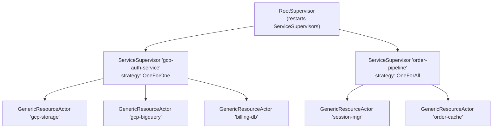
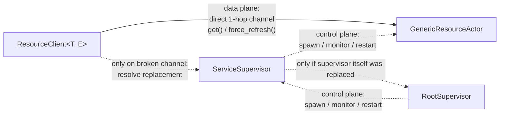
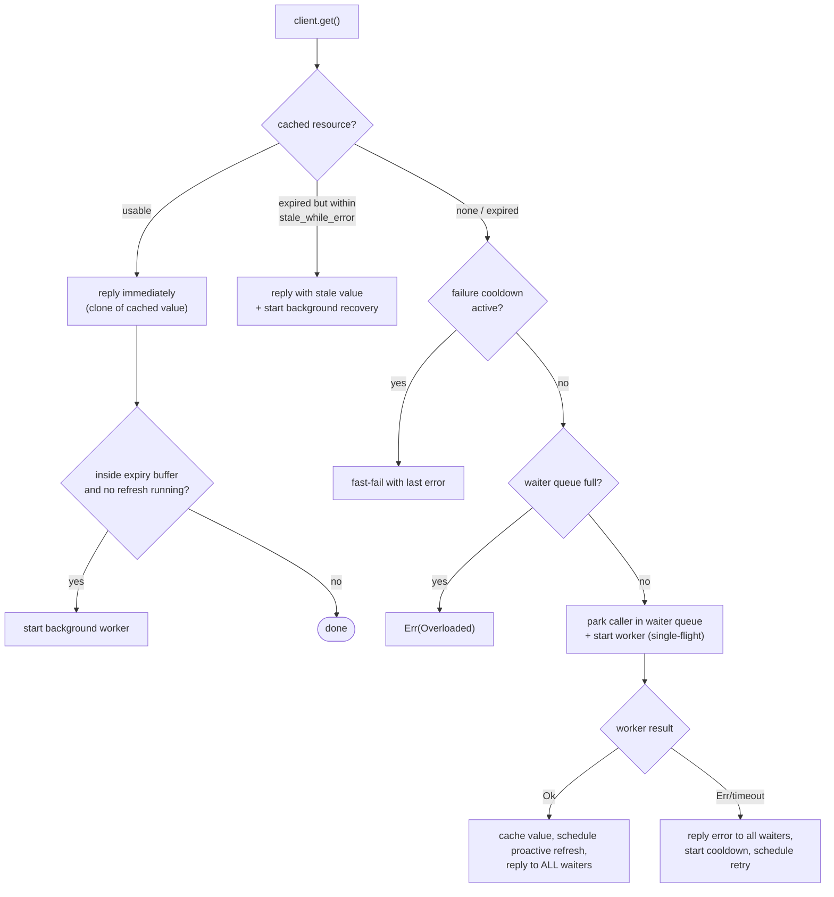
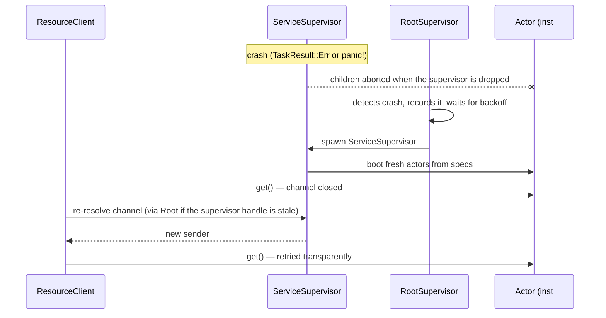

# otp-actor — Hierarchical Supervision Tree, Generic Resource Actor, Stateful Actor & gRPC Remote Actors for Tokio

A **fault-tolerant actor framework** for [Tokio](https://tokio.rs), inspired by Erlang/OTP supervision trees. It combines four core capabilities:

1. **A hierarchical supervision tree** (`RootSupervisor` → `ServiceSupervisor` → actors) that detects controlled error exits (`TaskResult::Err`) and task panics, applies restart strategies (`OneForOne`, `OneForAll`, `RestForOne`), honors OTP child restart rules (`RestartType::Permanent`, `Transient`, `Temporary`) and graceful shutdown policies (`ShutdownPolicy::Timeout`, `BrutalKill`, `Infinity`), and protects against crash loops with rate limiting and exponential backoff.
2. **A generic, reusable "resource actor" (`GenericResourceActor`)** that fetches, caches and proactively refreshes *any* kind of expiring resource (OAuth tokens, database credentials, config snapshots, signed URLs, …) by delegating the actual work to a user-supplied `Worker` — a struct, an `async fn`, or a closure.
3. **A zero-cost stateful actor (`StatefulActor`)** (modeled after Erlang's `gen_server`) for general-purpose state machines with typed `call` (request/response) and `cast` (fire-and-forget) messaging, `on_start` / `on_stop` lifecycle hooks, and the same self-healing 1-hop client architecture (`ActorClient`).
4. **Remote actors over gRPC (`RemoteActorClient`, `ActorNodeServer`, `AnyActorClient`)** (optional `--features remote`) providing complete location transparency, universal Protobuf envelopes (`proto/actor_node.proto`), Serde serialization, network self-healing across actor crashes without connection drops, and coordinated 2-phase graceful shutdown.

Clients talk **directly** to the actors over their own channel (the *data plane*). Supervisors are only involved in lifecycle management (the *control plane*), so they are never a bottleneck, and clients transparently re-bind to a replacement actor after a crash.

---

## Table of Contents

- [Highlights](#highlights)
- [Architecture](#architecture)
  - [Control plane vs. data plane](#control-plane-vs-data-plane)
  - [Component overview](#component-overview)
- [Getting Started](#getting-started)
  - [Requirements](#requirements)
  - [Build, run, test](#build-run-test)
- [Quick Start](#quick-start)
- [Core Concepts](#core-concepts)
  - [Workers](#workers)
  - [`TimedResource` and expiry](#timedresource-and-expiry)
  - [`WorkerContext`](#workercontext)
  - [Resource lifecycle inside an actor](#resource-lifecycle-inside-an-actor)
- [Configuring an Actor](#configuring-an-actor)
- [Stateful Actors (`StatefulActor`)](#stateful-actors-statefulactor)
  - [Implementing `StatefulActor`](#implementing-statefulactor)
  - [Spawning and communicating via `ActorClient`](#spawning-and-communicating-via-actorclient)
  - [State lifecycle on restart & persistence patterns](#state-lifecycle-on-restart--persistence-patterns)
- [Remote Actors over gRPC (`feature = "remote"`)](#remote-actors-over-grpc-feature--remote)
  - [Universal Protobuf wire envelope](#universal-protobuf-wire-envelope)
  - [Hosting actors on server nodes](#hosting-actors-on-server-nodes)
  - [Calling remote actors with location transparency](#calling-remote-actors-with-location-transparency)
  - [Network self-healing & OTP recovery](#network-self-healing--otp-recovery)
  - [Client-initiated domain termination (`ctx.stop()`)](#client-initiated-domain-termination-ctxstop)
  - [Coordinated 2-phase graceful shutdown](#coordinated-2-phase-graceful-shutdown)
  - [Distributed examples (multi-terminal / multi-host)](#distributed-examples-multi-terminal--multi-host)
- [Supervision](#supervision)
  - [Strategies](#supervision-strategies)
  - [Restart policy and backoff](#restart-policy-and-backoff)
  - [Child restart types (`RestartType`) and graceful shutdown (`ShutdownPolicy`)](#child-restart-types-restarttype-and-graceful-shutdown-shutdownpolicy)
  - [Declarative child specs](#declarative-child-specs-otp-style)
  - [Dynamic children](#dynamic-children)
  - [What happens when a supervisor crashes?](#what-happens-when-a-supervisor-crashes)
- [Client API](#client-api)
- [Error Handling](#error-handling)
- [Resilience Features in Detail](#resilience-features-in-detail)
- [Demo Application](#demo-application)
- [Testing](#testing)
- [Project Layout](#project-layout)
- [Release Profile](#release-profile)
- [Known Limitations & Design Notes](#known-limitations--design-notes)
- [License](#license)

---

## Highlights

| Area | Feature |
| --- | --- |
| **Supervision** | Three-level tree: `RootSupervisor` → `ServiceSupervisor` → actors |
| **Strategies** | `OneForOne`, `OneForAll`, `RestForOne` (Erlang/OTP semantics) |
| **Restart types** | `RestartType::Transient`, `RestartType::Permanent`, `RestartType::Temporary` |
| **Graceful shutdown** | `ShutdownPolicy::Timeout(d)`, `BrutalKill`, `Infinity` with mailbox draining & in-flight completion (`root.shutdown()`, `service.shutdown()`, `stop_child()`, `stop_service()`) |
| **Stateful actors** | `StatefulActor` trait (`call` / `cast`, `on_start` / `on_stop` hooks, `ActorContext`) running alongside `GenericResourceActor` under the same supervisors |
| **Escalation & Recovery** | OTP-grade crash escalation (`escalate_on_failure`), manual recovery APIs (`restart_child`, `restart_service`) |
| **Crash-loop protection** | Max restarts per time window, exponential backoff with a cap, permanent-failure state with fast-fail errors |
| **Non-blocking backoff** | Backoff sleeps run in separate tasks — a supervisor never stalls on a restarting child |
| **Zero-cost futures** | Both `Worker` and `StatefulActor` traits return `impl Future` — no `Box::pin` / `dyn` allocation per call |
| **Flexible workers** | Implement the trait on a struct, or pass any `async fn` / closure `Fn(WorkerContext) -> impl Future` |
| **Caching** | Per-actor cache with TTL, expiry buffer, request coalescing (single-flight) |
| **Proactive refresh** | Background timer refreshes the resource *before* it expires, with entropy-hashed jitter |
| **Eager pre-warming** | Optionally fetch the resource at actor start-up |
| **Stale-while-error** | Serve a recently expired value while a refresh recovers |
| **Negative caching** | Failure cooldown and exponential backoff prevent retry storms against a failing backend |
| **Backpressure** | Bounded mailbox + bounded waiter queue → `ResourceError::Overloaded` (pruned only at capacity) |
| **Timeouts** | Worker-side timeout (`worker_timeout`, default 30s), handler timeout (`handler_timeout`), and client-side timeouts (`get_timeout`, `call_timeout`) |
| **Race safety** | Generation counters discard stale results of superseded refreshes; force refresh aborts obsolete workers |
| **Fault & panic isolation** | Controlled error exits (`TaskResult::Err`, `max_consecutive_failures`, `ctx.fail()`) and panics are caught, escalated, and handled by the supervisor |
| **Transparent re-binding** | `ResourceClient` and `ActorClient` re-resolve their channels automatically after actor/supervisor restarts |
| **Remote actors (gRPC)** | High-performance HTTP/2 actor distribution (`--features remote`), universal Protobuf wire envelope (`actor_node.proto`), Location Transparency via `RemoteActorClient` and `AnyActorClient`, 4 MiB allocation bomb defense, coordinated 2-phase graceful shutdown |
| **Logging** | Structured logging via `tracing` with contextual fields across the entire actor hierarchy |
| **Chaos testing** | Built-in `simulate_crash()` and `trigger_service_crash()` |

---

## Architecture



### Control plane vs. data plane



- **Data plane** — `ResourceClient::get()` sends a message straight to the actor's mailbox. No supervisor is in the request path.
- **Control plane** — Supervisors own the actors' `JoinHandle`s, detect exits/panics, decide what to restart, and keep the registry (name → current channel). Clients consult it only when their direct channel is broken.

### Component overview

| Component | File | Responsibility |
| --- | --- | --- |
| `RootSupervisor` / `RootSupervisorHandle` | [`src/actor/root_supervisor.rs`](src/actor/root_supervisor.rs) | Top-level supervisor. Accepts self-registrations of service supervisors, restarts crashed ones with backoff, resolves their channels, and gracefully serializes service restarts. |
| `ServiceSupervisor` / `ServiceSupervisorHandle` / `ServiceSupervisorBuilder` | [`src/actor/service_supervisor.rs`](src/actor/service_supervisor.rs) | Type-agnostic domain supervisor. Owns child actors, applies the `SupervisionStrategy`, tracks restart rates and ticket-based restart wave isolation, hands out typed `ResourceClient`s and `ActorClient`s. |
| `GenericResourceActor`, `ActorBuilder`, `GenericResourceActorBuilder`, `ResourceClient`, `Worker`, `TimedResource`, `WorkerContext`, `ResourceError` | [`src/actor/generic_actor.rs`](src/actor/generic_actor.rs) | The cache/refresh actor, its fluent builders, the worker abstraction and the direct client. |
| `StatefulActor`, `StatefulActorBuilder`, `ActorClient`, `ActorContext`, `ActorControl`, `ActorError` | [`src/actor/stateful_actor.rs`](src/actor/stateful_actor.rs) | Zero-cost general-purpose stateful actor (`gen_server` style) with `call`/`cast` messaging, lifecycle hooks, and self-healing `ActorClient`. |
| `RemoteActorClient`, `AnyActorClient`, `ActorNodeHandle`, `ActorNodeRegistry`, `ByteEndpoint`, `RemoteActorError` | [`src/remote/mod.rs`](src/remote/mod.rs) | gRPC remote actors (`--features remote`): universal envelope, typed remote client, location transparency, coordinated 2-phase shutdown. |
| Protobuf Schema & Build Script | [`proto/actor_node.proto`](proto/actor_node.proto) & [`build.rs`](build.rs) | Compact universal gRPC actor wire contract (`Call`, `Cast`, `RemoteError`), compiled automatically via `tonic-prost-build`. |
| `SupervisionStrategy`, `RestartPolicy`, `RestartTracker`, `RestartType`, `ShutdownPolicy`, `ServiceError`, `RootError`, `TaskResult`, `EXPIRY_BUFFER`, `DEFAULT_SHUTDOWN_TIMEOUT` | [`src/actor/model.rs`](src/actor/model.rs) | Shared domain model: strategies, policies, restart types, shutdown policies, backoff computation, task exit results, error types. |
| Demo | [`examples/otp_actor.rs`](examples/otp_actor.rs) | Eight-phase walkthrough with simulated GCP tokens and a database secret. |
| Simple / Educational | [`examples/simple.rs`](examples/simple.rs) | Minimal, step-by-step example highlighting core usages, self-healing, and graceful shutdown. |
| Remote All-in-One Showcase | [`examples/remote/all_in_one.rs`](examples/remote/all_in_one.rs) | Full remote lifecycle: hosting, gRPC client calls, crash self-healing, client-initiated `ctx.stop()`, and 2-phase shutdown. |
| Remote Server Node (Rechner B) | [`examples/remote/server.rs`](examples/remote/server.rs) | Standalone daemon hosting actors under OTP supervision over network gRPC (`http://0.0.0.0:50051`). |
| Remote Client (Rechner A) | [`examples/remote/client.rs`](examples/remote/client.rs) | Lightweight client invoking remote actors with location transparency and testing crash recovery. |
| Integration tests | [`tests/actor_supervision_test.rs`](tests/actor_supervision_test.rs) | 58 tests covering supervision, caching, stateful actors, restart types, graceful shutdown, timeouts, backpressure, and more. |
| Remote gRPC tests | [`tests/remote_grpc_test.rs`](tests/remote_grpc_test.rs) | 6 integration tests covering TCP transport, location transparency, crash recovery, timeouts, and in-flight drainage. |

---

## Getting Started

### Requirements

- **Rust 1.88 or newer** (the crate uses `edition = "2024"` and `let`-chains).
- No system dependencies for standard in-memory usage. Runtime library dependencies are minimal:
  - [`tokio`](https://crates.io/crates/tokio) 1 (`rt`, `rt-multi-thread`, `sync`, `time`, `macros`)
  - [`thiserror`](https://crates.io/crates/thiserror) 2
  - [`tracing`](https://crates.io/crates/tracing) 0.1
- **Optional gRPC Remote Actors (`--features remote`):**
  - Requires standard `libprotoc` (or `protox`) on build; pulls in `tonic`, `prost`, `serde`, and `bincode`.

### Build, run, test

```bash
# Build the core library (zero gRPC overhead)
cargo build

# Run the simple educational example (core usages only)
cargo run --example simple

# Run the full interactive demo (8 phases: chaos engineering, crash loops, etc.)
cargo run --example otp_actor

# Run the complete core integration test suite
cargo test

# --- Distributed Remote Actor Examples (gRPC) ---

# Run the combined All-in-One remote actor showcase
cargo run --example remote_all_in_one --features remote

# Run in two separate terminals (or across two machines):
# Terminal 1 (Rechner B / Server Node):
cargo run --example remote_server --features remote

# Terminal 2 (Rechner A / Client):
cargo run --example remote_client --features remote

# Run all 64 core & remote integration tests
cargo test --features remote

# Optimized build
cargo build --release

# Optimized build tuned for the local CPU (AVX2, AES-NI, ...)
RUSTFLAGS="-C target-cpu=native" cargo build --release
```

To use the crate from another project in the same workspace, add a path dependency (the package is named `otp-actor`, and its public API is re-exported from the crate root as well as the `actor` module):

```toml
[dependencies]
otp-actor = { path = "../261102_actor" }
tokio = { version = "1", features = ["full"] }
```

```rust
use otp_actor::{GenericResourceActor, RootSupervisor, ServiceSupervisor, TimedResource, WorkerContext};
// (or via `otp_actor::actor::{...}`)
```

---

## Quick Start

A complete example: a supervised actor that "fetches" a token which is valid for 60 seconds. It is refreshed in the background shortly before it expires.

```rust
use std::time::Duration;
use otp_actor::actor::{
    GenericResourceActor, RootSupervisor, ServiceSupervisor, TimedResource, WorkerContext,
};

#[tokio::main]
async fn main() {
    // 1. Start the root of the supervision tree.
    let root = RootSupervisor::new();

    // 2. Start a service supervisor; it registers itself with the root.
    let service = ServiceSupervisor::spawn_and_register("auth-service", &root)
        .await
        .expect("service supervisor registration failed");

    // 3. Any async closure `Fn(WorkerContext) -> Future<Output = Result<TimedResource<T>, E>>`
    //    is a Worker. T and E are inferred.
    let token_worker = |ctx: WorkerContext| async move {
        // ... call your identity provider here ...
        Ok::<_, String>(TimedResource::with_ttl(
            format!("token-gen-{}", ctx.generation),
            Duration::from_secs(60),
        ))
    };

    // 4. Build, spawn, supervise and obtain a direct client in one go.
    let client = GenericResourceActor::builder("api-token")
        .worker(token_worker)
        .eager_prewarm(true)                          // fetch immediately on start
        .expiry_buffer(Duration::from_secs(5))        // refresh 5 s before expiry
        .worker_timeout(Duration::from_secs(10))      // abort slow workers
        .spawn_and_register(&service, &root)
        .await
        .expect("failed to start actor");

    // 5. Use it. Cache hits are served without touching the worker.
    let token = client.get().await.expect("token unavailable");
    println!("token = {token}");
}
```

---

## Core Concepts

### Workers

A `Worker<T, E>` produces a `TimedResource<T>` or an error `E`:

```rust
pub trait Worker<T, E>: Send + Sync + 'static {
    fn execute(&self, ctx: WorkerContext)
        -> impl Future<Output = Result<TimedResource<T>, E>> + Send;
}
```

Because `execute` returns `impl Future`, no boxing is required. There are three equally valid ways to supply a worker:

**1. A custom struct** (good for configuration and dependencies):

```rust
struct GcpTokenWorker { scope: String }

impl Worker<String, TokenError> for GcpTokenWorker {
    async fn execute(&self, ctx: WorkerContext) -> Result<TimedResource<String>, TokenError> {
        let token = fetch_token(&self.scope, ctx.generation).await?;
        Ok(TimedResource::with_ttl(token, Duration::from_secs(3600)))
    }
}

GenericResourceActor::builder("gcp-storage")
    .worker(GcpTokenWorker { scope: "gcp-storage".into() });
```

**2. A standalone `async fn`:**

```rust
async fn bigquery_worker(ctx: WorkerContext) -> Result<TimedResource<String>, TokenError> { /* ... */ }

GenericResourceActor::builder("gcp-bigquery").worker(bigquery_worker);
```

**3. A closure** — it may capture state, such as shared handles, HTTP clients or counters:

```rust
let counter = Arc::new(AtomicUsize::new(0));
let worker = move |ctx: WorkerContext| {
    let counter = counter.clone();
    async move {
        counter.fetch_add(1, Ordering::SeqCst);
        Ok::<_, String>(TimedResource::perpetual(format!("inst-{}", ctx.instance_id)))
    }
};
```

> **Type requirements.** `T` (payload) and `E` (error) must be `Clone + Send + Sync + 'static`. Values are cloned to hand them out to multiple callers.

### `TimedResource` and expiry

A value bundled with an optional expiry deadline (`Debug` formatting intentionally redacts `value` as `"<redacted>"` so cached tokens and secrets are never leaked into logs):

```rust
TimedResource::with_ttl(value, Duration::from_secs(300)); // expires 300 s from now
TimedResource::perpetual(value);                          // never expires
```

The actor reasons about three time zones for a cached resource:

```text
 fetched                         expires_at - expiry_buffer        expires_at        expires_at + stale_while_error
    |------------ FRESH ---------------|------- STALE-SOON -------|---- EXPIRED ----|-- hard expiry -->
                                       ^ background refresh starts  ^ no longer "usable"   ^ no longer served
```

| Method | Meaning |
| --- | --- |
| `is_fresh(buffer)` | More than `buffer` left until expiry (or perpetual). |
| `is_still_usable()` | Not yet expired. |
| `is_usable_stale(allowance)` | Expired, but within the stale-while-error `allowance`. |

### `WorkerContext`

Passed to every worker invocation:

| Field | Description |
| --- | --- |
| `instance_id` | Which incarnation of the actor is running. Starts at 1 and increases on every supervisor restart. |
| `generation` | Monotonically increasing number of the fetch attempt *within* one actor instance. Useful for logging and for tests. |

### Resource lifecycle inside an actor



Key properties:

- **Single-flight.** At most one worker runs per actor at any time. Concurrent callers during a cold start are parked and all answered by the same result.
- **Cache hits never block.** A valid cached value is returned immediately; refreshes happen in the background.
- **Generation guard.** Every worker run gets a new `generation`. Results (or timeouts/panics) from superseded generations are ignored, so a slow, old fetch can never overwrite a newer value.

---

## Configuring an Actor

`GenericResourceActor::builder(name)` (alias: `GenericResourceActor::spec(name)`) returns an `ActorBuilder` backed by an [`ActorConfig`]. Call `.worker(...)` to attach the worker; all options can be set before or after it.

| Option | Default | Description |
| --- | --- | --- |
| `.worker(w)` | — *(required)* | Attaches the `Worker` (struct, `async fn`, or closure). Infers `T` and `E`. |
| `.expiry_buffer(d)` | `2 s` (`EXPIRY_BUFFER`) | Safety margin: refresh begins this long before expiry. Clamped to at most half the remaining TTL, so short-lived values don't end up permanently "stale". |
| `.channel_capacity(n)` | `256` | Mailbox size of the actor (clamped to `>= 1`). |
| `.max_waiters(n)` | `1024` | Max parked callers during a cold start (clamped to `>= 1`). Beyond that → `ResourceError::Overloaded(n)`. |
| `.eager_prewarm(b)` | `false` | Fetch the resource immediately on (re)start instead of at the first `get()`. |
| `.restart_policy(p)` | `RestartPolicy::default()` | Crash-loop protection and backoff for this actor. |
| `.restart_type(t)` | `RestartType::Transient` | OTP restart rule (`Permanent`, `Transient`, or `Temporary`). |
| `.shutdown_policy(p)` | `ShutdownPolicy::Timeout(5 s)` | How the supervisor terminates the actor on stop/shutdown (`Timeout(Duration)`, `BrutalKill`, or `Infinity`). |
| `.shutdown_timeout(d)` | — | Shorthand for `.shutdown_policy(ShutdownPolicy::Timeout(d))`. |
| `.worker_timeout(d)` | `30 s` (`DEFAULT_WORKER_TIMEOUT`) | Abort a worker run that exceeds `d` → `ResourceError::Timeout(Duration)`. |
| `.no_worker_timeout()` | — | Disables the execution timeout, allowing workers to run indefinitely. |
| `.failure_cooldown(d)` | `0` (disabled) | After a failed fetch, fast-fail new callers for `d` instead of hammering the backend (negative caching). |
| `.stale_while_error(d)` | `0` (disabled) | Keep serving an expired value for up to `d` while a refresh recovers. |
| `.proactive_refresh(b)` | `true` | Refresh in the background via a timer before expiry, even without client traffic. |
| `.proactive_jitter(d)` | `0` | Randomly start proactive refreshes up to `d` earlier (clamped to at most half the refresh lead time, with entropy-hashed jitter) to avoid thundering herds across many actors. |
| `.max_consecutive_failures(n)` | `None` (disabled) | After `n` consecutive worker failures or timeouts, exit with `TaskResult::Err` to trigger a full supervisor restart (including `OneForAll` / `RestForOne` siblings) without panicking. |

Finish the builder with one of:

| Method | Result |
| --- | --- |
| `.spawn(&service_supervisor)` | Starts the actor under the supervisor and returns a `ResourceClient<T, E>`. |
| `.spawn_and_register(&service_supervisor, &root)` | Starts the actor under the supervisor (legacy alias for `.spawn`). |
| `.build_child_spec()` | Returns a `ChildSpec` (to start later or hand to a supervisor builder). |
| `.into()` / `ChildSpec::from(builder)` | Same as `build_child_spec()`. |

---

## Stateful Actors (`StatefulActor`)

Alongside `GenericResourceActor` (which is specialized for caching and refreshing single resources), the framework provides **`StatefulActor`** ([`src/actor/stateful_actor.rs`](src/actor/stateful_actor.rs)) for general-purpose stateful actors modeled after Erlang/OTP's `gen_server`.

`StatefulActor` runs on the **exact same `RootSupervisor` and `ServiceSupervisor`** hierarchy — you can even mix `GenericResourceActor`s and `StatefulActor`s inside the same `OneForAll` or `RestForOne` supervisor!

### Implementing `StatefulActor`

Like `Worker`, `StatefulActor` uses native `impl Future` return types (zero `#[async_trait]` / `Box::pin` heap allocations):

```rust
use otp_actor::actor::{ActorContext, RestartType, StatefulActor, StatefulActorBuilder};

#[derive(Clone, Default)]
struct CounterActor {
    total: i64,
}

#[derive(Clone, Debug)]
enum CounterMsg {
    Add(i64),
    Get,
}

impl StatefulActor for CounterActor {
    type Message = CounterMsg;
    type Response = i64;
    type Error = String;

    async fn handle(
        &mut self,
        msg: Self::Message,
        ctx: &mut ActorContext,
    ) -> Result<Self::Response, Self::Error> {
        match msg {
            CounterMsg::Add(delta) => {
                self.total += delta;
                Ok(self.total)
            }
            CounterMsg::Get => Ok(self.total),
        }
    }

    // Optional lifecycle hooks:
    async fn on_start(&mut self, _ctx: &mut ActorContext) -> Result<(), String> {
        Ok(())
    }

    async fn on_stop(&mut self, _ctx: &mut ActorContext) {}
}
```

Inside `handle`, `on_start`, and `on_stop`, `ctx: &mut ActorContext` provides:
- `ctx.name()` — the registered actor name.
- `ctx.instance_id()` — the current supervisor incarnation (starts at `1`, increments on every restart).
- `ctx.stop()` — instructs the actor to drain its mailbox, invoke `on_stop`, and exit cleanly with `Ok(())`.
- `ctx.fail("reason")` — escalates a fatal failure to the `ServiceSupervisor`, triggering supervision recovery (`OneForOne`, `OneForAll`, `RestForOne`).

### Spawning and communicating via `ActorClient`

Build and spawn a `StatefulActor` using `StatefulActorBuilder::from_default`, `StatefulActorBuilder::from_instance`, or `StatefulActorBuilder::new(name, |instance_id| ...)`:

```rust
let client = StatefulActorBuilder::from_default::<CounterActor>("session-counter")
    .restart_type(RestartType::Permanent)
    .shutdown_timeout(Duration::from_secs(2))
    .spawn(&service_supervisor)
    .await?;

// Fire-and-forget notification (gen_server:cast)
client.cast(CounterMsg::Add(10)).await?;

// Request-response (gen_server:call) with automatic 1-hop self-healing rebind
let current = client.call(CounterMsg::Add(5)).await?;
assert_eq!(current, 15);
```

`StatefulActorBuilder` options:

| Option | Default | Description |
| --- | --- | --- |
| `.channel_capacity(n)` | `256` | Mailbox size of the actor (clamped to `>= 1`). |
| `.restart_policy(p)` | `RestartPolicy::default()` | Crash-loop protection and exponential backoff for this actor. |
| `.restart_type(t)` | `RestartType::Transient` | OTP restart rule (`Permanent`, `Transient`, or `Temporary`). |
| `.shutdown_policy(p)` | `ShutdownPolicy::Timeout(5 s)` | How the supervisor terminates the actor on stop/shutdown (`Timeout(Duration)`, `BrutalKill`, or `Infinity`). |
| `.shutdown_timeout(d)` | — | Shorthand for `.shutdown_policy(ShutdownPolicy::Timeout(d))`. |
| `.handler_timeout(d)` | `None` (disabled) | Aborts a `handle()` execution that exceeds `d`, immediately returns `Err(ActorError::Timeout(d))` to the caller, and escalates to the supervisor (`ctx.fail(...)`) so a fresh instance is booted via `on_start` without leaving partially mutated `&mut self` state. |
| `.no_handler_timeout()` | — | Disables the handler execution timeout. |

### State Lifecycle on Restart & Persistence Patterns

#### Does an actor lose its in-memory state when restarted?
**Yes, by design.** When an actor crashes or terminates abnormally, its in-memory struct fields are discarded and the supervisor boots a **fresh, clean instance** from the configured factory (e.g. `Default::default()` or initial state clone).

This embodies the core Erlang/OTP philosophy:
- **Crash Loop Prevention**: In-memory crashes usually occur because internal state entered an invalid, corrupted, or inconsistent invariant. Reviving the exact same corrupted in-memory state would immediately trigger a crash on the very next message, trapping the system in an endless crash loop.
- **Known-Good State**: Starting fresh gives the actor a clean slate while the client's direct channel rebinds transparently.

#### How to preserve state across restarts (Persistence)
When state must survive actor restarts, combine `StatefulActor` with an external storage layer (database, SQLite, Redis, or disk):

1. **Rehydrate in `on_start`**:
   The `on_start(&mut self, ctx: &mut ActorContext)` hook runs before any mailbox messages are processed (both on initial boot and on every restart). Load the latest committed state snapshot here:
   ```rust
   async fn on_start(&mut self, ctx: &mut ActorContext) -> Result<(), String> {
       // Rehydrate state from database or disk using the actor's unique name:
       self.total = database::load_counter_state(ctx.name()).await?;
       Ok(())
   }
   ```

2. **Commit updates in `handle`**:
   Persist state updates or write-ahead event logs during message processing before returning `Ok(response)`:
   ```rust
   async fn handle(
       &mut self,
       msg: Self::Message,
       ctx: &mut ActorContext,
   ) -> Result<Self::Response, Self::Error> {
       match msg {
           CounterMsg::Add(delta) => {
               database::persist_increment(ctx.name(), delta).await?;
               self.total += delta;
               Ok(self.total)
           }
           // ...
       }
   }
   ```

3. **Inject storage handles via `StatefulActorBuilder::new`**:
   Pass shared connection pools or repository handles into the factory closure:
   ```rust
   let db_pool = pool.clone();
   let client = StatefulActorBuilder::new("session-counter", move |_instance_id| {
       CounterActor {
           db: db_pool.clone(),
           total: 0, // rehydrated in on_start
       }
   })
   .spawn(&service_supervisor)
   .await?;
   ```

---

## Remote Actors over gRPC (`feature = "remote"`)

When built with `--features remote`, the crate enables distributed actor communication across machines, processes, and containers over high-performance HTTP/2 gRPC.

```toml
[dependencies]
otp-actor = { version = "0.2.0", features = ["remote"] }
```

### Architectural Overview

```
 ┌─────────────────────────────────────────────────────────────┐
 │                      Remote Machine A                       │
 │                                                             │
 │   let client: AnyActorClient<BankAccountActor> =            │
 │       AnyActorClient::remote("http://192.168.1.50:50051",   │
 │                              "bank-service", "acc-42")      │
 │                              .await?;                       │
 │                                                             │
 │   let balance: i64 = client.call(AccountMsg::GetBalance,    │
 │                                  Duration::from_secs(3))    │
 │                                  .await?;                   │
 └──────────────────────────────┬──────────────────────────────┘
                                │
                                │ gRPC / HTTP/2 (actor_node.proto)
                                │ Envelope: [service, actor, payload, deadline]
                                ▼
 ┌─────────────────────────────────────────────────────────────┐
 │                      Remote Machine B                       │
 │                                                             │
 │   ActorNodeServer (0.0.0.0:50051)                           │
 │     │                                                       │
 │     ├── ActorRegistry ("bank-service" -> ByteEndpoint)      │
 │     │     │                                                 │
 │     │     └── Deserializes JSON payload (≤ 4 MiB)           │
 │     │           │                                           │
 │     ▼           ▼                                           │
 │   ServiceSupervisor (OneForOne, MaxRestarts: 3)             │
 │     └── BankAccountActor ("acc-42", balance: 500)           │
 └─────────────────────────────────────────────────────────────┘
```

The remote subsystem is architected around four core principles:
1. **Universal Protobuf Envelope (`proto/actor_node.proto`)**: A single schema-agnostic protocol transports arbitrary typed messages without recompiling `.proto` files for every actor type.
2. **Type-Erased Byte Adapters (`ByteEndpoint`)**: The server routes raw bytes to local `ActorClient<A>` handles using JSON (or custom) serialization and DoS payload limits (4 MiB max).
3. **Location Transparency (`AnyActorClient<A>`)**: Unifies `ActorClient<A>` (local mpsc) and `RemoteActorClient<A>` (gRPC) behind an identical interface (`call`, `cast`, `stop`).
4. **Coordinated 2-Phase Graceful Shutdown**: `ActorNodeHandle` drains active in-flight RPCs, then shuts down all registered actors in reverse registration order honoring their individual `ShutdownPolicy` deadlines.

### The Protobuf Contract

Defined in [`proto/actor_node.proto`](proto/actor_node.proto):

```protobuf
syntax = "proto3";
package otp_actor.v1;

service ActorNode {
  rpc Call  (Envelope) returns (CallReply);
  rpc Cast  (Envelope) returns (CastAck);
  rpc Stop  (StopRequest) returns (StopAck);
  rpc Health(HealthRequest) returns (HealthReply);
}

message Envelope {
  string service_name = 1;
  string instance_id  = 2;
  bytes  payload      = 3;
  uint64 deadline_ms  = 4;
  map<string, string> trace_context = 5;
}

message CallReply {
  bytes  payload = 1;
  string error   = 2;
}

message CastAck {}

message StopRequest {
  string service_name = 1;
  string instance_id  = 2;
  uint64 timeout_ms   = 3;
}

message StopAck {
  bool stopped = 1;
}

message HealthRequest {}

message HealthReply {
  string status              = 1;
  uint64 uptime_secs         = 2;
  uint32 active_actors_count = 3;
}
```

### Running Multi-Process / Multi-Terminal Examples

We provide ready-to-run examples in [`examples/remote/`](examples/remote/):

#### Scenario A: Two Terminals (Server + Client)

Open two terminal windows:

**Terminal 1 — Run the gRPC Remote Server Node:**
```bash
cargo run --example remote_server --features remote
```
Starts an actor node on `0.0.0.0:50051`, registers a supervised `BankAccountActor` ("account-42") with `RestartType::Transient`, and serves requests.

**Terminal 2 — Run the Remote Client:**
```bash
cargo run --example remote_client --features remote
```
Connects to `http://127.0.0.1:50051`, executes deposits, tests overdraft errors, triggers a crash to observe automatic supervisor self-healing over the wire, and performs a graceful client shutdown.

#### Scenario B: Automated All-in-One Demo

To run both server and client together in a single automated integration runner:
```bash
cargo run --example remote_all_in_one --features remote
```

### Code Example: Building a Remote Node

```rust
use otp_actor::{
    actor::{ActorContext, ActorControl, StatefulActor, StatefulActorBuilder},
    remote::{ActorNodeServer, ActorRegistry},
    supervision::{RestartPolicy, RestartType, ServiceSupervisor, SupervisionStrategy},
};
use serde::{Deserialize, Serialize};
use std::time::Duration;

#[derive(Debug, Serialize, Deserialize)]
enum BankMsg {
    Deposit(u64),
    GetBalance,
    SimulateCrash,
    CloseAccount,
}

#[derive(Default)]
struct BankAccount {
    balance: u64,
}

impl StatefulActor for BankAccount {
    type Message = BankMsg;
    type Response = Result<u64, String>;

    async fn handle(&mut self, msg: Self::Message, ctx: &mut ActorContext) -> ActorControl<Self::Response> {
        match msg {
            BankMsg::Deposit(amount) => {
                self.balance += amount;
                ActorControl::reply(Ok(self.balance))
            }
            BankMsg::GetBalance => ActorControl::reply(Ok(self.balance)),
            BankMsg::SimulateCrash => {
                ctx.fail("Fatal hardware error simulated!");
                ActorControl::reply(Err("Crashing...".into()))
            }
            BankMsg::CloseAccount => {
                ctx.stop(); // Normal termination
                ActorControl::reply(Ok(self.balance))
            }
        }
    }
}

#[tokio::main]
async fn main() -> Result<(), Box<dyn std::error::Error>> {
    // 1. Set up supervisor with Transient restart (stops are NOT restarted)
    let supervisor = ServiceSupervisor::builder("bank-supervisor")
        .strategy(SupervisionStrategy::OneForOne)
        .build();

    let client = StatefulActorBuilder::new("bank-service", |_| BankAccount::default())
        .restart_policy(RestartPolicy::default().with_type(RestartType::Transient))
        .spawn(&supervisor)
        .await?;

    // 2. Register actor in remote registry
    let registry = ActorRegistry::new();
    registry.register_client("bank-service", client);

    // 3. Start gRPC server
    let server = ActorNodeServer::new(registry)
        .with_drain_timeout(Duration::from_secs(5));

    let handle = server.serve("0.0.0.0:50051".parse()?).await?;
    println!("Node listening on :50051");

    // Wait for shutdown signal...
    tokio::signal::ctrl_c().await?;
    handle.shutdown().await?;
    Ok(())
}
```

### Code Example: Calling from a Remote Client

```rust
use otp_actor::remote::{AnyActorClient, RemoteActorClient};
use std::time::Duration;

#[tokio::main]
async fn main() -> Result<(), Box<dyn std::error::Error>> {
    // Option A: Explicit Remote Client
    let client = RemoteActorClient::<BankAccount>::connect(
        "http://127.0.0.1:50051",
        "bank-service",
        "default",
    ).await?;

    // Option B: Location-Transparent Client (Local or Remote)
    let client: AnyActorClient<BankAccount> = AnyActorClient::remote(
        "http://127.0.0.1:50051",
        "bank-service",
        "default",
    ).await?;

    // Call with deadline
    let balance = client.call(BankMsg::Deposit(250), Duration::from_secs(3)).await??;
    println!("Balance: {balance}");

    // Cast (fire-and-forget)
    client.cast(BankMsg::Deposit(50)).await?;

    // Gracefully stop the actor remotely
    client.stop(Duration::from_secs(3)).await?;
    Ok(())
}
```

### Client-Initiated Stopping & Lifecycle Semantics

When designing remote actors that can be stopped by external clients, consider the interaction with the actor's `RestartType`:

| Configuration | What happens when `ctx.stop()` or `client.stop()` is invoked? | Use Case |
| --- | --- | --- |
| **`RestartType::Transient`** *(Recommended for stoppable actors)* | The actor terminates cleanly. Because the exit is normal (`TaskResult::Ok`), the supervisor **does not** restart it. Subsequent client requests return `ActorNotFound`. | User sessions, shopping carts, game lobbies, connection workers. |
| **`RestartType::Permanent`** | The actor terminates, but the supervisor considers every exit unexpected and immediately restarts it with clean state. | Core infrastructure daemons that must always stay alive. |
| **`RestartType::Temporary`** | The actor is never restarted, even on crash. | Short-lived background compute jobs. |

---

## Supervision

### Supervision strategies

Configured per `ServiceSupervisor` via `SupervisionStrategy`:

| Strategy | When actor *X* crashes … | Typical use |
| --- | --- | --- |
| `OneForOne` *(default)* | only *X* is restarted. | Independent, shared-nothing actors. |
| `OneForAll` | *all* running children are gracefully terminated in reverse registration order (honoring their `ShutdownPolicy` and `on_stop` hooks) and then restarted in registration order without instance overlap. | Tightly coupled actors that share state or exclusive resources. |
| `RestForOne` | *X* and all children registered **after** *X* are gracefully terminated in reverse order and restarted in registration order; earlier ones stay untouched. | Linear dependency pipelines `A → B → C`. |

Example with `RestForOne` and children `pipe-1 → pipe-2 → pipe-3`:

| Crash in | Restarted |
| --- | --- |
| `pipe-1` | `pipe-1`, `pipe-2`, `pipe-3` |
| `pipe-2` | `pipe-2`, `pipe-3` |
| `pipe-3` | `pipe-3` |

### Restart policy and backoff

```rust
pub struct RestartPolicy {
    pub max_restarts: usize,        // allowed restarts within `time_window`
    pub time_window: Duration,      // sliding window for counting restarts
    pub initial_backoff: Duration,  // delay before the first restart
    pub max_backoff: Duration,      // upper bound for the delay
    pub backoff_multiplier: f64,    // growth factor per consecutive crash
}
```

Defaults: `max_restarts = 5`, `time_window = 10 s`, `initial_backoff = 50 ms`, `max_backoff = 2 s`, `backoff_multiplier = 2.0`.

Behaviour (implemented by `RestartTracker`):

- Each crash is recorded; entries older than `time_window` are discarded.
- If the number of recent restarts reaches `max_restarts`, the component is marked **permanently failed**. Pending and future lookups then fail fast with `MaxRestartsExceeded`.
- Otherwise the restart is delayed by `initial_backoff × multiplier^(consecutive_failures − 1)`, capped at `max_backoff`.
- Once a component has been stable for a full `time_window`, the failure streak resets and the backoff decays back to `initial_backoff`.
- The exponent is capped, so the computation can never overflow, produce `NaN`, or panic (covered by a test with 1,200 consecutive crashes).
- Backoff delays happen in a **separate task**, so a supervisor keeps serving other children and requests while one child waits to be restarted.
- Stale crash notifications from already-replaced instances are ignored via monotonic restart wave tickets.
- Backoff delays and sibling shutdown waves are strictly serialized so old instances cleanly finish their `ShutdownPolicy` (`on_stop`) before replacement instances are spawned.

Actors have their own `RestartPolicy` (set on the actor builder). Supervisors have one too (`ServiceSupervisorBuilder::restart_policy`), used by the `RootSupervisor` when it restarts the supervisor.

### Child restart types (`RestartType`) and graceful shutdown (`ShutdownPolicy`)

Each `ChildSpec` (and actor builder) configures how termination and shutdown are handled:

| `RestartType` | Clean exit (`Ok(())`) | Crash (`Err` or panic) | Typical use |
| --- | --- | --- | --- |
| `Transient` *(default)* | Not restarted | Restarted | Standard workers and actors that may complete normally. |
| `Permanent` | **Restarted** (unless stopped via supervisor) | Restarted | Critical long-lived daemons and token/cache actors. |
| `Temporary` | Not restarted (reaped completely) | **Never restarted** (reaped completely) | One-shot background tasks. Automatically removed from supervisor memory and specs upon exit to prevent memory leaks. |

| `ShutdownPolicy` | Behavior on `stop_child` / `stop_service` / `shutdown` |
| --- | --- |
| `Timeout(Duration)` *(default: 5 s)* | Signals graceful shutdown (closes mailbox, drains buffered requests, awaits in-flight worker) and aborts if the deadline elapses. |
| `BrutalKill` | Immediately aborts the task (`AbortHandle::abort`). |
| `Infinity` | Signals graceful shutdown and waits indefinitely for clean completion. |

### Declarative child specs (OTP style)

Declare the entire subtree up front. The supervisor starts all children on boot **and again after the supervisor itself is restarted**:

```rust
let service = ServiceSupervisor::builder("coupled-service")
    .strategy(SupervisionStrategy::OneForAll)
    .restart_policy(RestartPolicy::default())
    .escalate_on_failure(false) // Set to `true` for pure OTP escalation to RootSupervisor
    .add_child(GenericResourceActor::builder("a").worker(worker_a).eager_prewarm(true))
    .add_child(GenericResourceActor::builder("b").worker(worker_b))
    .spawn(&root)
    .await?;

let client_a = service.get_client::<String, String>("a").await?;
let client_b = service.get_client::<String, String>("b").await?;
```

`add_child` accepts anything convertible to a `ChildSpec` — including a configured `GenericResourceActorBuilder` directly.

> **Erlang/OTP Escalation (`escalate_on_failure`):** By default (`false`), exceeding `max_restarts` marks the child as permanently failed (`MaxRestartsExceeded`), allowing clients to fast-fail or operators to call `restart_child`. With `.escalate_on_failure(true)`, the supervisor instead terminates itself with `TaskResult::Err`, triggering an automatic supervisor-level reboot by the `RootSupervisor` without panicking.

### Dynamic children

Children can also be added at runtime. The spec is remembered, so the child is re-created if the supervisor is restarted:

```rust
let spec: ChildSpec = GenericResourceActor::builder("dyn-child")
    .worker(worker)
    .build_child_spec();

service.start_child(spec).await?;
let client = service.get_client::<String, String>("dyn-child").await?;
```

Starting a child with a name that already exists returns `ServiceError::ActorAlreadyExists`.

### What happens when a supervisor crashes?



Because children are owned by their supervisor, a supervisor crash also replaces its children with fresh instances (their in-memory cache starts empty again, and `instance_id` restarts at 1). Clients are unaffected apart from the one-time re-bind latency.

---

## Client API

`ServiceSupervisorHandle` (returned by the supervisor builders / `spawn_and_register`) is a cheap, cloneable handle:

| Method | Description |
| --- | --- |
| `get_client::<T, E>(name)` | Returns a typed `ResourceClient<T, E>`. Fails with `ActorTypeMismatch` if `T`/`E` do not match the actor. |
| `get_actor_client::<A>(name)` | Returns a typed `ActorClient<A>` for a supervised `StatefulActor`. Fails with `ActorTypeMismatch` if `A` does not match the actor. |
| `start_child(spec)` | Starts and supervises a new child (`GenericResourceActor` or `StatefulActor`). |
| `restart_child(name)` | Manually recovers a failed or stopped child (and dependent siblings under `OneForAll` / `RestForOne`), gracefully awaiting termination of any running instance before spawning the replacement. |
| `stop_child(name)` | Gracefully stops a supervised child according to its `ShutdownPolicy` and removes its spec from automatic supervisor-restart specs. |
| `delete_child(name)` | Gracefully stops (if running) and completely removes a child's specification and state from the supervisor. |
| `shutdown()` | Sequentially shuts down all supervised children in reverse registration order and terminates the supervisor. |
| `resolve_actor_channel::<S>(name)` / `resolve_actor_channel_untyped(name)` | Low-level channel lookup. |
| `trigger_service_crash()` | Chaos: terminate the supervisor with a crash error (`TaskResult::Err`). |
| `name()` | The supervisor's name. |

`RootSupervisorHandle`:

| Method | Description |
| --- | --- |
| `resolve_service_handle(name)` | Returns a resilient `ServiceSupervisorHandle` for a registered service. |
| `resolve_service_channel(name)` | Low-level channel lookup. |
| `restart_service(name)` | Manually recovers a service supervisor, resetting its state and backoff counters, and gracefully terminating any running instance according to its `ShutdownPolicy` before spawning the replacement. |
| `stop_service(name)` | Gracefully stops a registered service supervisor and all of its children sequentially in reverse registration order. |
| `shutdown()` | Sequentially shuts down the entire supervision tree (`RootSupervisor` → all `ServiceSupervisor`s → all child actors) in reverse registration order. |
| `trigger_service_crash(name)` | Chaos: terminate a service supervisor with a crash error (`TaskResult::Err`). |

`ResourceClient<T, E>` (cloneable, share it freely across tasks):

| Method | Description |
| --- | --- |
| `get()` | Returns the resource. Cache hits are answered immediately. On a broken channel or during actor restarts, transparently re-binds through the supervisor and retries (up to 3 attempts, 60 ms apart), propagating terminal supervisor errors (e.g. `ActorNotFound`) immediately. |
| `get_timeout(d)` | Like `get()` with a client-side deadline → `ResourceError::Timeout(Duration)`. |
| `force_refresh()` | Immediately starts a new fetch, superseding any in-flight one and clearing failure state / cooldown. Transparently re-binds if the channel was closed by a prior crash. |
| `shutdown()` | Sends a graceful shutdown command directly to the actor (with transparent channel re-binding). |
| `simulate_crash()` | Chaos: terminate the actor with a crash error (`TaskResult::Err`) to exercise supervision. |
| `name()` | The actor's name. |

`ActorClient<A>` (cloneable, self-healing client for `StatefulActor`s):

| Method | Description |
| --- | --- |
| `call(msg)` | Sends a request-response message and awaits `A::Response`. Re-binds and retries transparently if the channel was closed by a prior actor restart (without requiring `A::Message: Clone`). |
| `call_retry(msg)` | Like `call(msg)`, but requires `A::Message: Clone` so it can also re-bind and re-send when the actor crashes mid-handler while processing the request. |
| `call_timeout(msg, d)` | Like `call(msg)` with a client-side deadline → `ActorError::Timeout(Duration)`. |
| `cast(msg)` | Sends a fire-and-forget message. Re-binds transparently if the channel was closed. |
| `shutdown()` | Sends a graceful shutdown command directly to the actor (drains mailbox, runs `on_stop`, and exits cleanly; re-binds if needed). |
| `simulate_crash()` | Chaos: terminate the actor with a crash error (`TaskResult::Err`) to exercise supervision. |
| `name()` | The actor's name. |

---

## Error Handling

```rust
pub enum ResourceError<E> {
    ActorUnavailable,       // actor gone and could not be re-bound
    Service(ServiceError),  // supervisor-level error (e.g. MaxRestartsExceeded)
    WorkerFailed(E),        // your worker returned Err(E)
    Timeout(Duration),      // worker_timeout or get_timeout elapsed
    Overloaded(usize),      // waiter queue reached max_waiters
}

pub enum ActorError<E> {
    ActorUnavailable,       // actor gone and could not be re-bound
    Service(ServiceError),  // supervisor-level error (e.g. MaxRestartsExceeded)
    HandlerFailed(E),       // StatefulActor::handle returned Err(E)
    Timeout(Duration),      // handler_timeout or call_timeout elapsed
}
```

```rust
pub enum ServiceError {
    ActorAlreadyExists(String),
    ActorNotFound(String),
    ActorTypeMismatch(String),
    ServiceUnavailable,
    MaxRestartsExceeded(String, usize, Duration),
}

pub enum RootError {
    ServiceAlreadyExists(String),
    ServiceNotFound(String),
    RootUnavailable,
    MaxRestartsExceeded(String, usize, Duration),
}
```

All error types implement `std::error::Error` (via `thiserror`) and are `Clone`.

Typical handling:

```rust
match client.get_timeout(Duration::from_secs(2)).await {
    Ok(value) => use_it(value),
    Err(ResourceError::WorkerFailed(e)) => tracing::warn!("backend failed: {e:?}"),
    Err(ResourceError::Timeout(d)) => tracing::warn!("operation timed out after {d:?}"),
    Err(ResourceError::Overloaded(n)) => tracing::warn!("shed load, queue limit {n}"),
    Err(ResourceError::Service(e)) => tracing::error!("actor permanently failed: {e}"),
    Err(other) => tracing::error!("{other}"),
}
```

---

## Resilience Features in Detail

### Eager pre-warming
With `.eager_prewarm(true)` the first fetch starts when the actor boots. The first `get()` is typically an immediate cache hit instead of a cold start.

### Proactive refresh
Whenever a new resource is stored, the actor schedules a timer at `expires_at − min(expiry_buffer, ttl/2)` (minus optional jitter). When it fires the worker runs in the background, so under normal conditions clients never wait for a refresh. If a refresh fails, a retry is scheduled after `max(failure_cooldown, 50 ms)`.

### Request coalescing & backpressure
During a cold start or hard expiry, callers are parked in a waiter queue and answered by **one** worker run. Callers that have gone away (dropped / timed out) are pruned. When `max_waiters` is reached, new callers get `Overloaded` immediately instead of building an unbounded queue.

### Worker timeouts
`worker_timeout` wraps each worker run in `tokio::time::timeout`. On expiry all waiters get `ResourceError::Timeout`, a failure is recorded, and a retry is scheduled.

### Negative caching / failure cooldown
With `failure_cooldown`, a failed fetch is remembered. Until the cooldown ends, callers that would need a fresh fetch are failed fast with the previous error and no new worker is started. This protects a struggling backend from a retry storm. `force_refresh()` bypasses and clears the cooldown.

### Stale-while-error
With `stale_while_error`, an expired value is still served for the configured grace period while a background refresh tries to recover — turning short outages of the upstream system into non-events.

### Fault escalation & panic isolation
Supervisors monitor tasks via `JoinHandle<TaskResult>` (`Result<(), String>`):
- **Controlled error exits (`TaskResult::Err`)**: Escalations such as `.max_consecutive_failures(n)`, `.escalate_on_failure(true)`, and chaos hooks (`simulate_crash()`, `trigger_service_crash()`) return `Err(reason)` directly from the task loop without invoking `panic!`, so the entire supervision tree works even when compiled with `panic = "abort"`.
- **Worker panic isolation**: When compiled with `panic = "unwind"`, unexpected panics inside a worker are caught by the actor's `JoinSet` (`JoinError::is_panic()`) and cleanly escalated to the `ServiceSupervisor` as `TaskResult::Err` (without cascading re-panics). A client call that was waiting on the actor does not hang: it re-binds to the replacement instance and is retried.

### Generation guard
Each worker run is tagged with a generation. When `force_refresh()` supersedes an in-flight fetch, the older result is discarded when it eventually arrives (verified by `test_generation_guard_ignores_stale_refresh`).

---

## Demo Application

`cargo run --example otp_actor` runs an end-to-end scenario built around simulated Google Cloud tokens and a database secret rotator:

| Phase | What it shows |
| --- | --- |
| **1** | `RootSupervisor` starts; a `ServiceSupervisor` self-registers. |
| **2** | Three actors with three worker styles: a struct (`GcpTokenWorker`, eager pre-warm), an `async fn` (`gcp_bigquery_worker`, lazy) and a closure (`billing-db`). |
| **3** | Data-plane serving: eager cache hit vs. cold start vs. subsequent instant cache hits. |
| **4** | Crash of one actor; sibling stays unaffected; client re-binds transparently. |
| **5** | Crash of the `ServiceSupervisor`; `RootSupervisor` restarts it. |
| **6** | Supervision restored after supervisor restart; another actor crash is handled by supervisor #2. |
| **7** | Crash-loop protection: restart policy `max_restarts = 2` with exponential backoff, then permanent failure and fast-fail errors. |
| **8** | `OneForAll`: crashing `session-mgr` restarts `order-cache`, too (asserted). |

The output is intentionally verbose (emoji-tagged log lines such as `🔥 Eager Pre-Warming`, `⏰ Proactive refresh`, `🚨 ALARM`, `🔄 Spawning replacement`) so you can follow what each actor and supervisor is doing.

---

## Testing

```bash
cargo test                                   # everything
cargo test --test actor_supervision_test     # the integration suite only
cargo test test_strategy_rest_for_one -- --nocapture   # a single test with logs
```

The integration suite in [`tests/actor_supervision_test.rs`](tests/actor_supervision_test.rs) covers 58 deterministic tests:

| Topic | Tests |
| --- | --- |
| Builder & caching | `test_builder_and_eager_prewarm`, `test_proactive_timer_refresh`, `test_stale_while_error_serves_expired_cache`, `test_force_refresh_bypasses_failure_cooldown`, `test_ttl_duration_max_no_panic`, `test_force_refresh_aborts_in_flight_worker`, `test_ttl_shorter_than_expiry_buffer_does_not_storm_refresh_on_get`, `test_large_jitter_and_zero_ttl_do_not_cause_refresh_storm` |
| Strategies & tree lifecycle | `test_strategy_one_for_all`, `test_strategy_rest_for_one`, `test_rest_for_one_overlapping_backoffs_and_failed_downstream_recovery`, `test_sibling_isolation_during_crash`, `test_root_supervisor_shutdown_aborts_entire_tree`, `test_one_for_all_and_restart_child_graceful_on_stop_without_overlap`, `test_duplicate_service_supervisor_does_not_boot_children` |
| Restart types & graceful shutdown | `test_restart_type_permanent_restarts_on_normal_exit`, `test_restart_type_transient_stops_on_normal_exit_but_restarts_on_crash`, `test_restart_type_temporary_never_restarts_even_on_crash`, `test_stop_child_completes_in_flight_worker_gracefully`, `test_shutdown_policy_timeout_aborts_hung_actor`, `test_root_supervisor_graceful_shutdown_cascade`, `test_sequential_graceful_shutdown_in_reverse_registration_order`, `test_stopped_and_deleted_children_do_not_resurrect_on_supervisor_restart` |
| Stateful actors (`StatefulActor`) | `test_stateful_actor_call_and_cast_with_crash_recovery`, `test_stateful_actor_lifecycle_hooks_on_start_and_on_stop`, `test_mixed_supervision_resource_actor_and_stateful_actor_one_for_all`, `test_stateful_actor_ctx_stop_drains_all_queued_messages`, `test_stateful_actor_handler_timeout_fails_fast_and_restarts_cleanly`, `test_stateful_actor_non_clone_message_rebind_and_call_retry_mid_handler`, `test_stateful_actor_on_start_failure_triggers_supervisor_recovery` |
| Crash-loop & backoff | `test_crash_loop_protection`, `test_root_supervisor_crash_loop_protection`, `test_backoff_overflow_prevention`, `test_backoff_decays_after_stability`, `test_supervisor_nonblocking_backoff`, `test_retry_storm_exponential_backoff` |
| Recovery & manual intervention | `test_worker_panic_auto_recovery`, `test_max_consecutive_failures_escalates_without_panic`, `test_one_for_all_survives_and_heals_after_supervisor_crash`, `test_client_channel_rebind_during_slow_backoff`, `test_client_control_commands_rebind_after_crash`, `test_restart_child_recovers_failed_actor`, `test_restart_service_recovers_failed_supervisor`, `test_root_restart_service_honors_shutdown_policy_without_overlap`, `test_delete_and_start_child_during_backoff_ignores_stale_timer`, `test_escalate_on_failure_triggers_root_supervisor_restart` |
| Child specs | `test_child_spec_builder_pattern`, `test_dynamic_start_child`, `test_child_spec_with_custom_struct_worker`, `test_child_spec_with_closure_capturing_env`, `test_zero_channel_capacity_and_spec_poisoning_protection` |
| Timeouts & load | `test_client_get_timeout`, `test_actor_worker_timeout`, `test_actor_overloaded_backpressure`, `test_dead_waiters_pruned`, `test_resource_client_rebinds_on_actor_unavailable_and_propagates_actor_not_found` |
| Race safety | `test_generation_guard_ignores_stale_refresh` |
| Retry storms | `test_retry_storm_protection_and_negative_caching` |

> Tests relying on backoff decay use Tokio's virtual time (`#[tokio::test(start_paused = true)]`), running instantaneously and deterministically without sleeps or flaky wall-clock assertions.

---

## Project Layout

```text
.
├── Cargo.toml
├── README.md
├── src
│   ├── lib.rs                      # crate root: `pub mod actor; pub use actor::*;`
│   ├── actor
│   │   ├── mod.rs                  # module docs + public re-exports
│   │   ├── generic_actor.rs        # Worker trait, builders, ActorConfig, GenericResourceActor, ResourceClient
│   │   ├── stateful_actor.rs       # StatefulActor trait, ActorContext, StatefulActorBuilder, ActorClient
│   │   ├── model.rs                # SupervisionStrategy, RestartType, ShutdownPolicy, RestartPolicy, errors
│   │   ├── root_supervisor.rs      # RootSupervisor + handle
│   │   └── service_supervisor.rs   # ServiceSupervisor + builder + handle, ChildSpec
├── examples
│   ├── otp_actor.rs                # full 8-phase demo walkthrough
│   └── simple.rs                   # minimal step-by-step educational example
└── tests
    └── actor_supervision_test.rs   # 58 integration tests
```

The public API is re-exported from the crate root and `otp_actor::actor`:

```rust
use otp_actor::{
    // resource actors & clients
    ActorBuilder, ActorConfig, GenericResourceActor, GenericResourceActorBuilder, ResourceClient,
    ResourceError, TimedResource, Worker, WorkerContext, DEFAULT_WORKER_TIMEOUT,
    // stateful actors & clients (StatefulActor)
    ActorClient, ActorContext, ActorControl, ActorError, StatefulActor,
    StatefulActorBuilder, StatefulActorConfig,
    // supervision model
    DEFAULT_SHUTDOWN_TIMEOUT, EXPIRY_BUFFER, RestartPolicy, RestartTracker, RestartType, RootError,
    ServiceError, ShutdownPolicy, SupervisionStrategy, TaskResult,
    // supervisors
    RootSupervisor, RootSupervisorHandle,
    ChildSpec, ServiceSupervisor, ServiceSupervisorBuilder,
    ServiceSupervisorHandle, ShutdownSignalFn, UntypedActorFactory, UntypedSender,
};
```

---

## Release Profile

`Cargo.toml` ships an aggressive release profile:

| Setting | Value | Why |
| --- | --- | --- |
| `opt-level` | `3` | Maximum optimization |
| `lto` | `true` | Full cross-crate inlining |
| `codegen-units` | `1` | Best optimization, slower compile |
| `strip` | `true` | Smaller binary |
| `panic` | `"unwind"` | Required so unexpected panics inside workers/handlers (`JoinError::is_panic()` / `catch_unwind`) are isolated and recovered by the supervisor rather than aborting the process |
| `overflow-checks` | `true` | Prevent silent integer wrap-around in release builds |

---

## Known Limitations & Design Notes

- **In-process & Distributed execution.** Core actors run in-process over high-throughput Tokio mpsc channels with zero network overhead. When distributed cross-process, cross-container, or cross-network communication is needed, the optional `remote` feature (`--features remote`) provides high-performance gRPC actor nodes and location-transparent clients (`AnyActorClient`).
- **Secret redaction in `Debug`.** `TimedResource<T>` redacts its inner `value` (`"<redacted>"`) in `fmt::Debug` output so cached tokens or credentials are never accidentally leaked into logs.
- **Hybrid failure signaling (`TaskResult` + panic isolation).** Supervision is triggered both by controlled error exits (`TaskResult::Err`, such as `max_consecutive_failures`, `handler_timeout`, `ctx.fail()`, `escalate_on_failure`, or `simulate_crash()`) and by uncaught task/factory panics (`JoinError::is_panic()` / `catch_unwind`) when compiled with `panic = "unwind"`.
- **Restarts reset in-memory actor state (by design).** Actors and supervisors are re-created from their configured factories with clean initial state to prevent crash loops caused by corrupted state (see [State lifecycle on restart & persistence patterns](#state-lifecycle-on-restart--persistence-patterns)). Use `on_start` to rehydrate state from external persistence if durable state is needed.
- **Structured logging with `tracing`.** All actors and supervisors emit structured tracing events (`info!`, `warn!`, `error!`, `debug!`). The examples configure `tracing-subscriber` for formatted console output.
- **Graceful & hard shutdown.** `root.shutdown()` and `service.shutdown()` sequentially terminate services and child actors in reverse registration order via watch shutdown signals and `ShutdownPolicy` deadlines; dropping all handles to the `RootSupervisor` aborts remaining supervised tasks via `JoinSet` / `AbortHandle`.
- **Demo-friendly defaults.** `EXPIRY_BUFFER` is 2 seconds so the effects are visible quickly; in production you'd typically use a value such as 5 minutes.
- **Mock backends.** The demo's "GCP" and "database" workers are simulated — no network access or credentials are needed or used.
- **Chaos hooks are public.** `simulate_crash()` and `trigger_service_crash()` are part of the API on purpose; gate them behind your own feature flags or permissions if needed.
- **Spawning actors.** `GenericResourceActor::builder(name).worker(w).spawn(&service_supervisor)` is the primary method to launch supervised actors.

---

## License

Licensed under either of:

- Apache License, Version 2.0 ([LICENSE-APACHE](LICENSE-APACHE))
- MIT license ([LICENSE-MIT](LICENSE-MIT))

at your option.

