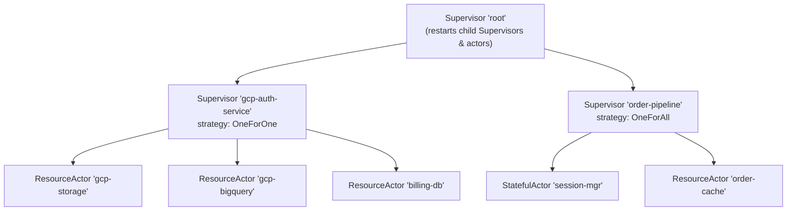
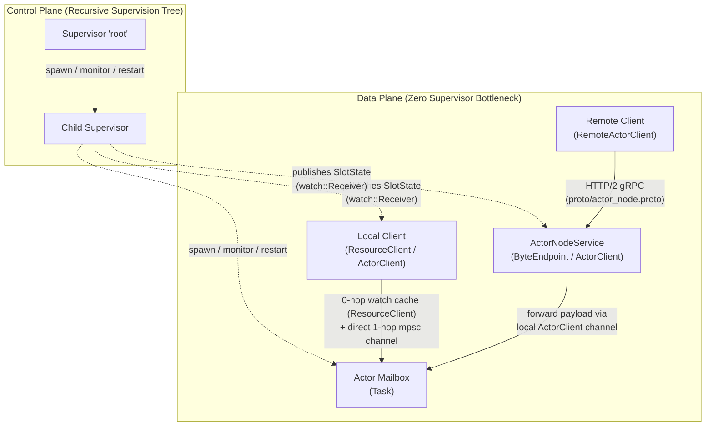
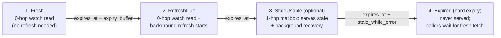
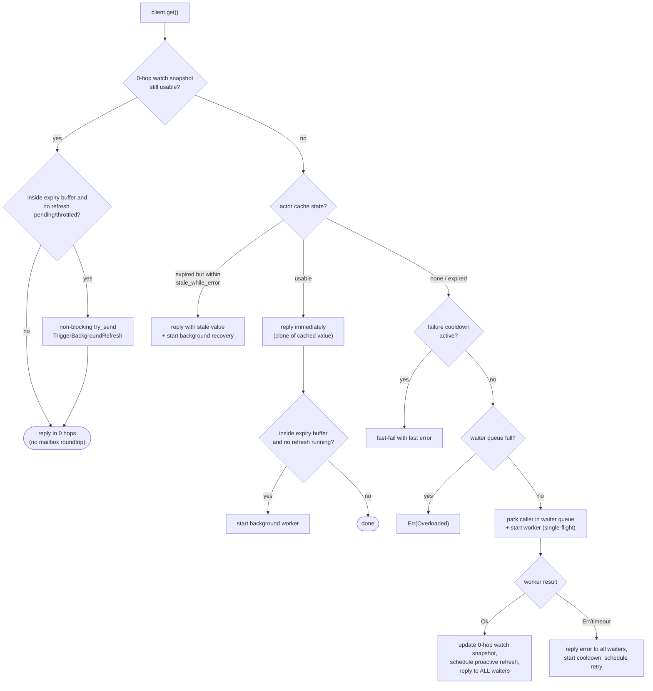
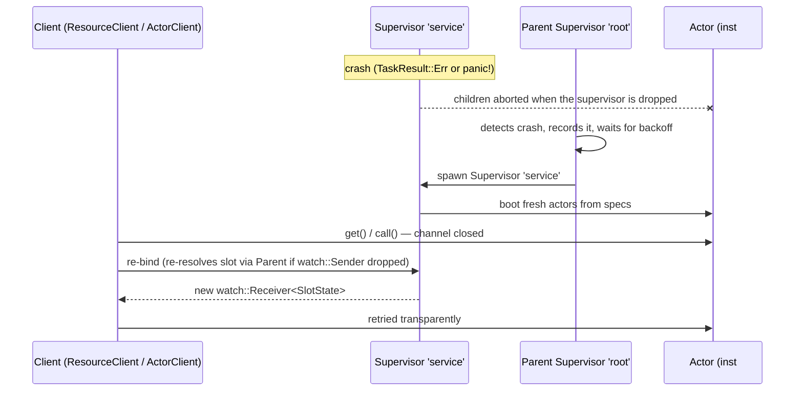

# otp-actor — Fault-Tolerant OTP Actors, 0-ms Self-Healing & gRPC Remoting for Tokio

> **Current Version:** `0.4` — hardened through full concurrency, performance, and API reviews; see [CHANGELOG.md](CHANGELOG.md) for what's new and upgrade notes.
>
> **Note:** This crate is based on code developed in a large production system since 2024 and is now being extracted step by step into a standalone crate.

**Stop writing brittle reconnect loops, guarding unbounded mailboxes against OOM, or wrapping actors in proc-macro boilerplate.**
`otp-actor` brings Erlang/OTP supervision semantics to [Tokio](https://tokio.rs) with two purpose-built actor primitives and strictly decoupled control and data planes:

- **Two Complementary Actor Models under One `Supervisor` Tree**: Build general-purpose state machines, sessions, and pipelines with [`StatefulActor`](src/actor/stateful_actor.rs) (`gen_server` style), or manage expiring tokens, credentials, and config snapshots with [`ResourceActor`](src/actor/generic_actor.rs) (0-hop `watch` cache + background refresh).
- **0-ms Reactive Client Rebinding (`watch<SlotState>`)**: When an actor crashes or panics, [`ActorClient`](src/actor/stateful_actor.rs) and [`ResourceClient`](src/actor/generic_actor.rs) never poll or sleep—they await the supervisor's `SlotState` watch channel and rebind immediately as soon as the replacement spawns.
- **0-Hop Lock-Free Cache Reads (`ResourceActor`)**: Fresh expiring resources (OAuth2 tokens, DB credentials, config snapshots, signed URLs) are read directly from a `tokio::sync::watch` snapshot on the caller task without crossing the actor mailbox or allocating a `oneshot`.
- **Zero-Cost Pure Traits (Native `impl Future`)**: [`StatefulActor`](src/actor/stateful_actor.rs) and [`Worker`](src/actor/generic_actor.rs) use native RPITIT `impl Future` (Rust `edition = "2024"`)—zero `#[async_trait]`, zero `Box::pin` per message, and zero heavy derive macros.
- **Bounded Mailboxes & Explicit Backpressure**: Bounded `mpsc` channels (`try_cast()` → `ActorError::MailboxFull`) and bounded single-flight waiter queues (`ResourceError::Overloaded`) prevent runaway memory growth under load.
- **N-Level OTP Supervision Trees**: Unified recursive [`Supervisor`](src/actor/supervisor.rs) supporting `OneForOne`, `OneForAll`, and `RestForOne` at every depth, sliding-window `RestartPolicy` budgets with exponential backoff, `RestartType`, `ShutdownPolicy`, and parent escalation (`escalate_on_failure`).
- **Point-to-Point gRPC Remoting (`--features remote`)**: Location-transparent HTTP/2 gRPC ([`RemoteActorClient`](src/remote/client.rs), [`AnyActorClient`](src/remote/client.rs)) with a universal Protobuf envelope ([`proto/actor_node.proto`](proto/actor_node.proto)), bounded 4 MiB `postcard` serialization, a separate `ActorNodeAdmin` control-plane service ([`RemoteNodeMonitor`](src/remote/monitor.rs), [`AnyNodeMonitor`](src/remote/monitor.rs)), and 2-phase `GOAWAY` shutdown—without running a Raft or Gossip cluster.
- **Zero-JSON Operational Telemetry & Prometheus Exposition**: Lock-free per-actor throughput/error/EMA-latency counters ([`ActorMetrics`](src/actor/telemetry.rs)), fast zero-hop health checks & bounded `NodeStatus` snapshots ([`LocalNodeMonitor`](src/actor/telemetry.rs)), and pure OpenMetrics/Prometheus text rendering (`format_prometheus_metrics`) with no HTTP or JSON dependencies.

---

## The Two Actor Types: `StatefulActor` vs. `ResourceActor`

`otp-actor` intentionally provides **two distinct actor abstractions** that share the exact same recursive `Supervisor` tree (`OneForOne`, `OneForAll`, `RestForOne`), `RestartPolicy`, `RestartType`, `ShutdownPolicy`, and `SlotState` self-healing:

| Aspect | [`StatefulActor`](src/actor/stateful_actor.rs) | [`ResourceActor`](src/actor/generic_actor.rs) |
| --- | --- | --- |
| **Designed for** | General-purpose stateful services (`gen_server` style): state machines, user sessions, order pipelines, coordinators, background stream consumers. | Expiring or refreshable shared values: OAuth2 tokens, DB credentials, signed URLs, TLS certs, dynamic config snapshots. |
| **What you implement** | `StatefulActor` trait (`handle`, optional `handle_cast`, `on_start`, `on_stop`). | `Worker<T, E>` trait on a struct, standalone `async fn`, or closure returning `TimedResource<T>`. |
| **Client & API** | [`ActorClient<A>`](src/actor/stateful_actor.rs): `call()`, `ask()` (`CallMessage`), `cast()`, `try_cast()`, `call_retry()`, `queue_stats()`. | [`ResourceClient<T, E>`](src/actor/generic_actor.rs): `get()`, `get_timeout()`, `force_refresh()`, `cache_state()`, `queue_stats()`. |
| **Data plane / Hot path** | Direct **1-hop** bounded `mpsc` mailbox per actor instance. | **0-hop** lock-free `tokio::sync::watch` snapshot on cache hits; 1-hop single-flight fallback on cold start / expiry. |
| **Lifecycle & timers** | `ActorContext<Self>`: `send_after()`, `send_interval()`, `send_interval_with()`, `spawn_scoped()` (`ActorScope`), `forward_receiver()`, `stop()`, `fail()`. | Built-in TTL cache, `eager_prewarm`, proactive background refresh with jitter, `failure_cooldown`, `stale_while_error`, generation guard. |
| **State on restart** | Fresh instance created from factory (`Default` / closure) + `on_start()` hook for optional external rehydration. | Cache starts empty (or immediately re-warms if `eager_prewarm(true)`) with incremented `instance_id`. |
| **gRPC Remoting (`--features remote`)** | **Direct out-of-the-box support** via `ActorNodeRegistry::register_client`, `RemoteActorClient<A>`, and `AnyActorClient<A>`. | Supported via a custom `ByteEndpoint` / thin `StatefulActor` façade on the node, or a local `ResourceActor` whose `Worker` fetches over `RemoteActorClient` (preserving 0-hop client caching). |

> **Rule of thumb:** Choose **`StatefulActor`** when callers send commands/queries that mutate or inspect custom domain state. Choose **`ResourceActor`** when callers simply read a cached, TTL-bound value that should stay fresh automatically without touching a mailbox on every read.

---

## Why `otp-actor`?

| Feature | `otp-actor` | `ractor` | Raw Tokio (`spawn` + `mpsc`) |
| --- | --- | --- | --- |
| **Supervision Trees** | Built-in recursive `Supervisor` (`OneForOne`, `OneForAll`, `RestForOne`, budgets & backoff) | Basic links in core; full trees via `ractor_supervisor` | Manual (`JoinSet` + custom loops) |
| **Client Rebinding on Crash** | Automatic **0-ms** reactive rebind via `watch<SlotState>` | Manual re-lookup / handle `ActorRef` exit | Manual channel replacement |
| **Cached Reads** | **0-hop** `watch` snapshot (`ResourceClient::get`) | Custom implementation | Custom `watch` / `RwLock` |
| **Mailbox & Backpressure** | Bounded `mpsc` (`try_cast` → `MailboxFull`) & bounded waiters | Unbounded by default (bounded options in factories) | Explicit (`mpsc::channel`) |
| **Async Trait Overhead** | Pure traits with native `impl Future` (zero `Box::pin`) | `#[async_trait]` (boxed trait futures) | None (manual loops) |
| **Remoting / Distribution** | Optional point-to-point gRPC (`--features remote`, no cluster daemon) | Full cluster layer (`ractor_cluster`) | Custom `tonic` / TCP |

---

## Highlights

| Area | Feature |
| --- | --- |
| **Stateful actors (`StatefulActor`)** | `gen_server`-style `StatefulActor` trait (`handle` / `handle_cast`, `CallMessage<A>` / `ask`, `on_start` / `on_stop` hooks) with `ActorContext<Self>` (`client()`, `supervisor()`, `send_after()`, `send_interval()` / `send_interval_with()`, `spawn_scoped()` / `ActorScope`, `forward_receiver()`) and self-healing `ActorClient<A>` |
| **Resource actors (`ResourceActor`)** | Specialized TTL-caching actor with `Worker<T, E>` (struct, `async fn`, or closure), `TimedResource<T>`, 0-hop lock-free `watch` cache reads via `ResourceClient::get()`, non-intrusive `cache_state()`, single-flight coalescing, eager pre-warming, proactive refresh with jitter, failure cooldown, stale-while-error, and generation guards |
| **Supervision** | Unified recursive tree: `Supervisor` → child `Supervisor`s / `StatefulActor`s / `ResourceActor`s to arbitrary depth $N$ |
| **Strategies** | `OneForOne`, `OneForAll`, `RestForOne` (Erlang/OTP semantics) at every tree level |
| **Restart types** | `RestartType::Transient`, `RestartType::Permanent`, `RestartType::Temporary` |
| **Graceful shutdown** | `ShutdownPolicy::Timeout(d)`, `BrutalKill`, `Infinity` with mailbox draining & in-flight completion (`supervisor.shutdown()`, `stop_child()`, `delete_child()`) |
| **Runtime introspection & telemetry** | Bounded supervisor snapshots (`snapshot()`, `snapshot_timeout()`, `snapshot_tree()`, `snapshot_tree_timeout()`) with `uptime`, `instance_uptime`, `restarts_total`, `consecutive_failures`, `queue_stats`, `actor_metrics`, and `cache_state`; read-only `watch_child_status()` (`ChildStatusWatcher`); lock-free `ActorMetrics`, `LocalNodeMonitor` (`health()`, `health_checked()`, `status()`), and pure Prometheus text exposition (`format_prometheus_metrics()`, zero HTTP/JSON dependencies) |
| **Escalation & recovery** | OTP-grade crash escalation (`escalate_on_failure`), manual recovery API (`restart_child`) |
| **Crash-loop protection** | `#[non_exhaustive]` `RestartPolicy` builder, `RestartTracker` with capped exponential backoff, permanent-failure `SlotState::Failed` with fast-fail errors |
| **Zero-polling self-healing** | Per-child `watch::Receiver<SlotState>` channels let `ActorClient`, `ResourceClient`, and child `SupervisorHandle`s rebind in 0 ms without polling loops or sleep backoff |
| **Backpressure & timeouts** | Bounded mailbox + `try_cast()` (`ActorError::MailboxFull`), `cast_timeout()`, bounded waiter queue (`ResourceError::Overloaded`), plus `worker_timeout`, `handler_timeout`, `get_timeout`, `call_timeout`, `call_retry_timeout` |
| **Fault & panic isolation** | Controlled error exits (`TaskResult::Err`, `max_consecutive_failures`, `ctx.fail()`) and panics are caught, escalated, and recovered by the supervisor |
| **Remote actors (gRPC)** | HTTP/2 actor distribution (`--features remote`), universal Protobuf wire envelope ([`proto/actor_node.proto`](proto/actor_node.proto) with `ActorNode` `Call`/`Cast` and separate non-breaking `ActorNodeAdmin` `Health`/`Status`), location transparency (`RemoteActorClient`, `AnyActorClient`, `RemoteNodeMonitor`, `AnyNodeMonitor`), 4 MiB allocation-bomb defense, coordinated 2-phase shutdown |
| **Observability & chaos testing** | Structured `tracing` spans (`#[tracing::instrument]`) across the actor hierarchy, plus feature-gated `simulate_crash()` / `trigger_child_crash()` (`chaos_test`, auto-enabled in `[dev-dependencies]`) |

---

## Table of Contents

- [The Two Actor Types: `StatefulActor` vs. `ResourceActor`](#the-two-actor-types-statefulactor-vs-resourceactor)
- [Why `otp-actor`?](#why-otp-actor)
- [Highlights](#highlights)
- [Getting Started](#getting-started)
  - [Requirements](#requirements)
  - [Installation](#installation)
  - [Build & test](#build--test)
- [Quick Start](#quick-start)
  - [1. `StatefulActor` — State Machine & 0-ms Panic Recovery](#1-statefulactor--state-machine--0-ms-panic-recovery)
  - [2. `ResourceActor` — Zero-Hop Expiring Resource Cache](#2-resourceactor--zero-hop-expiring-resource-cache)
- [Architecture](#architecture)
  - [Control plane vs. data plane](#control-plane-vs-data-plane)
- [Stateful Actors (`StatefulActor`)](#stateful-actors-statefulactor)
  - [Implementing `StatefulActor`](#implementing-statefulactor)
  - [Configuring & spawning via `ActorClient`](#configuring--spawning-via-actorclient)
  - [Timers, streams & scoped background tasks](#timers-streams--scoped-background-tasks)
  - [State lifecycle on restart & persistence patterns](#state-lifecycle-on-restart--persistence-patterns)
- [Resource Actors (`ResourceActor`)](#resource-actors-resourceactor)
  - [Workers (`Worker<T, E>`)](#workers-workert-e)
  - [`WorkerContext`](#workercontext)
  - [`TimedResource` and expiry](#timedresource-and-expiry)
  - [Resource lifecycle inside an actor](#resource-lifecycle-inside-an-actor)
  - [Configuring a `ResourceActor`](#configuring-a-resourceactor)
  - [Caching & resilience features in detail](#caching--resilience-features-in-detail)
- [Supervision](#supervision)
  - [Supervision strategies](#supervision-strategies)
  - [Restart policy and backoff](#restart-policy-and-backoff)
  - [Child restart types (`RestartType`) and graceful shutdown (`ShutdownPolicy`)](#child-restart-types-restarttype-and-graceful-shutdown-shutdownpolicy)
  - [Declarative child specs (OTP style)](#declarative-child-specs-otp-style)
  - [Dynamic children](#dynamic-children)
  - [Fault escalation & panic isolation](#fault-escalation--panic-isolation)
  - [What happens when a supervisor crashes?](#what-happens-when-a-supervisor-crashes)
  - [Runtime introspection, telemetry & Prometheus exposition](#runtime-introspection-telemetry--prometheus-exposition)
- [Remote Actors over gRPC](#remote-actors-over-grpc)
  - [Supported actor types over gRPC](#supported-actor-types-over-grpc)
  - [Architectural overview](#architectural-overview)
  - [Wire contract & RPCs](#wire-contract--rpcs)
  - [Code example: building a remote server node](#code-example-building-a-remote-server-node)
  - [Code example: calling from a remote client](#code-example-calling-from-a-remote-client)
  - [Client-initiated stopping and lifecycle semantics](#client-initiated-stopping-and-lifecycle-semantics)
- [Client API Reference](#client-api-reference)
- [Error Handling](#error-handling)
- [Examples](#examples)
- [Testing & Code Quality](#testing--code-quality)
- [Project Layout](#project-layout)
- [Release Profile](#release-profile)
- [Design Trade-offs & Production Notes](#design-trade-offs--production-notes)
  - [Securing remote gRPC nodes (TLS/mTLS, Bearer tokens & Tower layers)](#securing-remote-grpc-nodes-tlsmtls-bearer-tokens--tower-layers)
- [License](#license)

---

## Getting Started

### Requirements

- **Rust 1.88 or newer** (`edition = "2024"`).
- No system dependencies for standard in-memory usage. Core runtime dependencies are minimal:
  - [`tokio`](https://crates.io/crates/tokio) 1 (`rt`, `sync`, `time`, `macros`)
  - [`thiserror`](https://crates.io/crates/thiserror) 2
  - [`tracing`](https://crates.io/crates/tracing) 0.1
- **Optional gRPC Remote Actors (`--features remote`):**
  - Requires `libprotoc` (or `protox`) at build time; enables `tonic`, `tonic-prost`, `prost`, `serde`, `postcard`, `tokio-stream`, `tower-layer`, and `tokio/net`.

### Installation

Add `otp-actor` to your `Cargo.toml` (all public APIs are re-exported from the crate root as well as `otp_actor::actor`):

```toml
[dependencies]
otp-actor = "0.4"
# Optional features:
# otp-actor = { version = "0.4", features = ["remote"] }
# otp-actor = { version = "0.4", features = ["chaos_test"] }
tokio = { version = "1", features = ["rt-multi-thread", "macros"] }
```

*(Tokio's `full` feature is **not** required; for single-threaded runtimes `features = ["rt", "macros"]` is sufficient.)*

### Build & test

```bash
# Build the core library (zero gRPC overhead)
cargo build

# Run the core test suite (integration + unit + doc-tests)
cargo test

# Run all 143 core & remote tests (integration + remote gRPC + unit + doc-tests)
cargo test --all-features

# Optimized release build
cargo build --release

# Optimized build tuned for the local CPU (AVX2, AES-NI, ...)
RUSTFLAGS="-C target-cpu=native" cargo build --release
```

---

## Quick Start

### 1. `StatefulActor` — State Machine & 0-ms Panic Recovery

Use `StatefulActor` for stateful entities, sessions, and command/query handlers ([`examples/quickstart.rs`](examples/quickstart.rs) — run with `cargo run --example quickstart`):

```rust
use otp_actor::{ActorContext, ActorError, StatefulActor, StatefulActorBuilder, Supervisor};

#[derive(Default)]
struct Counter(i64);

enum Msg { Add(i64), Get, PanicNow }

impl StatefulActor for Counter {
    type Message = Msg;
    type Response = i64;
    type Error = String;

    async fn handle(&mut self, msg: Msg, ctx: &mut ActorContext<Self>) -> Result<i64, String> {
        match msg {
            Msg::Add(n) => { self.0 += n; Ok(self.0) }
            Msg::Get => Ok(self.0),
            // panics in actor: to test supervisor
            Msg::PanicNow => panic!("boom inside instance #{}!", ctx.instance_id()),
        }
    }
}

#[tokio::main]
async fn main() -> Result<(), Box<dyn std::error::Error>> {
    let root = Supervisor::new_root();
    let client = StatefulActorBuilder::from_default::<Counter>("counter")
        .spawn(&root)
        .await?;

    assert_eq!(client.call(Msg::Add(42)).await?, 42);

    // Real panic inside the actor task — isolated by the Supervisor.
    let crash = client.call(Msg::PanicNow).await;
    assert!(matches!(crash, Err(ActorError::ActorUnavailable)));

    // Same `ActorClient` immediately rebinds via `watch<SlotState>` (zero polling/sleeps)
    // and delivers the non-Clone `Msg::Get` to the fresh replacement instance:
    assert_eq!(client.call(Msg::Get).await?, 0);

    root.shutdown().await?;
    Ok(())
}
```

### 2. `ResourceActor` — Zero-Hop Expiring Resource Cache

Use `ResourceActor` for expiring tokens, credentials, or config snapshots that should refresh automatically in the background and serve reads in **0 hops** directly from a `watch` snapshot:

```rust
use std::time::Duration;
use otp_actor::{ResourceActor, Supervisor, TimedResource, WorkerContext};

#[tokio::main]
async fn main() -> Result<(), Box<dyn std::error::Error>> {
    // 1. Start the root of the supervision tree and a domain child supervisor.
    let root = Supervisor::new_root();
    let service = Supervisor::spawn_child("auth-service", &root).await?;

    // 2. Any async closure `Fn(WorkerContext) -> Future<Output = Result<TimedResource<T>, E>>`
    //    implements `Worker<T, E>` (T and E are inferred).
    let token_worker = |ctx: WorkerContext| async move {
        Ok::<_, String>(TimedResource::with_ttl(
            format!("token-gen-{}", ctx.generation),
            Duration::from_secs(60),
        ))
    };

    // 3. Build, spawn, supervise, and obtain a direct ResourceClient in one go.
    let client = ResourceActor::builder("api-token")
        .worker(token_worker)
        .eager_prewarm(true)                     // fetch immediately on start
        .expiry_buffer(Duration::from_secs(5))   // refresh 5 s before expiry
        .worker_timeout(Duration::from_secs(10)) // abort slow workers
        .spawn(&service)
        .await?;

    // 4. Fresh cache hits are served in 0 hops without touching the actor mailbox.
    let token = client.get().await?;
    println!("token = {token}");

    root.shutdown().await?;
    Ok(())
}
```

---

## Architecture

Both `StatefulActor`s and `ResourceActor`s live side-by-side inside the same recursive `Supervisor` tree:



### Control plane vs. data plane



- **Data plane** —
  - **In-process (`ResourceClient`):** `ResourceClient::get()` reads a local **0-hop `tokio::sync::watch` cache snapshot** first (covering both `Fresh` and `RefreshDue` entries, while triggering at most one non-blocking background refresh); only on cold starts, hard expiry, or stale-while-error recovery without a usable fresh snapshot does it send to the actor's mailbox over a direct 1-hop `mpsc` channel.
  - **In-process (`ActorClient`):** `ActorClient::call()` / `ask()` / `cast()` / `try_cast()` communicate directly with the actor's bounded `mpsc` mailbox.
  - **Remote (`--features remote`):** `RemoteActorClient` sends requests over multiplexed HTTP/2 gRPC to `ActorNodeService`, where `ActorClient<A>` (implementing `ByteEndpoint`) decodes the `postcard` payload and forwards it directly into the local actor's mailbox.
  - In every case, **no supervisor is ever in the message request path**.
- **Control plane** — `Supervisor`s spawn child futures directly into a single-task `JoinSet<TaskResult>`, detect exits/panics via `join_next_with_id()`, execute restart strategies (`OneForOne`, `OneForAll`, `RestForOne`) at *any* depth, and maintain an internal reactive `watch::Sender<SlotState>` per child slot. When a direct `mpsc` channel closes after a crash, clients (and child `SupervisorHandle`s) reactively await the replacement over their `watch` channel—rebinding in 0 ms with **zero polling** (and re-resolving via the managing `SupervisorHandle` only if the parent supervisor itself was restarted).

---

## Stateful Actors (`StatefulActor`)

[`StatefulActor`](src/actor/stateful_actor.rs) models Erlang/OTP's `gen_server`: each actor owns private mutable state `&mut self`, processes messages sequentially from a bounded mailbox, and communicates exclusively via message passing—running alongside `ResourceActor`s under the same `Supervisor`s.

### Implementing `StatefulActor`

Like `Worker`, `StatefulActor` uses native `impl Future` return types (zero `#[async_trait]` / `Box::pin` heap allocations):

```rust
use std::time::Duration;
use otp_actor::{ActorContext, CallMessage, RestartType, StatefulActor, StatefulActorBuilder};

// 1. Private actor state: owned exclusively by the actor task (no `Mutex` needed).
#[derive(Clone, Default)]
struct CounterActor {
    total: i64,
}

// 2. Message protocol accepted by the actor's bounded mailbox.
#[derive(Clone, Debug)]
enum CounterMsg {
    Add(i64),
    Get,
}

impl StatefulActor for CounterActor {
    type Message = CounterMsg;
    type Response = i64;   // Unified reply type returned by `client.call(...)`
    type Error = String;   // Domain error returned to callers (does NOT crash the actor)

    // Required request-response handler (`client.call` / `client.ask`).
    // Messages are processed sequentially on `&mut self`, so state mutations are race-free.
    async fn handle(
        &mut self,
        msg: Self::Message,
        _ctx: &mut ActorContext<Self>,
    ) -> Result<Self::Response, Self::Error> {
        match msg {
            CounterMsg::Add(delta) => {
                self.total += delta;
                Ok(self.total)
            }
            CounterMsg::Get => Ok(self.total),
        }
    }

    // Optional fire-and-forget handler (`client.cast` / `client.try_cast`).
    // Defaults to calling `handle` and discarding the reply; override it when casts
    // need a leaner path or different error handling.
    async fn handle_cast(
        &mut self,
        msg: Self::Message,
        ctx: &mut ActorContext<Self>,
    ) -> Result<(), Self::Error> {
        let _ = self.handle(msg, ctx).await?;
        Ok(())
    }

    // Optional startup hook: runs on initial boot and after every supervisor restart
    // before any mailbox message is processed. Returning `Err` aborts startup and
    // triggers supervision recovery.
    async fn on_start(&mut self, _ctx: &mut ActorContext<Self>) -> Result<(), String> {
        Ok(())
    }

    // Optional graceful-shutdown hook: runs once during an orderly stop (`ctx.stop()`,
    // `stop_child`, or supervisor shutdown) *after* buffered mailbox messages have been
    // drained—ideal for flushing state, closing connections, or releasing resources
    // (not invoked on `ShutdownPolicy::BrutalKill` or panics).
    async fn on_stop(&mut self, _ctx: &mut ActorContext<Self>) {}
}

// 3. Optional typed request wrapper via `CallMessage<A>`:
// Especially helpful when `Response` is an enum with many variants—callers receive
// `Self::Reply` directly instead of manually unpacking the response enum every time.
struct GetCount;
impl From<GetCount> for CounterMsg {
    fn from(_: GetCount) -> Self {
        CounterMsg::Get
    }
}
impl CallMessage<CounterActor> for GetCount {
    type Reply = i64;
    fn extract_reply(resp: i64) -> Result<Self::Reply, String> {
        Ok(resp)
    }
}
```

With `CallMessage<CounterActor>` implemented, callers can pass `GetCount` directly to `ask` or `ask_timeout` and receive the unpacked `i64` reply (works identically on `ActorClient`, `RemoteActorClient`, and `AnyActorClient`):

```rust
let total: i64 = client.ask(GetCount).await?;
let total: i64 = client.ask_timeout(GetCount, Duration::from_secs(2)).await?;
```

Inside `handle`, `handle_cast`, `on_start`, and `on_stop`, `ctx: &mut ActorContext<Self>` provides:
- `ctx.name()` — the registered actor name.
- `ctx.instance_id()` — the current supervisor incarnation (starts at `1`, increments on every restart).
- `ctx.client()` — returns a self-healing `ActorClient<Self>` handle to this actor (pre-subscribed to `SlotState` so `try_cast()` also rebinds synchronously after restarts).
- `ctx.supervisor()` — returns a `&SupervisorHandle` to the parent supervisor (for dynamic sibling/child spawning).
- `ctx.send_after(delay, msg)` — schedules a delayed fire-and-forget `cast` to `self`, returning a `tokio::task::AbortHandle`.
- `ctx.send_interval(period, msg)` / `ctx.send_interval_with(period, make_msg)` — schedules a lifecycle-bound periodic timer (`MissedTickBehavior::Skip`; non-`Clone` compatible via closure), returning an `AbortHandle`.
- `ctx.spawn_scoped(|scope| ...)` — spawns an instance-bound background task receiving an [`ActorScope<Self>`](src/actor/stateful_actor.rs) (`cancelled()`, `cast()`, `try_cast()`, `instance_id()`) that cancels automatically when this instance exits or panics.
- `ctx.forward_receiver(rx, map_msg)` — forwards items from an external `tokio::sync::mpsc::Receiver` into `self` as `cast` messages without idle permit starvation.
- `ctx.stop()` — instructs the actor to drain its mailbox, invoke `on_stop`, and exit cleanly with `Ok(())`.
- `ctx.fail("reason")` — escalates a fatal failure to the `Supervisor`, triggering supervision recovery (`OneForOne`, `OneForAll`, `RestForOne`).

### Configuring & spawning via `ActorClient`

Construct a builder with `StatefulActorBuilder::from_default`, `StatefulActorBuilder::from_instance`, `StatefulActorBuilder::new(name, |instance_id| ...)`, or `StatefulActorBuilder::from_config(name, config, factory)` (backed by [`StatefulActorConfig`](src/actor/stateful_actor.rs)).

Because every actor is managed by a supervision tree, `.spawn(&supervisor)` requires a running `SupervisorHandle` created beforehand (for example via `Supervisor::new_root()`, `Supervisor::new("...")`, or a child supervisor via `Supervisor::spawn_child(...)`):

```rust
use otp_actor::Supervisor;

// Every actor must be spawned under a supervisor—create one first
// (or reuse an existing root / child `SupervisorHandle`):
let supervisor = Supervisor::new_root();

// Register and boot the actor, returning a cloneable, self-healing `ActorClient<CounterActor>`:
let client = StatefulActorBuilder::from_default::<CounterActor>("session-counter")
    .restart_type(RestartType::Permanent)          // always restart on exit or crash
    .shutdown_timeout(Duration::from_secs(2))      // wait up to 2 s for drain + `on_stop()`
    .spawn(&supervisor)
    .await?;

// Fire-and-forget notifications (`gen_server:cast`):
client.cast(CounterMsg::Add(10)).await?;           // awaits mailbox capacity if full
client.try_cast(CounterMsg::Add(1))?;              // non-blocking: Err(ActorError::MailboxFull) when saturated

// Request-response (`gen_server:call`) & typed `CallMessage` unpacking (`ask`):
let current = client.call(CounterMsg::Add(5)).await?; // waits for `handle()` reply
let total: i64 = client.ask(GetCount).await?;         // uses `CallMessage<CounterActor>` from example above
assert_eq!((current, total), (16, 16));

// Orderly shutdown drains buffered messages and invokes `on_stop()`:
supervisor.shutdown().await?;
```

`StatefulActorBuilder` options:

| Option | Default | Description |
| --- | --- | --- |
| `.channel_capacity(n)` | `256` | Mailbox size of the actor (clamped to `>= 1`). |
| `.restart_policy(p)` | `RestartPolicy::default()` | Crash-loop protection and exponential backoff for this actor. |
| `.restart_type(t)` | `RestartType::Transient` | OTP restart rule (`Permanent`, `Transient`, or `Temporary`). |
| `.shutdown_policy(p)` | `ShutdownPolicy::Timeout(5 s)` | How the supervisor terminates the actor on stop/shutdown (`Timeout(Duration)`, `BrutalKill`, or `Infinity`). |
| `.shutdown_timeout(d)` | — | Shorthand for `.shutdown_policy(ShutdownPolicy::Timeout(d))`. |
| `.handler_timeout(d)` | `None` (disabled) | Aborts a `handle()` or `handle_cast()` execution that exceeds `d`, immediately returns `Err(ActorError::Timeout(d))` to `call` callers, and escalates to the supervisor (`ctx.fail(...)`) so a fresh instance is booted via `on_start` without leaving partially mutated `&mut self` state. |
| `.with_config(cfg)` | — | Applies a [`StatefulActorConfig`](src/actor/stateful_actor.rs) (`channel_capacity` clamped to `>= 1`). |

Finish the builder with `.spawn(&supervisor)`, `.build_child_spec()`, or `.into()` / `ChildSpec::from(builder)`.

### Timers, streams & scoped background tasks

If you start a background loop in `on_start()` with a plain `tokio::spawn` and a self-healing `ActorClient`, that loop **keeps running even after the actor crashes and restarts**: the old task rebinds to the fresh actor instance while the new `on_start()` spawns a second loop—causing task leaks and duplicate messages.

Instead, bind timers, channel forwarders, and custom loops directly to the **current actor instance** via `ActorContext`. Every message they emit arrives as a normal fire-and-forget `cast` in `handle_cast()` / `handle()`, and every task is **automatically cancelled** when that actor instance stops, fails, or panics:

```rust
// Example actor message enum (`type Message = Msg;`):
#[derive(Clone)]
enum Msg {
    Heartbeat,
    Tick(Instant),
    InboundEvent(String), // payload type `T` from `external_rx: mpsc::Receiver<T>` (any domain type works)
    Item(String),         // item type yielded by an external async stream
}

async fn on_start(&mut self, ctx: &mut ActorContext<Self>) -> Result<(), String> {
    // 1. Fixed periodic message (requires `Msg: Clone`):
    //    Sends `Msg::Heartbeat` every 5 s (first tick after 5 s) to this actor's own mailbox
    //    If the actor is busy, missed ticks are skipped (`MissedTickBehavior::Skip`)
    //    instead of piling up. Stops automatically when this instance exits or crashes.
    ctx.send_interval(Duration::from_secs(5), Msg::Heartbeat);

    // 2. Dynamic / non-Clone periodic message:
    //    Calls the closure on every tick to build a fresh message (here: the current
    //    timestamp instead of a stale timestamp cloned from startup). The closure only
    //    runs *after* a mailbox slot is reserved, avoiding wasted work under backpressure.
    //    (Both methods return an `AbortHandle` if you also want to cancel a timer early.)
    ctx.send_interval_with(Duration::from_secs(1), || Msg::Tick(Instant::now()));

    Ok(())
}

// Both timer messages arrive sequentially in this actor's own `handle_cast` (or `handle`):
async fn handle_cast(&mut self, msg: Msg, _ctx: &mut ActorContext<Self>) -> Result<(), String> {
    match msg {
        Msg::Heartbeat => self.emit_heartbeat(),
        Msg::Tick(now) => self.evict_expired_sessions(now),
        _ => {}
    }
    Ok(())
}
```

An actor should never block its own `handle()` loop waiting on external I/O or streams. To feed external events into an actor without blocking its mailbox, call either `ctx.forward_receiver` or `ctx.spawn_scoped` (typically inside `on_start()`):

- **`ctx.forward_receiver(rx, map_msg)`** is the one-liner when you already have a `tokio::sync::mpsc::Receiver<T>`: it does **not** replace the actor's own mailbox—instead, it spawns a lightweight bridge task that reads from `rx`, converts each item with `map_msg`, and forwards it *additionally* as a `cast` into this actor's mailbox (`handle_cast` / `handle`), alongside regular `ActorClient` `call`/`cast` messages (you can even attach multiple forwarders at once).
- **`ctx.spawn_scoped(|mut scope| async move { ... })`** is the general-purpose version for arbitrary async sources (WebSocket readers, Kafka consumers, TCP streams, Redis Pub/Sub, etc.). The `scope: ActorScope<Self>` handle lets you watch for shutdown via `scope.cancelled()` and push messages to `self` via `scope.cast(...)` / `scope.try_cast(...)`.

```rust
// 1. Bridge an existing `tokio::sync::mpsc::Receiver<String>` (or any domain type `T`) into this actor:
//    - `Msg::InboundEvent` is shorthand for `|ev| Msg::InboundEvent(ev)`; each item arrives in `handle_cast` / `handle`.
//    - Awaits `external_rx.recv()` *before* reserving a mailbox slot (no idle permit starvation),
//      and applies natural backpressure when this actor's mailbox is full.
//    - Exits automatically when `external_rx` closes or when this actor instance stops/crashes.
ctx.forward_receiver(external_rx, Msg::InboundEvent);

// 2. Run a custom async background loop bound to this exact actor instance:
//    `ActorScope<Self>` is pinned to the current `instance_id`—unlike `ActorClient`, it never
//    rebinds to a replacement after a crash, so stale stream items cannot leak across restarts.
ctx.spawn_scoped(|mut scope| async move {
    loop {
        tokio::select! {
            // `biased;` always checks cancellation first so shutdown/crash exits immediately
            // even if `stream` has buffered items ready:
            biased;

            // Resolves as soon as this actor instance stops gracefully, fails, or panics:
            _ = scope.cancelled() => break,

            // Read the next item from an external async stream (e.g. WebSocket / TCP / Kafka):
            next_item = stream.next() => match next_item {
                Some(item) => {
                    // Deliver to this actor's own mailbox (`handle_cast` / `handle`).
                    // Returns `Err(ActorError::ActorUnavailable)` if this instance just exited:
                    if scope.cast(Msg::Item(item)).await.is_err() {
                        break;
                    }
                }
                // External stream ended cleanly -> stop the background task:
                None => break,
            }
        }
    }
    // Optional cleanup (e.g. close socket / flush consumer offset) runs here before task exit.
});
```

Key design guarantees:
- **Zero-duration guard:** `send_interval` and `send_interval_with` ignore `Duration::ZERO` (logging a warning and returning a completed `AbortHandle`) rather than panicking.
- **No idle permit starvation:** `send_interval_with` and `forward_receiver` wait for input *first* and only then reserve a bounded mailbox slot (`tx.reserve()`), so even `channel_capacity(1)` actors never deadlock waiting on an idle timer or stream.
- **No cross-instance leaks:** Unlike `ActorClient`, `ActorScope<A>` is pinned to a single `instance_id` and intentionally **never** rebinds after a crash—returning `Err(ActorError::ActorUnavailable)` once that instance exits.

For a complete, runnable blueprint combining `send_interval_with`, `forward_receiver`, and `spawn_scoped` (including verified `ActorScope` cancellation across crash recovery and shutdown), run [`examples/microservice_pipeline.rs`](examples/microservice_pipeline.rs) (`cargo run --example microservice_pipeline`).

### State lifecycle on restart & persistence patterns

#### Does a `StatefulActor` lose its in-memory state when restarted?
**Yes, by design.** When an actor crashes or terminates abnormally, its in-memory struct fields are discarded and the supervisor boots a **fresh, clean instance** from the configured factory (e.g. `Default::default()` or initial state clone).

This embodies the core Erlang/OTP philosophy:
- **Crash-loop prevention**: In-memory crashes usually occur because internal state entered an invalid or inconsistent invariant. Reviving the exact same corrupted in-memory state would immediately trigger another crash on the next message.
- **Known-good state**: Starting fresh gives the actor a clean slate while the client's direct channel rebinds transparently.

#### Preserving state across restarts (persistence)
When state must survive restarts, combine `StatefulActor` with external storage (database, SQLite, Redis, or disk):

1. **Rehydrate in `on_start`**: Runs before any mailbox messages are processed (both on initial boot and on every restart):
   ```rust
   async fn on_start(&mut self, ctx: &mut ActorContext<Self>) -> Result<(), String> {
       self.total = database::load_counter_state(ctx.name()).await?;
       Ok(())
   }
   ```
2. **Commit updates in `handle`**: Persist state updates or write-ahead logs before returning `Ok(response)`:
   ```rust
   async fn handle(
       &mut self,
       msg: Self::Message,
       ctx: &mut ActorContext<Self>,
   ) -> Result<Self::Response, Self::Error> {
       match msg {
           CounterMsg::Add(delta) => {
               database::persist_increment(ctx.name(), delta).await?;
               self.total += delta;
               Ok(self.total)
           }
           // ...
       }
   }
   ```
3. **Inject storage handles via `StatefulActorBuilder::new`**:
   ```rust
   let db_pool = pool.clone();
   let client = StatefulActorBuilder::new("session-counter", move |_instance_id| {
       CounterActor {
           db: db_pool.clone(),
           total: 0, // rehydrated in on_start
       }
   })
   .spawn(&supervisor)
   .await?;
   ```

---

## Resource Actors (`ResourceActor`)

[`ResourceActor`](src/actor/generic_actor.rs) is specialized for fetching, caching, and proactively refreshing expiring resources (OAuth2 tokens, database credentials, signed URLs, configuration snapshots). Once the cache is populated, normal steady-state reads (`Fresh` or still-usable `RefreshDue`) bypass the actor mailbox completely via a **0-hop `tokio::sync::watch` cache**—the actor mailbox is only contacted on cold starts, hard expiry, invalidation, or error recovery.

### Workers (`Worker<T, E>`)

A `Worker<T, E>` encapsulates the pure async fetch/refresh logic (such as requesting an OAuth token, rotating credentials, or loading a config snapshot), while `ResourceActor` handles everything around it—single-flight deduplication, caching, proactive background refreshes, timeouts, backoff, and panic isolation—by running the worker in an isolated background task whenever a fresh `TimedResource<T>` is needed:

```rust
pub trait Worker<T, E>: Send + Sync + 'static {
    fn execute(&self, ctx: WorkerContext)
        -> impl Future<Output = Result<TimedResource<T>, E>> + Send;
}
```

Because `execute` returns `impl Future`, no boxing is required.

There are three equally valid ways to supply a worker:

**1. A custom struct** (good for configuration and dependencies):

```rust
// Custom struct holding your own domain configuration or shared clients (e.g. an OAuth2 scope):
struct GcpTokenWorker {
    oauth_scope: String,
}

impl Worker<String, TokenError> for GcpTokenWorker {
    async fn execute(&self, ctx: WorkerContext) -> Result<TimedResource<String>, TokenError> {
        let token = fetch_token(&self.oauth_scope, ctx.generation).await?;
        Ok(TimedResource::with_ttl(token, Duration::from_secs(3600)))
    }
}

ResourceActor::builder("gcp-storage").worker(GcpTokenWorker {
    oauth_scope: "https://www.googleapis.com/auth/devstorage.read_only".into(),
});
```

**2. A standalone `async fn`:**

```rust
async fn bigquery_worker(ctx: WorkerContext) -> Result<TimedResource<String>, TokenError> { /* ... */ }

ResourceActor::builder("gcp-bigquery").worker(bigquery_worker);
```

**3. A closure** — it may capture state, such as shared handles, HTTP clients, or counters:

```rust
let counter = Arc::new(AtomicUsize::new(0));
let worker = move |ctx: WorkerContext| {
    let counter = counter.clone();
    async move {
        counter.fetch_add(1, Ordering::SeqCst);
        Ok::<_, String>(TimedResource::perpetual(format!("inst-{}", ctx.instance_id)))
    }
};
```

> **Type requirements.** `T` (payload) and `E` (error) must be `Clone + Send + Sync + 'static`. Values are cloned when handed out to callers.

### `WorkerContext`

Passed to every worker invocation:

| Field | Description |
| --- | --- |
| `instance_id` | Which incarnation of the actor is running. Starts at 1 and increases on every supervisor restart. |
| `generation` | Monotonically increasing number of the fetch attempt *within* one actor instance. Useful for logging and tests. |

### `TimedResource` and expiry

A value bundled with an optional expiry deadline (`Debug` formatting intentionally redacts `value` as `"<redacted>"` so cached tokens and secrets are never leaked into logs):

```rust
TimedResource::with_ttl(value, Duration::from_secs(300)); // expires 300 s from now
TimedResource::perpetual(value);                          // never expires
```

Over its lifetime, a cached resource moves through four expiry phases (matching `CacheState`):



For example, given a `300 s` TTL, `expiry_buffer = 30 s`, and `stale_while_error = 60 s`:
1. **`Fresh` (`0 s – 270 s`):** The value is valid and far from expiry. `client.get()` returns it immediately from the 0-hop `watch` cache without touching the actor mailbox.
2. **`RefreshDue` (`270 s – 300 s`):** The value is still valid and keeps being served in 0 hops, while the actor proactively starts a single background worker to fetch a replacement *before* `expires_at` is reached.
3. **`StaleUsable` (`300 s – 360 s`, only if `stale_while_error > 0`):** The value has expired (for example, because the upstream service was temporarily unavailable during the proactive refresh). Instead of failing callers immediately, the actor serves the slightly expired value as a grace fallback while triggering background recovery.
4. **`Expired` (`> 360 s`, hard expiry):** The grace window has elapsed (or `stale_while_error` is disabled). The old value is never served; callers wait in the single-flight queue for a fresh fetch (or fail fast while a failure cooldown is active).

| Method | Phase(s) | Meaning |
| --- | --- | --- |
| `is_fresh(buffer)` | `Fresh` | More than `min(buffer, ttl / 2)` left until expiry (or perpetual). |
| `is_still_usable()` | `Fresh`, `RefreshDue` | Not yet expired (`now < expires_at`); served directly from the 0-hop `watch` cache. |
| `is_usable_stale(allowance)` | `StaleUsable` | Expired, but still within the optional `stale_while_error` grace window. |

### Resource lifecycle inside an actor



Key properties:
- **0-hop cache reads.** Usable snapshots (both `Fresh` and `RefreshDue`) are served from a lock-free `tokio::sync::watch` channel, so steady-state `client.get()` calls avoid both mailbox queuing and `oneshot` allocation even while a background refresh or failure cooldown is active.
- **Single-flight.** At most one worker runs per actor at any time. Concurrent callers during a cold start are parked and all answered by the same result.
- **Cache hits never block.** A valid cached value is returned immediately; refreshes happen in the background.
- **Generation guard.** Every worker run gets a new `generation`. Results (or timeouts/panics) from superseded generations are ignored, so a slow, old fetch can never overwrite a newer value.

### Configuring a `ResourceActor`

`ResourceActor::builder(name)` (alias: `ResourceActor::spec(name)`) returns a `ResourceActorBuilder<T, E, W>` backed by a [`ResourceActorConfig`](src/actor/generic_actor.rs). Call `.worker(...)` to attach the worker; all options can be set **both before and after** `.worker(...)`, or applied via `.with_config(config)` / `ResourceActorBuilder::from_config(...)`.

| Option | Default | Description |
| --- | --- | --- |
| `.worker(w)` | — *(required)* | Attaches the `Worker` (struct, `async fn`, or closure). Infers `T` and `E`. |
| `.expiry_buffer(d)` | `2 s` (`EXPIRY_BUFFER`) | Safety margin: refresh begins this long before expiry. Clamped to at most half the remaining TTL, so short-lived values don't end up permanently "stale". |
| `.channel_capacity(n)` | `256` | Mailbox size of the actor (clamped to `>= 1`). |
| `.max_waiters(n)` | `1024` | Max parked callers during a cold start (clamped to `>= 1`). Beyond that → `ResourceError::Overloaded(n)`. |
| `.eager_prewarm(b)` | `false` | Fetch the resource immediately on (re)start instead of at the first `get()`. |
| `.restart_policy(p)` | `RestartPolicy::default()` | Crash-loop protection and backoff for this actor. |
| `.restart_type(t)` | `RestartType::Transient` | OTP restart rule (`Permanent`, `Transient`, or `Temporary`). |
| `.shutdown_policy(p)` | `ShutdownPolicy::Timeout(5 s)` | How the supervisor terminates the actor on stop/shutdown (`Timeout(Duration)`, `BrutalKill`, or `Infinity`). |
| `.shutdown_timeout(d)` | — | Shorthand for `.shutdown_policy(ShutdownPolicy::Timeout(d))`. |
| `.worker_timeout(d)` | `30 s` (`DEFAULT_WORKER_TIMEOUT`) | Abort a worker run that exceeds `d` → `ResourceError::Timeout(Duration)`. |
| `.no_worker_timeout()` | — | Disables the execution timeout, allowing workers to run indefinitely. |
| `.failure_cooldown(d)` | `1 s` (`DEFAULT_FAILURE_COOLDOWN`) | After a failed fetch, fast-fail new callers for `d` instead of hammering the backend (negative caching). |
| `.stale_while_error(d)` | `0` (disabled) | Keep serving an expired value for up to `d` while a refresh recovers. |
| `.proactive_refresh(b)` | `true` | Refresh in the background via a timer before expiry, even without client traffic. |
| `.proactive_jitter(d)` | `0` | Randomly start proactive refreshes up to `d` earlier (clamped to at most half the refresh lead time, with entropy-hashed jitter) to avoid thundering herds across many actors. |
| `.max_consecutive_failures(n)` | `None` (disabled) | After `n` consecutive worker failures or timeouts, exit with `TaskResult::Err` to trigger a full supervisor restart (including `OneForAll` / `RestForOne` siblings) without panicking. |
| `.with_config(cfg)` | — | Applies a [`ResourceActorConfig`](src/actor/generic_actor.rs) (`channel_capacity` and `max_waiters` clamped to `>= 1`). |

Finish the builder with `.spawn(&supervisor)`, `.build_child_spec()`, or `.into()` / `ChildSpec::from(builder)`.

### Caching & resilience features in detail

- **Eager pre-warming:** With `.eager_prewarm(true)` the first fetch starts when the actor boots, so the first `get()` is typically an immediate 0-hop cache hit instead of a cold start.
- **Proactive refresh:** Whenever a new resource is stored, the actor schedules a timer at `expires_at − min(expiry_buffer, ttl / 2)` (minus optional jitter). When it fires, the worker runs in the background so under normal conditions clients never wait for a refresh. If a refresh fails, a retry is scheduled after `max(failure_cooldown, 50 ms)`.
- **Request coalescing & backpressure:** During a cold start or hard expiry, callers are parked in a waiter queue and answered by **one** worker run. Closed/timed-out waiters are pruned before capacity checks; when `max_waiters` is reached, new callers immediately receive `ResourceError::Overloaded`.
- **Worker timeouts:** `worker_timeout` wraps each worker run in `tokio::time::timeout`. On expiry all waiters receive `ResourceError::Timeout`, a failure is recorded, and a retry is scheduled.
- **Negative caching / failure cooldown:** With `failure_cooldown`, a failed fetch is remembered. Until the cooldown ends, callers that would require a fresh fetch fail fast with the previous error and no new worker is started, protecting struggling backends from retry storms. `force_refresh()` bypasses and clears the cooldown.
- **Stale-while-error:** With `stale_while_error`, an expired value is still served for the configured grace period while a background refresh attempts recovery—turning short upstream outages into non-events.
- **Generation guard:** Each worker run is tagged with a generation. When `force_refresh()` supersedes an in-flight fetch, the older result is discarded when it eventually arrives (verified by `test_generation_guard_ignores_stale_refresh`).

---

## Supervision

### Supervision strategies

Configured per `Supervisor` via [`SupervisionStrategy`](src/actor/model.rs):

```rust
#[non_exhaustive]
#[derive(Debug, Clone, Copy, PartialEq, Eq, Default)]
pub enum SupervisionStrategy {
    #[default]
    OneForOne,
    OneForAll,
    RestForOne,
}
```

| Strategy | When child *X* crashes … | Typical use |
| --- | --- | --- |
| `OneForOne` *(default)* | only *X* is restarted. | Independent, shared-nothing actors or sub-supervisors. |
| `OneForAll` | *all* running children are gracefully terminated in reverse registration order (honoring their `ShutdownPolicy` and `on_stop` hooks) and then restarted in registration order without instance overlap. | Tightly coupled actors that share state or exclusive resources. |
| `RestForOne` | *X* and all children registered **after** *X* are gracefully terminated in reverse order and restarted in registration order; earlier ones stay untouched. | Linear dependency pipelines `A → B → C`. |

Example with `RestForOne` and children `pipe-1 → pipe-2 → pipe-3`:

| Crash in | Restarted |
| --- | --- |
| `pipe-1` | `pipe-1`, `pipe-2`, `pipe-3` |
| `pipe-2` | `pipe-2`, `pipe-3` |
| `pipe-3` | `pipe-3` |

### Restart policy and backoff

```rust
#[non_exhaustive]
pub struct RestartPolicy {
    pub max_restarts: usize,        // allowed restarts within `time_window`
    pub time_window: Duration,      // sliding window for counting restarts
    pub initial_backoff: Duration,  // delay before the first restart
    pub max_backoff: Duration,      // upper bound for the delay
    pub backoff_multiplier: f64,    // growth factor per consecutive crash
}
```

Defaults: `max_restarts = 5`, `time_window = 10 s`, `initial_backoff = 50 ms`, `max_backoff = 2 s`, `backoff_multiplier = 2.0`.

`RestartPolicy` is configured **per child** via `.restart_policy(...)` on `StatefulActorBuilder`, `ResourceActorBuilder`, or `SupervisorBuilder` (for a child `Supervisor`, applied by its parent `Supervisor`), and enforced by the managing `Supervisor` via a dedicated `RestartTracker` per child—so one crashing child never consumes a sibling's restart budget:

```rust
let policy = RestartPolicy::new(3, Duration::from_secs(30))
    .initial_backoff(Duration::from_millis(100))
    .max_backoff(Duration::from_secs(5))
    .backoff_multiplier(2.0);

let client = StatefulActorBuilder::from_default::<CounterActor>("counter")
    .restart_policy(policy) // same setter exists on `ResourceActorBuilder` & `SupervisorBuilder`
    .spawn(&supervisor)
    .await?;
```

Behaviour (implemented by [`RestartTracker`](src/actor/model.rs), which the `Supervisor` manages automatically per child and surfaces in `ChildSnapshot` / Prometheus metrics):

- Each crash is recorded; entries older than `time_window` are discarded.
- If the number of recent restarts reaches `max_restarts`, the component is marked **permanently failed** (`ChildStatus::Failed`). Pending and future lookups then fail fast with `MaxRestartsExceeded`.
- Otherwise the restart is delayed by `initial_backoff × multiplier^(consecutive_failures − 1)`, capped at `max_backoff`.
- Once a component has been stable for a full `time_window`, both `restarts_in_window()` and `consecutive_failures()` dynamically report `0` without waiting for a new crash, and the next restart backoff resets back to `initial_backoff`.
- The exponent is capped, so the computation can never overflow, produce `NaN`, or panic (covered by a test with 1,200 consecutive crashes).
- Backoff delays happen in a **separate task**, so a supervisor keeps serving other children and requests while one child waits to be restarted.
- Stale crash notifications from already-replaced instances are ignored via monotonic restart wave tickets.
- Backoff delays and sibling shutdown waves are strictly serialized so old instances cleanly finish their `ShutdownPolicy` (`on_stop`) before replacement instances are spawned.

**Using `RestartTracker` standalone:** While supervised actors never need to touch `RestartTracker` directly (the `Supervisor` owns one internally per child), `RestartTracker` is public and exposes `.record_crash()`, `.policy()`, `.consecutive_failures()`, and `.restarts_in_window()`.

1. **Direct API / unit-testing a policy:**

```rust
use std::time::Duration;
use otp_actor::{RestartPolicy, RestartTracker};

let policy = RestartPolicy::new(3, Duration::from_secs(30))
    .initial_backoff(Duration::from_millis(100))
    .max_backoff(Duration::from_secs(2))
    .backoff_multiplier(2.0);

let mut tracker = RestartTracker::new(policy);

assert_eq!(tracker.record_crash(), Some(Duration::from_millis(100))); // 1st failure
assert_eq!(tracker.record_crash(), Some(Duration::from_millis(200))); // 2nd failure
assert_eq!(tracker.record_crash(), Some(Duration::from_millis(400))); // 3rd failure
assert_eq!(tracker.restarts_in_window(), 3);
assert_eq!(tracker.consecutive_failures(), 3);
assert_eq!(tracker.policy().max_restarts, 3);

// 4th failure within the 30 s window exceeds `max_restarts` -> `None` (stop retrying):
assert_eq!(tracker.record_crash(), None);
```

2. **Two-tier resilience — `RestartTracker` inside an Actor + `Supervisor`:**
   A scoped background reader uses a local `RestartTracker` to absorb brief connection blips without restarting the actor; only when local retries are exhausted does the actor call `ctx.fail(...)`, handing recovery over to the `Supervisor` (which enforces the actor's own `RestartPolicy` via its internal `RestartTracker`):

```rust
use std::time::Duration;
use otp_actor::{
    ActorContext, RestartPolicy, RestartTracker, StatefulActor, StatefulActorBuilder, Supervisor,
};

enum StreamMsg {
    Data(String),
    StreamFailed(String),
}

#[derive(Default)]
struct StreamActor;

impl StatefulActor for StreamActor {
    type Message = StreamMsg;
    type Response = ();
    type Error = String;

    async fn on_start(&mut self, ctx: &mut ActorContext<Self>) -> Result<(), String> {
        // Tier 1 (inside actor): local reconnect policy for brief network blips
        let reconnect_policy = RestartPolicy::new(3, Duration::from_secs(30))
            .initial_backoff(Duration::from_millis(100))
            .max_backoff(Duration::from_secs(2));

        ctx.spawn_scoped(move |mut scope| async move {
            let mut reconnect = RestartTracker::new(reconnect_policy);
            while let Err(err) = connect_and_stream(&mut scope).await {
                match reconnect.record_crash() {
                    Some(backoff) => {
                        // Wait for backoff, but exit immediately if the actor stops:
                        tokio::select! {
                            biased;
                            _ = scope.cancelled() => return,
                            _ = tokio::time::sleep(backoff) => {}
                        }
                    }
                    None => {
                        // Tier 1 exhausted -> notify the actor so it can escalate to the Supervisor:
                        let _ = scope.cast(StreamMsg::StreamFailed(err)).await;
                        return;
                    }
                }
            }
        });
        Ok(())
    }

    async fn handle_cast(
        &mut self,
        msg: StreamMsg,
        ctx: &mut ActorContext<Self>,
    ) -> Result<(), String> {
        match msg {
            StreamMsg::Data(line) => { /* process incoming item */ let _ = line; }
            StreamMsg::StreamFailed(err) => {
                // Escalate fatal failure to the Supervisor -> triggers Tier 2 recovery:
                ctx.fail(format!("stream reconnects exhausted: {err}"));
            }
        }
        Ok(())
    }

    async fn handle(
        &mut self,
        msg: StreamMsg,
        ctx: &mut ActorContext<Self>,
    ) -> Result<(), String> {
        self.handle_cast(msg, ctx).await
    }
}

// Tier 2 (Supervisor): enforces `actor_policy` automatically via its internal `RestartTracker`
let supervisor = Supervisor::new_root();
let actor_policy = RestartPolicy::new(5, Duration::from_secs(60))
    .initial_backoff(Duration::from_millis(500));

let _client = StatefulActorBuilder::from_default::<StreamActor>("stream-consumer")
    .restart_policy(actor_policy)
    .spawn(&supervisor)
    .await?;
```

### Child restart types (`RestartType`) and graceful shutdown (`ShutdownPolicy`)

Each `ChildSpec` (and actor/`Supervisor` builder) configures how termination and shutdown are handled:

| `RestartType` | Clean exit (`Ok(())`) | Crash (`Err` or panic) | Typical use |
| --- | --- | --- | --- |
| `Transient` *(default)* | Not restarted | Restarted | Standard workers, actors, and sub-supervisors that may complete normally. |
| `Permanent` | **Restarted** (unless stopped via supervisor) | Restarted | Critical long-lived daemons and token/cache actors. |
| `Temporary` | Not restarted (reaped completely) | **Never restarted** (reaped completely) | One-shot background tasks. Automatically removed from supervisor memory and specs upon exit to prevent memory leaks. |

| `ShutdownPolicy` | Behavior on `stop_child` / `delete_child` / `shutdown` |
| --- | --- |
| `Timeout(Duration)` *(default: 5 s for actors; `Infinity` for child `Supervisor`s)* | Signals graceful shutdown (closes mailbox, drains buffered requests, awaits in-flight work) and aborts if the deadline elapses. |
| `BrutalKill` | Immediately aborts the task (`AbortHandle::abort`). |
| `Infinity` | Signals graceful shutdown and waits indefinitely for clean completion (default for child `Supervisor`s so they can complete child shutdowns sequentially). |

### Declarative child specs (OTP style)

Declare the entire multi-level subtree up front (including nested child `Supervisor`s, `StatefulActor`s, and `ResourceActor`s!). Each supervisor starts all children on boot **and again after the supervisor itself is restarted**:

```rust
let core_pool = Supervisor::builder("worker-pool")
    .strategy(SupervisionStrategy::OneForOne)
    .add_child(ResourceActor::builder("cache").worker(worker_a).eager_prewarm(true));

let service = Supervisor::builder("coupled-service")
    .strategy(SupervisionStrategy::OneForAll)
    .restart_policy(RestartPolicy::default())
    .escalate_on_failure(false) // Set to `true` for pure OTP escalation to parent Supervisor
    .add_child(ResourceActor::builder("a").worker(worker_a).eager_prewarm(true))
    .add_child(StatefulActorBuilder::from_default::<SessionActor>("b"))
    .add_child(core_pool) // Arbitrary recursive nesting!
    .spawn(&root)
    .await?;

let client_a = service.get_resource_client::<String, String>("a").await?;
let client_b = service.get_actor_client::<SessionActor>("b").await?;
let nested = service.get_supervisor("worker-pool").await?;
```

`add_child` accepts anything convertible to a `ChildSpec` — including a configured `ResourceActorBuilder`, `StatefulActorBuilder`, or nested `SupervisorBuilder` directly.

> **Erlang/OTP Escalation (`escalate_on_failure`):** By default (`false`), exceeding `max_restarts` marks the child as permanently failed (`MaxRestartsExceeded`), allowing clients to fast-fail or operators to call `restart_child`. With `.escalate_on_failure(true)`, the supervisor first gracefully shuts down any remaining children sequentially in reverse registration order and then terminates itself with `TaskResult::Err`, triggering an automatic parent-level subtree reboot without panicking.

### Dynamic children

Children (`StatefulActor`, `ResourceActor`, and sub-supervisors) can also be added at runtime. The spec is remembered, so the child is re-created if the supervisor is restarted:

```rust
let child_spec: ChildSpec = ResourceActor::builder("dyn-child")
    .worker(worker)
    .build_child_spec();

service.start_child(child_spec).await?;
let client = service.get_resource_client::<String, String>("dyn-child").await?;
```

Starting a child with a name that already exists returns `SupervisorError::ChildAlreadyExists`. Inside any `StatefulActor`, `ctx.supervisor()` also provides direct access to its managing `SupervisorHandle`.

### Fault escalation & panic isolation

Supervisors monitor child tasks directly via `JoinSet<TaskResult>` (`Result<(), String>`):

- **Controlled error exits (`TaskResult::Err`)**: Escalations such as `.max_consecutive_failures(n)` (`ResourceActor`), `.handler_timeout(d)` / `ctx.fail(...)` (`StatefulActor`), `.escalate_on_failure(true)` (`Supervisor`), and chaos hooks (`simulate_crash()`, `trigger_child_crash()`) return `Err(reason)` directly from the task loop without invoking `panic!`, so the entire supervision tree works even when compiled with `panic = "abort"`.
- **Panic isolation**: When compiled with `panic = "unwind"`, unexpected panics inside a `StatefulActor` handler, a `ResourceActor` worker, or a `ChildSpec` factory are caught cleanly and escalated to the `Supervisor` as `TaskResult::Err` (or `SupervisorError::FactoryPanicked`) without cascading process aborts. Waiting clients rebind reactively via `SlotState` to the replacement instance.

### What happens when a supervisor crashes?



Because children are owned by their supervisor, a supervisor crash replaces its subtree with fresh instances (`instance_id` restarts at 1). Clients rebind seamlessly via `SlotState` watch channels apart from the one-time rebind latency.

### Runtime introspection, telemetry & Prometheus exposition

`otp-actor` provides non-invasive, zero-hot-path-overhead primitives for health endpoints, flapping detection, and lifecycle observation:

- **Bounded supervisor snapshots (`snapshot()` / `snapshot_timeout(d)`):**
  Returns `SupervisorSnapshot` containing the supervisor's `name`, `instance_id`, `uptime`, `strategy`, and ordered `children: Vec<ChildSnapshot>` (`name`, `status: ChildStatus`, `instance_id`, `instance_uptime`, `restart_type`, `restarts_in_window`, `consecutive_failures`, `restarts_total`, plus optional `queue_stats`, lock-free `actor_metrics`, and `cache_state`). Queries are bounded by `DEFAULT_SNAPSHOT_TIMEOUT` (2 s) or a custom duration (`SupervisorError::Timeout`), ensuring health probes never hang indefinitely if a supervisor is stalled in shutdown or heavy restarts.
  `SupervisorSnapshot` offers raw inspection helpers (`child(name)`, `all_running()`, `any_failed()`, `any_restarting()`, `running_count()`, `restarting_count()`, `stopped_count()`, `failed_count()`) rather than an opinionated `is_healthy()`, leaving readiness policies (e.g., whether a `Restarting` child in backoff counts as `200 OK` vs `503`) to your service.
- **Whole-hierarchy snapshots (`snapshot_tree()` / `snapshot_tree_timeout(d)`):**
  Returns a `SupervisorTreeSnapshot { snapshot, subtrees }` composing per-level snapshots concurrently under **one shared deadline for the whole tree**, never stalling on a child supervisor's backoff timer. Only an unreachable *root* fails the call; a restarting, stopped, failed, or slow subtree appears as `Err` in its `SubtreeSnapshot::result`. Helpers: `find(&["mid", "deep"])`, `subtree(name)`, `all_running_deep()`, `any_failed_deep()`, `any_restarting_deep()`, `unavailable_count()`.
- **Zero-channel-duplication status watcher (`watch_child_status(name)`):**
  Returns a read-only `ChildStatusWatcher` wrapping the child's existing `SlotState` watch channel (`child_name()`, `current()`, `changed()`, `wait_for(...)`), succeeding for `Stopped` and `Failed` children too. `ChildStatus` bridges directly to portable [`ChildLifecycle`](src/actor/telemetry.rs) (`to_lifecycle()`, `From<ChildStatus>`, cross-type `PartialEq`).
- **Node-level operational telemetry & Prometheus exposition (`LocalNodeMonitor`, `ActorMetrics`, `format_prometheus_metrics`):**
  Every `StatefulActor` automatically records lock-free counters (`in_flight`, `calls_total`, `casts_total`, `handler_errors_total`, `timeouts_total`, `panics_total`, `last_latency_us`, `ema_latency_us`) across restarts. [`LocalNodeMonitor`](src/actor/telemetry.rs) aggregates them with `SupervisorHandle::snapshot_tree_timeout` into `NodeStatus` (`health`, `summary: NodeSummary`, optional `supervision_tree`) and exposes `health()` (zero-hop synchronous liveness), `health_checked(timeout)`, `status(opts)`, and `prometheus_metrics(opts)` (`format_prometheus_metrics`). Use [`AnyNodeMonitor`](src/remote/monitor.rs) (`--features remote`) to run the same calls against remote `ActorNodeAdmin` gRPC endpoints (see [`examples/telemetry.rs`](examples/telemetry.rs) and [`examples/remote/monitor.rs`](examples/remote/monitor.rs)).
- **Approximate mailbox depth (`ActorClient::queue_stats()` / `ResourceClient::queue_stats()`):**
  Reads the locally cached bounded channel sender (`max_capacity`, `available`, `queued`, `is_closed`, `is_full()`) without contacting the supervisor or locking across `.await`.
- **Non-intrusive cache health (`ResourceClient::cache_state()`):**
  Synchronously classifies the 0-hop `watch` cache as `CacheState::{Empty, Fresh, RefreshDue, StaleUsable, Expired, Invalidated}` with timing metadata (`expires_in`, `expired_for`) without touching the mailbox, triggering a refresh, or exposing the cached value.

```rust
// Observe transitions without polling:
let mut watcher = supervisor.watch_child_status("worker").await?;
let status = watcher.wait_for(|s| s.is_running()).await?;
println!("{} ready: {status:?}", watcher.child_name());

// Inspect a supervisor level and flapping counters:
let snap = supervisor.snapshot().await?;
if !snap.any_failed() && snap.all_running() {
    for child in &snap.children {
        println!("{} restarts_in_window={}", child.name, child.restarts_in_window);
    }
}

// Whole tree under one deadline; a slow or restarting subtree degrades instead of failing the probe:
let tree = root.snapshot_tree_timeout(Duration::from_millis(500)).await?;
if let Some(sub) = tree.find(&["ingestion-pipeline"]) {
    println!("{} running children", sub.snapshot.running_count());
}
println!("deep healthy: {}, unreachable subtrees: {}", tree.all_running_deep(), tree.unavailable_count());

// Approximate mailbox depth without contacting the supervisor:
let stats = worker_client.queue_stats();
println!("queued={}/{} (full={}, closed={})", stats.queued, stats.max_capacity, stats.is_full(), stats.is_closed);

// Cache health without a mailbox hop (never exposes the value):
match tokens.cache_state() {
    CacheState::Fresh { .. } | CacheState::RefreshDue { .. } => { /* ready */ }
    CacheState::StaleUsable { expired_for } => println!("serving stale for {expired_for:?}"),
    other => println!("not ready: {other:?}"),
}

// Node-level health, aggregated status & Prometheus text (zero HTTP/JSON dependencies):
let monitor = LocalNodeMonitor::new(root.clone());
let liveness = monitor.health(); // synchronous zero-hop check
let status = monitor.status_default().await?;
println!("calls={}, panics={}", status.summary.total_calls, status.summary.total_panics);
let prom_text = format_prometheus_metrics(&status);
```

---

## Remote Actors over gRPC

When built with `--features remote`, the crate enables distributed actor communication across machines, processes, and containers over HTTP/2 gRPC:

```toml
[dependencies]
otp-actor = { version = "0.4", features = ["remote"] }
serde = { version = "1", features = ["derive"] }
tokio = { version = "1", features = ["rt-multi-thread", "macros", "signal"] }
```

*(The `"signal"` feature on `tokio` is only needed when awaiting `tokio::signal::ctrl_c()` on a server node; remote clients only need `["rt-multi-thread", "macros"]`.)*

### Supported actor types over gRPC

Both actor types can participate in remote architectures, with distinct roles:

- **`StatefulActor` (first-class direct gRPC support):** `ActorClient<A>` implements [`ByteEndpoint`](src/remote/endpoint.rs) directly. Register actors with `ActorNodeRegistry::register_client(client)` (or `register(...)`) and invoke them transparently via [`RemoteActorClient<A>`](src/remote/client.rs) or [`AnyActorClient<A>`](src/remote/client.rs) (`Local` | `Remote`).
- **`ResourceActor` (two integration patterns):** `ResourceClient<T, E>` does not implement `ByteEndpoint` directly (its primary advantage is local **0-hop** `watch` caching, which cannot cross a network socket on its own). You can expose or consume cached resources across nodes in two clean ways:
  1. **Client-side caching (recommended):** Run a local `ResourceActor` on the client node whose `Worker` fetches fresh values from the remote node via a `RemoteActorClient`—giving callers local 0-hop `watch` reads plus remote fault tolerance.
  2. **Server-side exposure:** Expose a server-side `ResourceClient<T, E>` through a thin `StatefulActor` façade (e.g., `GetResource` / `ForceRefresh` messages) or a custom `Arc<dyn ByteEndpoint>` registered via `ActorNodeRegistry::register_endpoint(...)`.

### Architectural overview

```text
 ┌─────────────────────────────────────────────────────────────────┐
 │                Client Node A (remote caller only)               │
 │                                                                 │
 │   let remote = RemoteActorClient::<BankAccount>::connect(       │
 │       "http://192.168.1.50:50051",                              │
 │       "bank-service",                                           │
 │       "account-42",                                             │
 │   ).await?;                                                     │
 │   let client: AnyActorClient<BankAccount> =                     │
 │       AnyActorClient::Remote(remote);                           │
 │                                                                 │
 │   let balance: i64 = client                                     │
 │       .call_timeout(BankMsg::GetBalance, Duration::from_secs(3))│
 │       .await?;                                                  │
 └───────────────────────────────┬─────────────────────────────────┘
                                 │
                                 │ gRPC / HTTP/2 (otp_actor.remote.v1)
                                 │ CallRequest / CastRequest { service_name,
                                 │   actor_name, payload (postcard), timeout_ms }
                                 ▼
 ┌─────────────────────────────────────────────────────────────────┐
 │              Server Node B (hosts actor & supervisor)           │
 │                                                                 │
 │   ActorNodeHandle / ActorNodeService (192.168.1.50:50051)       │
 │     │                                                           │
 │     ├── ActorNodeRegistry (("bank-service", "account-42")       │
 │     │     │              -> Arc<dyn ByteEndpoint>)              │
 │     │     │                                                     │
 │     │     └── ActorClient<BankAccount> (impl ByteEndpoint)      │
 │     │           │ Decodes postcard payload (<= 4 MiB)           │
 │     ▼           ▼                                               │
 │   Supervisor "bank-service" (OneForOne, RestartType::Transient) │
 │     └── BankAccount ("account-42", balance: 1000)               │
 └─────────────────────────────────────────────────────────────────┘
```

Five core principles:
1. **Universal Protobuf wire contract ([`proto/actor_node.proto`](proto/actor_node.proto))**: A schema-agnostic `ActorNode` service transports arbitrary `postcard`-serialized messages without modifying or recompiling `.proto` files per actor type.
2. **Non-breaking control-plane monitoring (`ActorNodeAdmin`)**: A separate `ActorNodeAdmin` service (`Health` and `Status` RPCs) shares the same gRPC port, `Authorizer`, and drain state (`HealthState::Draining`), paired with [`RemoteNodeMonitor`](src/remote/monitor.rs) and [`AnyNodeMonitor`](src/remote/monitor.rs).
3. **Type-erased byte bridging & DoS defense (`ByteEndpoint`)**: `ActorClient<A>` decodes `postcard` payloads via `postcard::take_from_bytes` with a strict **4 MiB** limit (`MAX_REMOTE_PAYLOAD_BYTES`) and trailing-byte rejection, returning both `Ok(A::Response)` and domain errors `Err(A::Error)` symmetrically across the wire.
4. **Location transparency (`AnyActorClient<A>` & `AnyNodeMonitor`)**: Enum unifiers (`Local` | `Remote`) exposing uniform `.call()`/`.ask()`/`.cast()` and `.health()`/`.status()`/`.prometheus_metrics()` APIs.
5. **Coordinated 2-phase graceful shutdown**: `ActorNodeHandle::shutdown()` marks admin health as `HealthState::Draining`, rejects new data-plane frames cleanly, emits HTTP/2 `GOAWAY`, drains active in-flight RPCs (bounded by `with_drain_timeout`, default `DEFAULT_DRAIN_TIMEOUT = 10 s`), and then calls `SupervisorHandle::shutdown()`.

### Wire contract & RPCs

Defined in [`proto/actor_node.proto`](proto/actor_node.proto) (`package otp_actor.remote.v1`, `protocol_version = 1`):

| Service | RPC | Request | Response | Notes |
| --- | --- | --- | --- | --- |
| `ActorNode` | `Call` | `service_name`, `actor_name`, `payload` (`Bytes`), optional `timeout_ms`, `protocol_version` | `oneof { ok_payload, actor_error_payload, framework_error }` | Typed request/response with symmetrical domain error propagation. |
| `ActorNode` | `Cast` | `service_name`, `actor_name`, `payload` (`Bytes`), optional `timeout_ms`, `protocol_version` | `optional RemoteError framework_error` | Returns once enqueued (`timeout_ms == Some(0)` maps to non-blocking `try_cast`). |
| `ActorNodeAdmin` | `Health` | `protocol_version` | `alive`, `uptime_seconds`, `state` (`ok`/`degraded`/`draining`/`unavailable`), `framework_error` | Zero-mailbox-hop liveness probe. |
| `ActorNodeAdmin` | `Status` | `protocol_version`, optional `timeout_ms`, `include_tree`, `include_child_details` | `oneof { status_payload, framework_error }` | `postcard`-encoded `NodeStatus` snapshot. |

`RemoteError::Kind` covers `SERVICE_NOT_FOUND`, `ACTOR_NOT_FOUND`, `MAILBOX_FULL`, `ACTOR_UNAVAILABLE`, `TIMEOUT`, `SERIALIZATION`, `DESERIALIZATION`, `ACTOR_PANIC`, `MAX_RESTARTS_EXCEEDED`, and `INCOMPATIBLE_PROTOCOL`.

### Code example: building a remote server node

On the **server node**, you spawn the `Supervisor` and `StatefulActor` locally, register the resulting `ActorClient` in an `ActorNodeRegistry`, and expose it over gRPC via `ActorNodeHandle::start(...)` (or `ActorNodeBuilder`):

```rust
use otp_actor::actor::{
    ActorContext, RestartType, StatefulActor, StatefulActorBuilder, SupervisionStrategy,
    Supervisor,
};
use otp_actor::remote::{ActorNodeHandle, ActorNodeRegistry};
use serde::{Deserialize, Serialize};
use std::net::SocketAddr;

#[derive(Clone, Debug, Serialize, Deserialize)]
enum BankMsg {
    Deposit(i64),
    GetBalance,
    SimulateCrash,
    CloseAccount,
}

#[derive(Clone, Default)]
struct BankAccount {
    balance: i64,
}

impl StatefulActor for BankAccount {
    type Message = BankMsg;
    type Response = i64;
    type Error = String;

    async fn handle(
        &mut self,
        msg: Self::Message,
        ctx: &mut ActorContext<Self>,
    ) -> Result<Self::Response, Self::Error> {
        match msg {
            BankMsg::Deposit(amount) => {
                self.balance += amount;
                Ok(self.balance)
            }
            BankMsg::GetBalance => Ok(self.balance),
            BankMsg::SimulateCrash => {
                ctx.fail("Fatal hardware error simulated!");
                Err("Crashing...".into())
            }
            BankMsg::CloseAccount => {
                ctx.stop(); // Clean termination
                Ok(self.balance)
            }
        }
    }
}

#[tokio::main]
async fn main() -> Result<(), Box<dyn std::error::Error + Send + Sync>> {
    // 1. Set up supervision tree with Transient restart (normal stops are NOT restarted)
    let root = Supervisor::new_root();
    let supervisor = Supervisor::builder("bank-service")
        .strategy(SupervisionStrategy::OneForOne)
        .spawn(&root)
        .await?;

    let local_client = StatefulActorBuilder::from_default::<BankAccount>("account-42")
        .restart_type(RestartType::Transient)
        .spawn(&supervisor)
        .await?;

    // 2. Register actor in the remote node registry (uses client.service_name() & client.name())
    let registry = ActorNodeRegistry::new();
    registry.register_client(local_client);

    // 3. Start gRPC server attached to the root Supervisor for coordinated shutdown
    let addr: SocketAddr = "127.0.0.1:50051".parse()?;
    let node = ActorNodeHandle::start(addr, registry, Some(root)).await?;
    println!("Node listening on http://{}", node.local_addr());

    // 4. Wait for shutdown signal, then drain RPCs & tear down supervision tree
    tokio::signal::ctrl_c().await?;
    node.shutdown().await?;
    Ok(())
}
```

### Code example: calling from a remote client

On the **client node**, you do **not** run a `Supervisor` or spawn the actor locally—you only connect to the already-registered actor on the server via `RemoteActorClient` (sharing the `BankAccount` / `BankMsg` definitions via a common module or crate, as in [`examples/remote/common.rs`](examples/remote/common.rs)):

```rust
use otp_actor::remote::{AnyActorClient, RemoteActorClient};
use std::time::Duration;

#[tokio::main]
async fn main() -> Result<(), Box<dyn std::error::Error + Send + Sync>> {
    let remote = RemoteActorClient::<BankAccount>::connect(
        "http://127.0.0.1:50051",
        "bank-service",
        "account-42",
    )
    .await?;

    // Optional location-transparent wrapper (`AnyActorClient::Local` | `AnyActorClient::Remote`):
    // Downstream business logic only depends on `AnyActorClient<BankAccount>` and never needs to
    // know whether the actor lives in-process (e.g. in tests/monoliths) or across gRPC.
    // (If a caller is always remote, you can also invoke `remote.call(...)` directly.)
    let client: AnyActorClient<BankAccount> = AnyActorClient::Remote(remote);

    // Call with timeout deadline (reserves transport headroom automatically)
    let balance = client
        .call_timeout(BankMsg::Deposit(250), Duration::from_secs(3))
        .await?;
    println!("Balance: {balance}");

    // Cast (fire-and-forget enqueue; Duration::ZERO maps to non-blocking try_cast)
    client.cast(BankMsg::Deposit(50)).await?;

    // Domain-initiated graceful stop via a message whose handler calls ctx.stop()
    let final_balance = client.call(BankMsg::CloseAccount).await?;
    println!("Final balance before close: {final_balance}");
    Ok(())
}
```

### Client-initiated stopping and lifecycle semantics

Because `RemoteActorClient` intentionally exposes only domain `Call` / `Cast` RPCs (rather than a generic administrative stop RPC), remote clients trigger controlled termination via a domain message whose `StatefulActor::handle` calls `ctx.stop()`, while in-process callers can also invoke `ActorClient::shutdown()`. The actor's `RestartType` governs what happens next:

| Configuration | What happens when `ctx.stop()` (or local `ActorClient::shutdown()`) runs? | Use Case |
| --- | --- | --- |
| **`RestartType::Transient`** *(Recommended for stoppable actors)* | The actor drains its mailbox, runs `on_stop`, and terminates cleanly (`TaskResult::Ok`). The supervisor **does not** restart it, and follow-up calls receive `ActorUnavailable` (or `ActorNotFound` if unregistered). | User sessions, shopping carts, bank accounts, per-tenant workers. |
| **`RestartType::Permanent`** | The actor terminates, but the supervisor treats any self-initiated exit as unexpected and immediately restarts a fresh instance (unless stopped explicitly via supervisor APIs like `stop_child`). | Core infrastructure daemons that must always remain active. |
| **`RestartType::Temporary`** | The actor is never restarted, even after a crash (`ctx.fail` / panic), and is reaped from supervisor state on exit. | Short-lived one-shot compute jobs. |

---

## Client API Reference

`Supervisor` entrypoints:
- `Supervisor::new(name)` — spawns a top-level supervisor with `OneForOne` strategy.
- `Supervisor::new_root()` — spawns a top-level supervisor named `"root"`.
- `Supervisor::with_strategy(name, strategy)` — spawns a top-level supervisor with custom strategy (`OneForOne`, `OneForAll`, `RestForOne`).
- `Supervisor::builder(name)` — returns a `SupervisorBuilder` for declarative setup (strategies, policies, nested children).
- `Supervisor::spawn_child(name, &parent)` / `Supervisor::spawn_child_with_strategy(name, strategy, &parent)` — spawns a child supervisor under `parent`.

`SupervisorHandle` (returned by `Supervisor::new*` / `SupervisorBuilder::spawn*` / `get_supervisor`) is a cheap, cloneable handle for every level of the tree:

| Method | Description |
| --- | --- |
| `get_resource_client::<T, E>(name)` | Returns a typed `ResourceClient<T, E>`. Fails with `ChildTypeMismatch` if `T`/`E` do not match the actor. |
| `get_actor_client::<A>(name)` | Returns a typed `ActorClient<A>` for a supervised `StatefulActor`. Fails with `ChildTypeMismatch` if `A` does not match the actor. |
| `get_supervisor(name)` | Returns a resilient child `SupervisorHandle` for a supervised child `Supervisor`. |
| `start_child(spec)` | Starts and supervises a new child (`StatefulActor`, `ResourceActor`, or child `Supervisor`). |
| `restart_child(name)` | Manually recovers a failed or stopped child (and dependent siblings under `OneForAll` / `RestForOne`), restoring its spec in canonical registration order and gracefully awaiting termination of any running instance before spawning the replacement. |
| `stop_child(name)` | Gracefully stops a supervised child (`Running`, backoff-`Restarting`, or `Failed`) according to its `ShutdownPolicy`, removes its spec from automatic supervisor reboot while keeping its registration slot, and allows immediate reuse via `start_child`. |
| `delete_child(name)` | Gracefully stops (if running) and completely removes a child's specification and state from the supervisor. |
| `snapshot()` / `snapshot_timeout(d)` | Captures a point-in-time `SupervisorSnapshot` bounded by `DEFAULT_SNAPSHOT_TIMEOUT` (2 s) or `d` → `SupervisorError::Timeout(d)`. |
| `snapshot_tree()` / `snapshot_tree_timeout(d)` | Captures a `SupervisorTreeSnapshot` of this supervisor and all nested child supervisors under one shared deadline. Unreachable subtrees appear as `Err` in `SubtreeSnapshot::result`. |
| `watch_child_status(name)` | Returns a read-only `ChildStatusWatcher` wrapping the child's existing `SlotState` watch channel (`current()`, `changed()`, `wait_for(...)`). Succeeds on `Stopped` and `Failed` children too. |
| `request_shutdown()` | Enqueues graceful shutdown without waiting for completion (safe to call from inside a child actor's message handler via `ctx.supervisor()` without deadlocking; rebinds if a child supervisor restarted and remains idempotent). |
| `shutdown()` | Sequentially shuts down all supervised children in reverse registration order and terminates this supervisor (cascading recursively into child supervisors). Do not `.await` from inside a supervised child's own message handler; use `request_shutdown()` instead. |
| `resolve_child_channel::<S>(name)` / `resolve_child_channel_untyped(name)` | Low-level endpoint lookup. |
| `trigger_child_crash(name)` / `simulate_crash()` | Chaos *(requires `chaos_test` or test cfg)*: terminates a child or this supervisor with `TaskResult::Err`. |
| `name()` / `started_at()` / `uptime()` / `is_alive()` | Supervisor name, instance creation/restart timestamp (preserved across `get_supervisor()` lookups), elapsed uptime, and zero-hop liveness (`!command_sender.is_closed()`). |

`ActorClient<A>` (cloneable, self-healing client for `StatefulActor`s):

| Method | Description |
| --- | --- |
| `call(msg)` | Sends a request-response message and awaits `A::Response`. Rebinds reactively via `SlotState` and retries if the channel was closed by a prior crash or `on_start` failure (without requiring `A::Message: Clone`). |
| `ask(msg)` / `ask_timeout(msg, d)` | Sends a `CallMessage<A>` sub-message and unpacks its strongly-typed `M::Reply` (optionally bounded by `d` → `ActorError::Timeout(d)`). |
| `call_retry(msg)` / `call_retry_timeout(msg, d)` | Like `call(msg)`, requiring `A::Message: Clone` so it can also rebind and re-send when the actor crashes mid-handler while processing the request. |
| `call_timeout(msg, d)` | Like `call(msg)` with a client-side deadline → `ActorError::Timeout(Duration)`. |
| `cast(msg)` / `cast_timeout(msg, d)` | Sends a fire-and-forget message (rebinds reactively via `SlotState` if closed). |
| `try_cast(msg)` | Non-blocking enqueue attempt. Returns `Err(ActorError::MailboxFull)` when saturated, synchronously rebinds via `SlotState` if the actor restarted (`Err(ActorError::ActorUnavailable)` while restarting), or returns `Err(ActorError::Supervisor(_))` once stopped/failed. |
| `queue_stats()` | Returns approximate mailbox metrics (`QueueStats`: `max_capacity`, `available`, `queued`, `is_closed`, `is_full()`) from the cached sender without contacting the supervisor. |
| `shutdown()` | Sends a graceful shutdown command directly to the actor (drains mailbox, runs `on_stop`, and exits cleanly; rebinds if needed). |
| `simulate_crash()` | Chaos *(requires `chaos_test` or test cfg)*: terminates the actor with `TaskResult::Err` to exercise supervision. |
| `name()` / `service_name()` / `supervisor()` | The actor's name, managing supervisor name, and `&SupervisorHandle`. |

`ResourceClient<T, E>` (cloneable, self-healing client for `ResourceActor`s):

| Method | Description |
| --- | --- |
| `get()` | Serves both `Fresh` and `RefreshDue` hits in **0 hops** directly from the `watch` snapshot without `oneshot` allocation or mailbox waiting, triggering at most one non-blocking `TriggerBackgroundRefresh` when idle. Falls back to the 1-hop mailbox on cold start, hard expiry, stale-while-error recovery, or crash and rebinds reactively via `SlotState` (up to 3 attempts). |
| `get_timeout(d)` | Like `get()` with a client-side deadline → `ResourceError::Timeout(Duration)`. |
| `cache_state()` | Synchronously classifies the locally cached resource as `CacheState` (`Empty`, `Fresh`, `RefreshDue`, `StaleUsable`, `Expired`, `Invalidated`) using only the 0-hop `watch` cache (no mailbox hop, no supervisor contact, no refresh, never exposes the value). |
| `force_refresh()` | Immediately starts a new fetch, superseding any in-flight one, invalidating the 0-hop cache, and clearing failure state / cooldown. |
| `shutdown()` | Invalidates the 0-hop cache and sends a graceful shutdown command directly to the actor. |
| `queue_stats()` | Returns approximate mailbox metrics (`QueueStats`) from the cached sender without contacting the supervisor. |
| `simulate_crash()` | Chaos *(requires `chaos_test` or test cfg)*: terminates the actor with `TaskResult::Err` to exercise supervision. |
| `name()` / `service_name()` / `supervisor()` | The actor's name, managing supervisor name, and `&SupervisorHandle`. |

---

## Error Handling

All error types are marked `#[non_exhaustive]`, implement `std::error::Error` (via `thiserror`), and are `Clone`:

```rust
#[non_exhaustive]
pub enum ActorError<E> {
    ActorUnavailable,             // actor gone and could not be re-bound
    MailboxFull,                  // non-blocking try_cast failed (mailbox saturated)
    Supervisor(SupervisorError),  // supervisor-level error (e.g. MaxRestartsExceeded)
    HandlerFailed(E),             // StatefulActor::handle / handle_cast returned Err(E)
    Timeout(Duration),            // handler_timeout or call/cast timeout elapsed
}

#[non_exhaustive]
pub enum ResourceError<E> {
    ActorUnavailable,             // actor gone and could not be re-bound
    Supervisor(SupervisorError),  // supervisor-level error (e.g. MaxRestartsExceeded)
    WorkerFailed(E),              // your worker returned Err(E)
    Timeout(Duration),            // worker_timeout or get_timeout elapsed
    Overloaded(usize),            // waiter queue reached max_waiters
}

#[non_exhaustive]
pub enum SupervisorError {
    ChildAlreadyExists(String),
    ChildNotFound(String),
    ChildTypeMismatch(String),
    SupervisorUnavailable,
    MaxRestartsExceeded(String, usize, Duration),
    FactoryPanicked(String, String),
    Timeout(Duration),
}
```

Typical handling:

```rust
match client.get_timeout(Duration::from_secs(2)).await {
    Ok(value) => use_it(value),
    Err(ResourceError::WorkerFailed(e)) => tracing::warn!("backend failed: {e:?}"),
    Err(ResourceError::Timeout(d)) => tracing::warn!("operation timed out after {d:?}"),
    Err(ResourceError::Overloaded(n)) => tracing::warn!("shed load, queue limit {n}"),
    Err(ResourceError::Supervisor(e)) => tracing::error!("actor permanently failed: {e}"),
    Err(other) => tracing::error!("{other}"),
}
```

---

## Examples

### Core examples

| Example | Command | What it demonstrates |
| --- | --- | --- |
| Quickstart | `cargo run --example quickstart` | Minimal `StatefulActor` panic isolation and 0-ms `watch<SlotState>` client rebinding. |
| Minimum | `cargo run --example minimum` | Output-free minimal example running both `ResourceActor` and `StatefulActor` under a root `Supervisor`. |
| Simple | `cargo run --example simple` | Step-by-step introduction to 0-hop `ResourceActor` reads, `StatefulActor`, self-healing, and graceful shutdown. |
| Microservice Pipeline | `cargo run --example microservice_pipeline` | `StatefulActor` ingestion worker (`forward_receiver`, `send_interval_with`, `spawn_scoped` / `ActorScope`) + 0-hop `ResourceActor` auth cache (`stale_while_error`, `cache_state()`) + `try_cast` / `queue_stats()` + `ChildStatusWatcher` / `snapshot_tree()`. |
| `RestForOne` Pipeline | `cargo run --example rest_for_one_pipeline` | 3-stage pipeline isolating panics and restarting only downstream stages (supports `-- --interactive`). |
| Local Telemetry | `cargo run --example telemetry` | `LocalNodeMonitor` (`health()`, `health_checked()`, `status_default()`), crash-loop `Degraded` → `Healthy` recovery, `CacheState`, and Prometheus exposition. |
| Dynamic Child | `cargo run --example dynamic_child` | Spawning sibling child actors dynamically at runtime via `ctx.supervisor()`. |
| Dynamic Supervisor | `cargo run --example dynamic_supervisor` | Provisioning isolated `OneForAll` child `Supervisor` subtrees dynamically at runtime. |
| 8-Phase Walkthrough (`otp_actor`) | `cargo run --example otp_actor` | End-to-end showcase with simulated GCP tokens and a DB secret rotator: 0-hop eager pre-warm vs. cold start, actor & child-supervisor crash recovery, crash-loop `max_restarts` protection, and `OneForAll` sibling restarts. |

### Remote gRPC examples (`--features remote`)

| Example | Command | What it demonstrates |
| --- | --- | --- |
| Remote All-in-One | `cargo run --example remote_all_in_one --features remote` | Automated single-process showcase: gRPC node hosting, `RemoteActorClient` calls, crash recovery, `ctx.stop()`, and 2-phase shutdown. |
| Remote Server (Terminal 1) | `cargo run --example remote_server --features remote` | Standalone gRPC server node on `127.0.0.1:50051` (override via `REMOTE_ADDR`) hosting supervised `BankAccountActor` (`RestartType::Transient`). |
| Remote Client (Terminal 2) | `cargo run --example remote_client --features remote` | Connects to `http://127.0.0.1:50051` (override via `REMOTE_ENDPOINT`), exercises `AnyActorClient`, domain errors, crash recovery, and `CloseAccount`. |
| Remote Telemetry Monitor | `cargo run --example remote_monitor --features remote` | `ActorNodeAdmin` (`Health`/`Status`), Bearer-token `Authorizer`, `AnyNodeMonitor` (`Local` vs. `Remote`), `RemoteMetricsSnapshot`, and remote Prometheus output. |

---

## Testing & Code Quality

When developing or contributing from a cloned repository, run the test and lint suite below (when `otp-actor` is used as a Cargo dependency, tests and examples are never compiled into your application):

```bash
cargo test                                            # core integration, unit & doc-tests (118 + 1 + 4 = 123)
cargo test --all-features                             # core, remote gRPC, unit & doc-tests (118 + 16 + 5 + 4 = 143)
cargo test --test actor_supervision_test              # core integration suite only (118 tests)
cargo test --test remote_grpc_test --features remote  # remote gRPC suite only (16 tests)
cargo test test_strategy_rest_for_one -- --nocapture  # single test with logs
cargo clippy --all-targets --all-features -- -D warnings
```

*(Note: `[dev-dependencies]` enables `otp-actor = { path = ".", features = ["chaos_test"] }`, so integration tests, doc-tests, and examples can call chaos hooks out of the box without exposing them in default production builds. Tests relying on backoff decay use Tokio's virtual time via `#[tokio::test(start_paused = true)]` for deterministic execution.)*

> **Quality & Reviews:** Prior to `0.4`, the codebase underwent full concurrency, performance, and API-consistency reviews (see [CHANGELOG.md](CHANGELOG.md) for the full list of fixes) and passes `cargo clippy --all-targets --all-features -- -D warnings` with zero warnings.

| Suite / Area | Count | Covered Topics |
| --- | --- | --- |
| [`tests/actor_supervision_test.rs`](tests/actor_supervision_test.rs) | 118 | `ResourceActor` caching, `RefreshDue` 0-hop fast path, proactive jitter, stale-while-error, failure cooldown, generation guards; `StatefulActor` `call`/`ask`/`cast`/`try_cast`, `on_start`/`on_stop`, `handler_timeout`, `ctx.stop`/`ctx.fail`; timers, `forward_receiver`, `ActorScope`; `OneForOne`/`OneForAll`/`RestForOne`, N-level subtrees, `RestartType`, `ShutdownPolicy`, `RestartTracker` aging & overflow safety, `escalate_on_failure`, factory panic isolation; `snapshot`/`snapshot_tree`, `watch_child_status`, `LocalNodeMonitor`, `ActorMetrics`, `format_prometheus_metrics`, `tracing` span propagation. |
| [`tests/remote_grpc_test.rs`](tests/remote_grpc_test.rs) | 16 | TCP/HTTP2 `call`/`ask`/`cast`/`cast_timeout` (incl. `Duration::ZERO` `try_cast` load-shedding), domain error round-tripping, `AnyActorClient`, `AnyNodeMonitor`, `ActorNodeAdmin` (`Health`/`Status` incl. degraded snapshots), `Tower` middleware layers (`ActorNodeBuilder::layer`), Bearer-token helpers & rotation (`bearer_token`, `bearer_authorizer`, `with_bearer_token`, `with_bearer_token_provider`), `RemoteActorError` `PartialEq`/`Eq`, crash recovery, protocol versioning, `Authorizer`, label sanitization, headroom budgeting, Phase-1 drain rejection, and 2-phase shutdown. |
| Unit tests (`src/**`) | 5 | Core & remote (`--features remote`) unit checks (including `postcard` `BoundedVec` bounds, label sanitization, and Bearer-token extraction / constant-time comparison). |
| Doc-tests (`src/lib.rs`, `src/actor/mod.rs`) | 4 | Compiled and executed examples for both `ResourceActor` and `StatefulActor`. |

---

## Project Layout

```text
.
├── Cargo.toml
├── CHANGELOG.md                        # version history and upgrade notes
├── build.rs                            # compiles actor_node.proto when `--features remote` is active
├── proto
│   └── actor_node.proto                # universal Protobuf wire contract (otp_actor.remote.v1)
├── docs
│   └── actor_model_guide.md            # deep-dive architectural guide to the Actor Model & OTP
├── src
│   ├── lib.rs                          # crate root: `pub mod actor; pub use actor::*; #[cfg(feature = "remote")] pub mod remote;`
│   ├── actor
│   │   ├── mod.rs                      # module docs + public re-exports
│   │   ├── stateful_actor.rs           # StatefulActor trait, CallMessage, ActorContext, ActorScope, QueueStats, StatefulActorBuilder, ActorClient
│   │   ├── generic_actor.rs            # Worker trait, ResourceActorBuilder, ResourceActorConfig, ResourceActor, ResourceClient, CacheState
│   │   ├── model.rs                    # SupervisionStrategy, RestartType, ShutdownPolicy, RestartPolicy, RestartTracker, SupervisorError
│   │   ├── supervisor.rs               # Unified recursive Supervisor, SupervisorHandle, SupervisorSnapshot, SupervisorTreeSnapshot, ChildStatus, ChildStatusWatcher, ChildSpec
│   │   └── telemetry.rs                # ActorMetrics, LocalNodeMonitor, NodeHealth, NodeStatus, NodeSummary, StatusOptions, format_prometheus_metrics
│   └── remote                          # optional (`--features remote`) distributed gRPC subsystem
│       ├── mod.rs                      # module docs + public re-exports
│       ├── client.rs                   # RemoteActorClient, AnyActorClient
│       ├── endpoint.rs                 # ByteEndpoint trait + bounded postcard codec (MAX_REMOTE_PAYLOAD_BYTES)
│       ├── error.rs                    # RemoteActorError, RemoteNodeError + gRPC status mapping
│       ├── monitor.rs                  # RemoteNodeMonitor, AnyNodeMonitor, RemoteMonitorError
│       ├── proto.rs                    # generated tonic/prost bindings (`ActorNode` + `ActorNodeAdmin`)
│       ├── registry.rs                 # ActorNodeRegistry (`snapshot_endpoints`, `len`, `is_empty`)
│       └── server.rs                   # ActorNodeService, ActorNodeAdminService, ActorNodeBuilder, ActorNodeHandle
├── examples
│   ├── quickstart.rs                   # 35-line StatefulActor panic isolation & 0-ms rebind showcase
│   ├── minimum.rs                      # output-free minimal example for both actor types
│   ├── simple.rs                       # minimal step-by-step educational example
│   ├── microservice_pipeline.rs        # StatefulActor ingestion worker + ResourceActor cache + introspection
│   ├── rest_for_one_pipeline.rs        # 3-stage RestForOne panic recovery (automated & --interactive)
│   ├── telemetry.rs                    # local telemetry, ActorMetrics, health_checked & Prometheus output
│   ├── dynamic_child.rs                # dynamic child spawning via ctx.supervisor()
│   ├── dynamic_supervisor.rs           # dynamic child Supervisor subtree provisioning
│   ├── otp_actor.rs                    # full 8-phase demo walkthrough
│   └── remote
│       ├── all_in_one.rs               # combined gRPC remote actor showcase
│       ├── common.rs                   # shared domain actor & messages for remote examples
│       ├── server.rs                   # standalone gRPC server node
│       ├── client.rs                   # standalone gRPC client
│       └── monitor.rs                  # remote telemetry & AnyNodeMonitor showcase (`--example remote_monitor`)
└── tests
    ├── actor_supervision_test.rs       # 118 core integration tests
    └── remote_grpc_test.rs             # 16 gRPC remote tests (`--features remote`)
```

All core types are re-exported from both the crate root (`otp_actor::*`) and `otp_actor::actor::*`; remote types live under `otp_actor::remote::*` (`--features remote`). For the complete, always up-to-date API reference, see [docs.rs/otp-actor](https://docs.rs/otp-actor).

---

## Release Profile

This repository's `Cargo.toml` defines the following `[profile.release]` for examples and standalone builds (Cargo ignores `[profile.*]` sections in dependencies—when using `otp-actor` from your own application, make sure your root crate keeps `panic = "unwind"` rather than `panic = "abort"` so supervisor panic isolation works):

| Setting | Value | Why |
| --- | --- | --- |
| `opt-level` | `3` | Maximum optimization |
| `lto` | `true` | Full cross-crate inlining |
| `codegen-units` | `1` | Best optimization, slower compile |
| `strip` | `"debuginfo"` | Strip DWARF debug info while keeping symbol names for panic unwinds |
| `panic` | `"unwind"` | Required so unexpected panics inside workers/handlers (`JoinError::is_panic()` / `catch_unwind`) are isolated and recovered by the supervisor rather than aborting the process |
| `overflow-checks` | `true` | Prevent silent integer wrap-around in release builds |

---

## Design Trade-offs & Production Notes

- **Point-to-point remoting (no cluster/gossip/Raft):** `--features remote` connects clients directly to a known node address (`RemoteActorClient::connect`). Actors are spawned and registered on the server node; clients do not spawn actors remotely, and there is no built-in service discovery or cluster consensus.
- **Rust-to-Rust wire format (`postcard`, <= 4 MiB):** Remote payloads are encoded with bounded `postcard` inside a versioned Protobuf envelope (`protocol_version = 1`). Client and server must share matching Rust message/response/error definitions (this is not intended for schema-evolving polyglot contracts).
- **Restarts reset in-memory actor state (by design):** Actors and child supervisors are re-created from their configured factories with clean initial state to prevent crash loops caused by corrupted state (see [State lifecycle on restart & persistence patterns](#state-lifecycle-on-restart--persistence-patterns)). Rehydrate durable state in `on_start` if needed.
- **Panic isolation requires `panic = "unwind"`:** If your root application compiles with `panic = "abort"`, an uncaught panic terminates the process instead of being isolated and recovered by the supervisor.
- **Demo-friendly `EXPIRY_BUFFER` default (`2 s`):** Short by default so expiry/refresh behavior is immediately visible in examples; in production with long-lived tokens (e.g. 1 h TTL), configure a larger `.expiry_buffer(...)` such as `30 s – 5 min`.

### Securing remote gRPC nodes (TLS/mTLS, Bearer tokens & Tower layers)

`ActorNodeHandle::start(addr, registry, Some(root))` is intentionally minimal for local development: it binds **gRPC calls over plaintext HTTP/2 (`http://`)** with **no encryption** and **no access control**. That is fine on `127.0.0.1` or behind a TLS-terminating reverse proxy / Zero-Trust gateway or service mesh (such as [`praeco-rs`](https://crates.io/crates/praeco-rs), Envoy, Istio, or Linkerd), but on untrusted networks you should combine **transport encryption (TLS/mTLS)** with **request-level authorization (Bearer tokens / Tower middleware)**:

1. **Transport encryption (TLS / mTLS):**
   Enable a `tonic` TLS backend in your application's `Cargo.toml` (e.g. `tonic = { version = "0.14", features = ["tls-ring"] }` or `"tls-aws-lc"`).
   - **Server:** Configure `tonic::transport::Server::builder().tls_config(server_tls)?` and pass it into `ActorNodeHandle::builder(addr, registry).server(...)`. For **mTLS** (mutual TLS, where the server also verifies client certificates), add `.client_ca_root(ca_cert)` on `ServerTlsConfig`.
   - **Client:** Configure a `tonic::transport::Endpoint` (`https://...`) with `.tls_config(client_tls)?` (plus `.identity(client_identity)` for mTLS) and connect via `RemoteActorClient::connect_with(endpoint, service, actor)` (or `RemoteNodeMonitor::connect_with(endpoint)`).

2. **Access control with Bearer tokens (`bearer_authorizer` / `bearer_token` + `with_bearer_token`):**
   - **Server:** Use `.bearer_authorizer(|token, service_name, actor_name| ...)` on `ActorNodeBuilder` (or `.bearer_token("shared-secret")` for constant-time single-secret validation). Both validate `authorization: Bearer <token>` **before** every RPC is routed and protect **both** `ActorNode` (`Call`/`Cast`) and `ActorNodeAdmin` (`service_name == "__admin"`, `actor_name == "health" | "status"`). If you also inspect `tonic::Extensions` (for example mTLS client-certificate OIDs) inside a full `.authorizer(...)`, call [`extract_bearer_token(metadata)`](src/remote/server.rs) directly.
   - **Client:** Attach `.with_bearer_token("...")?` (for static tokens, validated once upfront) or `.with_bearer_token_provider(|| ...)` (for rotating OAuth2/JWT tokens, e.g., read from a local `ResourceActor` or shared cache) on `RemoteActorClient`, `AnyActorClient`, `RemoteNodeMonitor`, or `AnyNodeMonitor`. Both compose cleanly with `.with_request_metadata(...)` in any order.
   - *Tip:* Always pair Bearer tokens with **TLS/mTLS** (or a service mesh / [`praeco-rs`](https://crates.io/crates/praeco-rs)) so tokens are never sent in plaintext.

3. **Additional Tower middleware (`.layer(...)` / `.start_with_layer(...)`):**
   Attach any `tower_layer::Layer` to `ActorNodeBuilder` for cross-cutting concerns such as rate limiting, request timeouts, or extracting verified client certificate attributes/OIDs into `tonic::Extensions` (which your `Authorizer` receives as its `extensions` parameter).

**Server node (TLS/mTLS + Bearer-token `bearer_authorizer` + optional Tower layer):**

```rust
use std::net::SocketAddr;
use otp_actor::remote::{ActorNodeHandle, ActorNodeRegistry};
use tonic::transport::{Certificate, Identity, Server, ServerTlsConfig};

let server_cert = tokio::fs::read("certs/server.pem").await?;
let server_key  = tokio::fs::read("certs/server.key").await?;
let ca_cert     = tokio::fs::read("certs/ca.pem").await?; // only needed for mTLS

let tls = ServerTlsConfig::new()
    .identity(Identity::from_pem(server_cert, server_key))
    .client_ca_root(Certificate::from_pem(ca_cert)); // enforce client certs (mTLS)

let tls_server = Server::builder().tls_config(tls)?;

let node = ActorNodeHandle::builder("0.0.0.0:50051".parse::<SocketAddr>()?, registry)
    .supervisor(root)
    .server(tls_server) // enables TLS / mTLS for gRPC instead of plaintext HTTP/2
    // .layer(my_tower_rate_limit_layer) // optional Tower middleware (e.g. rate limiting)
    // For a single shared secret use `.bearer_token("shared-secret")`, or `.authorizer(...)`
    // with `extract_bearer_token(metadata)` when you also inspect `tonic::Extensions` (e.g. mTLS OIDs):
    .bearer_authorizer(|token, service_name, _actor_name| {
        // In production, verify a JWT / OAuth2 token here (static strings shown for brevity):
        match (service_name, token) {
            ("__admin", "ops-admin-secret") => Ok(()),
            ("bank-service", "svc-bank-secret") => Ok(()),
            (_, "ops-admin-secret" | "svc-bank-secret") => {
                Err(tonic::Status::permission_denied("token not authorized for this service"))
            }
            _ => Err(tonic::Status::unauthenticated("invalid Bearer token")),
        }
    })
    .start()
    .await?;
```

**Client node (HTTPS / mTLS + automatic Bearer header on every RPC):**

```rust
use otp_actor::remote::RemoteActorClient;
use tonic::transport::{Certificate, ClientTlsConfig, Endpoint, Identity};

let ca_cert     = tokio::fs::read("certs/ca.pem").await?;
let client_cert = tokio::fs::read("certs/client.pem").await?; // only needed for mTLS
let client_key  = tokio::fs::read("certs/client.key").await?; // only needed for mTLS

let client_tls = ClientTlsConfig::new()
    .domain_name("node-b.internal")
    .ca_certificate(Certificate::from_pem(ca_cert))
    .identity(Identity::from_pem(client_cert, client_key)); // present client cert (mTLS)

let endpoint = Endpoint::from_shared("https://node-b.internal:50051")?
    .tls_config(client_tls)?;

let client = RemoteActorClient::<BankAccount>::connect_with(
    endpoint,
    "bank-service",
    "account-42",
)
.await?
// Automatically attaches `authorization: Bearer svc-bank-secret` to every RPC:
.with_bearer_token("svc-bank-secret")?;
```

**Rotating Bearer tokens (short-lived OAuth2 / JWTs without reconnecting):**

When tokens rotate at runtime, read the latest token synchronously via `.with_bearer_token_provider(...)` on the client and validate each incoming token dynamically via `.bearer_authorizer(...)` on the server:

```rust
// Server side: validate each incoming token dynamically (e.g. JWT signature + expiry + scope)
let node = ActorNodeHandle::builder(addr, registry)
    .supervisor(root)
    .bearer_authorizer(|token, service_name, _actor_name| {
        let claims = verify_jwt_signature_and_exp(token)
            .map_err(|_| tonic::Status::unauthenticated("invalid or expired JWT"))?;
        if claims.allowed_services.contains(service_name) {
            Ok(())
        } else {
            Err(tonic::Status::permission_denied("service not permitted"))
        }
    })
    .start()
    .await?;

// Client side: pull the latest cached token before every RPC (e.g. refreshed in the background)
let (token_tx, token_rx) = tokio::sync::watch::channel(Some("jwt-v1".to_string()));
let client = RemoteActorClient::<BankAccount>::connect_with(endpoint, "bank-service", "account-42")
    .await?
    .with_bearer_token_provider(move || token_rx.borrow().clone());

client.call(BankMsg::GetBalance).await?;        // sends `Bearer jwt-v1`
token_tx.send(Some("jwt-v2".to_string()))?;     // background rotation — no reconnect needed
client.call(BankMsg::GetBalance).await?;        // automatically sends `Bearer jwt-v2`
```

For a directly runnable Bearer-token walkthrough (`bearer_token` + `with_bearer_token` across both `ActorNode` and `ActorNodeAdmin`), see [`examples/remote/monitor.rs`](examples/remote/monitor.rs).

---

## License

Licensed under either of:

- Apache License, Version 2.0 ([LICENSE-APACHE](LICENSE-APACHE))
- MIT license ([LICENSE-MIT](LICENSE-MIT))

at your option.
